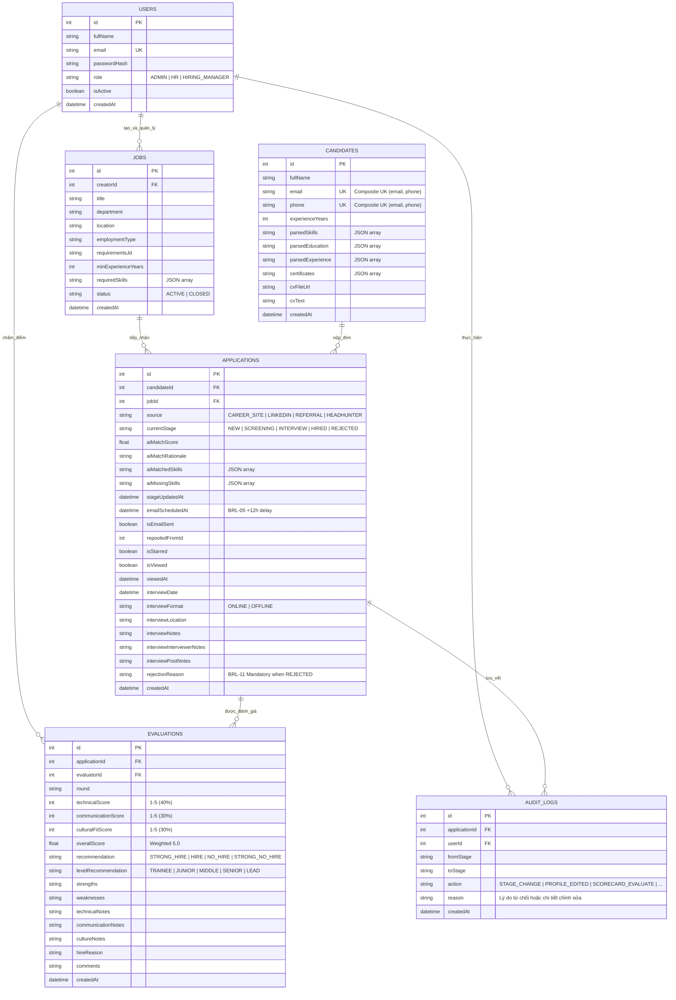

# THIẾT KẾ CƠ SỞ DỮ LIỆU, SƠ ĐỒ ERD & TỪ ĐIỂN DỮ LIỆU CHUẨN 10 CỘT

> **Dự án:** ReCoverX Career — Applicant Tracking System (ATS)  
> **ORM & DBMS:** Prisma ORM (`prisma/schema.prisma`) — SQLite (`file:./dev.db`) trên môi trường phát triển, PostgreSQL trên môi trường sản xuất.  
> **Tiêu chuẩn biên soạn:** Universal BA Toolkit (`RULE-09` — Từ điển dữ liệu 10 cột & Data Masking Nghị định 13/2023/NĐ-CP, `RULE-18`, `RULE-19`).

## Lịch Sử Phiên Bản (Revision History)

| Phiên Bản | Ngày Phát Hành | Tác Giả | Phân Loại | Tóm Tắt Thay Đổi | Người Phê Duyệt |
| :---: | :---: | :--- | :---: | :--- | :--- |
| `v1.0.0` | 2026-11-12 | BA Team | **Initial** | Thiết kế 6 bảng cốt lõi (`users`, `jobs`, `candidates`, `applications`, `evaluations`, `audit_logs`). | Tech Lead |
| `v2.0.0` | 2026-11-15 | BA & Dev Team | **Added** | Bổ sung `certificates`, `isStarred`, `isViewed`, `interview*` (6 trường vòng đời phỏng vấn) và 7 trường Deep Scorecard trong `evaluations`. | Tech Lead |
| `v2.1.0` | 2026-11-18 | BA & Dev Team | **Changed** | Bổ sung `Application.rejectionReason` (`BRL-11`) và `AuditLog.reason`; nâng cấp toàn bộ Từ điển dữ liệu lên chuẩn **10 cột (`RULE-09`)** có phân cấp bảo mật `PII`/`Restricted` và quy tắc che giấu. | Product Owner & Tech Lead |

---

## 1. QUYẾT ĐỊNH KIẾN TRÚC DỮ LIỆU (DATA DESIGN DECISIONS)

1. **Tính toàn vẹn giao dịch (ACID Transactions):** Mọi thao tác luân chuyển trạng thái (`POST /api/pipeline/move`), chỉnh sửa hồ sơ (`PATCH /api/applications/[id]/profile`), xếp/hủy lịch phỏng vấn đều chạy trong `prisma.$transaction([...])` để cập nhật đồng thời bảng nghiệp vụ và `audit_logs`.
2. **Tách biệt tệp tin nhị phân (File Storage Decoupling):** Tệp CV (`.pdf`, `.docx`) và ảnh chứng chỉ lưu tại thư mục lưu trữ tệp (`/public/uploads/` trên dev, Object Storage S3/R2 trên production); CSDL chỉ lưu đường dẫn `cvFileUrl` và mảng JSON `certificates`.
3. **Khử trùng lặp bằng Composite Unique Key (`BRL-02`):** Bảng `candidates` đặt khóa duy nhất kết hợp `@@unique([email, phone])`. Một ứng viên chỉ tồn tại 1 bản ghi `Candidate` nhưng có thể liên kết nhiều `Application` ở các vị trí khác nhau (truy vết lịch sử ứng tuyển chéo).
4. **Bảo vệ dữ liệu cá nhân (Nghị định 13/2023/NĐ-CP & `BRL-10`):** Phân loại rõ 4 cấp độ bảo mật (`Public`, `Internal`, `Confidential - PII`, `Restricted`); `ADMIN` thực thi Hard Delete hồ sơ `REJECTED` quá 180 ngày (`onDelete: Cascade`).

---

## 2. SƠ ĐỒ THỰC THỂ QUAN HỆ (ERD — MERMAID)

---

## 3. TỪ ĐIỂN DỮ LIỆU CHUẨN 10 CỘT (DATA DICTIONARY — RULE-09)

### Bảng 1: `users` (Tài khoản Nội bộ)

| Tên Thuộc Tính | Cột DB (`Prisma`) | Kiểu Dữ Liệu | Nullability | Key | Mặc Định | Ràng Buộc Validation | Mức Độ Nhạy Cảm | Quy Tắc Che Giấu | Mô Tả Nghiệp Vụ |
| :--- | :--- | :--- | :---: | :---: | :---: | :--- | :---: | :--- | :--- |
| Mã người dùng | `id` | `INT` (Autoincrement) | NOT NULL | PK | Auto | Số nguyên dương | Internal | Không che | Khóa chính định danh nhân viên nội bộ. |
| Họ và tên | `fullName` | `VARCHAR(150)` | NOT NULL | - | None | ≥ 2 ký tự | Internal | Không che | Tên hiển thị trên Scorecard và AuditLog. |
| Email đăng nhập | `email` | `VARCHAR(255)` | NOT NULL | UK | None | RFC 5322, viết thường | **Confidential - PII** | Ẩn khỏi Public API | Địa chỉ email định danh đăng nhập nội bộ. |
| Mật khẩu băm | `passwordHash` | `VARCHAR(255)` | NOT NULL | - | None | NIST `PBKDF2-SHA512` (100k iter) | **Restricted** | **Cấm trả ra mọi API/UI** | Chuỗi hash có salt 16 bytes chống Rainbow Table. |
| Vai trò RBAC | `role` | `VARCHAR(30)` | NOT NULL | - | `'HR'` | Enum: `ADMIN \| HR \| HIRING_MANAGER` | Internal | Không che | Quyết định quyền truy cập & chuyển vòng Kanban. |
| Trạng thái hoạt động | `isActive` | `BOOLEAN` | NOT NULL | - | `true` | `true \| false` | Internal | Không che | `false` khóa đăng nhập tức thì (`ERR-AUTH-403-01`). |
| Ngày tạo | `createdAt` | `DATETIME` | NOT NULL | - | `now()` | ISO 8601 UTC | Public | Không che | Thời điểm tạo tài khoản nhân viên. |

---

### Bảng 2: `jobs` (Vị trí Tuyển dụng & Tiêu chuẩn JD)

| Tên Thuộc Tính | Cột DB (`Prisma`) | Kiểu Dữ Liệu | Nullability | Key | Mặc Định | Ràng Buộc Validation | Mức Độ Nhạy Cảm | Quy Tắc Che Giấu | Mô Tả Nghiệp Vụ |
| :--- | :--- | :--- | :---: | :---: | :---: | :--- | :---: | :--- | :--- |
| Mã vị trí | `id` | `INT` | NOT NULL | PK | Auto | Số nguyên dương | Public | Không che | Khóa chính tin tuyển dụng. |
| Người tạo | `creatorId` | `INT` | NOT NULL | FK (`users.id`) | None | Tồn tại trong `users` | Internal | Ẩn khỏi Public | HR/Admin tạo tin tuyển dụng. |
| Tiêu đề vị trí | `title` | `VARCHAR(200)` | NOT NULL | - | None | ≥ 3 ký tự | Public | Không che | **Trường #3 trong 5 trường cốt lõi hiển thị hồ sơ.** |
| Phòng ban | `department` | `VARCHAR(100)` | NOT NULL | - | None | Không rỗng | Public | Không che | Bộ phận tuyển dụng (Engineering, Product, QA...). |
| Địa điểm & Hình thức | `location`, `employmentType` | `VARCHAR(100)` | NOT NULL | - | `'Hồ Chí Minh'`, `'Toàn thời gian'` | Chuỗi hợp lệ | Public | Không che | Nơi làm việc và loại hình hợp đồng. |
| Mô tả JD chi tiết | `requirementsJd` | `TEXT` | NOT NULL | - | None | Văn bản mô tả công việc | Public | Không che | Làm đầu vào đối chiếu cho Hybrid AI (`BRL-04`). |
| Số năm KN tối thiểu | `minExperienceYears` | `INT` | NOT NULL | - | `0` | `0 <= val <= 30` | Public | Không che | Mốc đối chiếu với `Candidate.experienceYears` (40% trọng số). |
| Kỹ năng bắt buộc | `requiredSkills` | `TEXT` (JSON) | NOT NULL | - | `'[]'` | JSON Array of strings | Public | Không che | Mốc đối chiếu với `Candidate.parsedSkills` (60% trọng số). |
| Trạng thái tin | `status` | `VARCHAR(20)` | NOT NULL | - | `'ACTIVE'` | Enum: `ACTIVE \| CLOSED` | Public | Không che | Chỉ `ACTIVE` mới mở nhận đơn công khai. |

---

### Bảng 3: `candidates` (Hồ sơ Ứng viên — 5 Trường Cốt Lõi & Chi Tiết Mở Rộng)

| Tên Thuộc Tính | Cột DB (`Prisma`) | Kiểu Dữ Liệu | Nullability | Key | Mặc Định | Ràng Buộc Validation | Mức Độ Nhạy Cảm | Quy Tắc Che Giấu | Mô Tả Nghiệp Vụ |
| :--- | :--- | :--- | :---: | :---: | :---: | :--- | :---: | :--- | :--- |
| Mã ứng viên | `id` | `INT` | NOT NULL | PK | Auto | Số nguyên dương | Internal | Không che | Khóa chính duy nhất của 1 cá nhân ứng viên. |
| Họ tên ứng viên | `fullName` | `VARCHAR(150)` | NOT NULL | - | None | ≥ 2 ký tự | **Confidential - PII** | Chỉ nội bộ & chính chủ | **Trường #1/5 cốt lõi**; HR có thể sửa tay (`BRL-03`). |
| Email liên hệ | `email` | `VARCHAR(255)` | NOT NULL | Composite UK | None | RFC 5322, lowercase | **Confidential - PII** | Mask trên log/public (`u***@domain`) | **Trường #2/5 cốt lõi** & khóa khử trùng lặp `BRL-02`. |
| Số điện thoại | `phone` | `VARCHAR(20)` | NOT NULL | Composite UK | None | `^(0\|\+84)[0-9]{9,10}$` | **Confidential - PII** | Ẩn ở view mặc định; hiện khi mở chi tiết | Khóa khử trùng lặp `BRL-02` cùng `email`. |
| Số năm kinh nghiệm | `experienceYears` | `INT` | NOT NULL | - | `0` | `0 <= val <= 50` | Internal | Không che | **Trường #5/5 cốt lõi**; HR có thể sửa tay. |
| Kỹ năng trích xuất | `parsedSkills` | `TEXT` (JSON) | NULL | - | `'[]'` | JSON Array (khử trùng) | Internal | Không che | **Trường #4/5 cốt lõi**; HR thêm/xóa trực tiếp. |
| Học vấn & Kinh nghiệm | `parsedEducation`, `parsedExperience` | `TEXT` (JSON) | NULL | - | `'[]'` | JSON Array đối tượng | Internal | Ẩn mặc định (Progressive Disclosure) | Mở rộng khi bấm *"Xem chi tiết hồ sơ"*. |
| Chứng chỉ đính kèm | `certificates` | `TEXT` (JSON) | NULL | - | `'[]'` | JSON Array `{name, fileUrl, fileType}` | **Confidential - PII** | Chỉ người dùng nội bộ đã xác thực | Thư viện ảnh bằng cấp/IELTS/chứng chỉ. |
| Tệp CV gốc & Văn bản | `cvFileUrl`, `cvText` | `VARCHAR` / `TEXT` | NOT NULL / NULL | - | None | PDF/DOCX ≤ 10MB, Magic Bytes hợp lệ | **Confidential - PII** | Xóa vĩnh viễn theo `BRL-10` | Đường dẫn file CV gốc và text bóc từ `pdf-parse`. |

---

### Bảng 4: `applications` (Đơn Ứng Tuyển, Vòng Đời Kanban, Lịch PV & Lý Do Từ Chối)

| Tên Thuộc Tính | Cột DB (`Prisma`) | Kiểu Dữ Liệu | Nullability | Key | Mặc Định | Ràng Buộc Validation | Mức Độ Nhạy Cảm | Quy Tắc Che Giấu | Mô Tả Nghiệp Vụ |
| :--- | :--- | :--- | :---: | :---: | :---: | :--- | :---: | :--- | :--- |
| Mã đơn ứng tuyển | `id` | `INT` | NOT NULL | PK | Auto | Số nguyên dương | Internal | Không che | Mã dùng cho Public Tracker (`/jobs/tracker`). |
| Liên kết Ứng viên & Job | `candidateId`, `jobId` | `INT` | NOT NULL | FK | None | `onDelete: Cascade` | Internal | Không che | Liên kết N-1 với `candidates` và `jobs`. |
| Nguồn ứng tuyển | `source` | `VARCHAR(30)` | NOT NULL | - | `'CAREER_SITE'` | `CAREER_SITE \| LINKEDIN \| REFERRAL \| HEADHUNTER` | Internal | Ẩn khỏi Public | Phân loại kênh tuyển dụng. |
| Trạng thái Kanban | `currentStage` | `VARCHAR(20)` | NOT NULL | - | `'NEW'` | `NEW \| SCREENING \| INTERVIEW \| HIRED \| REJECTED` | Internal | Hiển thị mô tả thân thiện trên Tracker | Chịu sự kiểm soát chặt của `src/lib/stage-rules.ts`. |
| Điểm & Đối chiếu AI | `aiMatchScore`, `aiMatchRationale`, `aiMatchedSkills`, `aiMissingSkills` | `FLOAT` / `TEXT` | NULL | - | `NULL` / `'[]'` | `0.0 <= score <= 100.0` | **Restricted (Internal)** | **Cấm tuyệt đối trả ra Public Tracker (`NFR-SEC-04`)** | Hỗ trợ đối chiếu tiêu chuẩn JD (Human-in-the-loop). |
| Mốc SLA & Delay Email | `stageUpdatedAt`, `emailScheduledAt`, `isEmailSent` | `DATETIME` / `BOOLEAN` | NOT NULL / NULL | - | `now()` / `NULL` / `false` | `emailScheduledAt = now + 12h` khi `REJECTED` | Internal | Không lộ thời gian hoãn cho ứng viên | Phục vụ cảnh báo SLA (`BRL-07`) & Delay Buffer (`BRL-05`). |
| Đánh dấu sao & Đã xem | `isStarred`, `isViewed`, `viewedAt` | `BOOLEAN` / `DATETIME` | NOT NULL / NULL | - | `false` / `false` / `NULL` | Boolean | Internal | Chỉ nội bộ | Ghim hồ sơ ưu tiên và đánh sáng thẻ `NEW` chưa xử lý. |
| Thông tin Phỏng vấn | `interviewDate`, `interviewFormat`, `interviewLocation`, `interviewNotes`, `interviewInterviewerNotes`, `interviewPostNotes` | `DATETIME` / `TEXT` | NULL | - | `NULL` | `ONLINE \| OFFLINE`; chỉ `HM`/`ADMIN` xếp/hủy | Internal | `interviewInterviewerNotes` & `interviewPostNotes` **ẩn khỏi Public Tracker** | Quản lý vòng đời lịch hẹn & ghi chú 3 lớp (`UC-05A`). |
| **Lý do từ chối** | `rejectionReason` | `TEXT` | NULL | - | `NULL` | **Bắt buộc ≥ 5 ký tự khi `currentStage = REJECTED` (`BRL-11`)** | **Restricted (Internal)** | **Ẩn khỏi Public Tracker** | Lưu lý do cụ thể khi từ chối; tự động xóa nếu phục hồi thẻ. |

---

### Bảng 5: `evaluations` (Phiếu Đánh Giá Scorecard Chuyên Sâu)

| Tên Thuộc Tính | Cột DB (`Prisma`) | Kiểu Dữ Liệu | Nullability | Key | Mặc Định | Ràng Buộc Validation | Mức Độ Nhạy Cảm | Quy Tắc Che Giấu | Mô Tả Nghiệp Vụ |
| :--- | :--- | :--- | :---: | :---: | :---: | :--- | :---: | :--- | :--- |
| Mã phiếu & Liên kết | `id`, `applicationId`, `evaluatorId` | `INT` | NOT NULL | PK, FK | Auto | `onDelete: Cascade` | Internal | Ẩn khỏi Public | Mỗi giám khảo lưu phiếu độc lập, không ghi đè. |
| Vòng & Cấp bậc đề xuất | `round`, `levelRecommendation` | `VARCHAR(100)` | NULL | - | `'Vòng 1...'` | `TRAINEE \| JUNIOR \| MIDDLE \| SENIOR \| LEAD` | Internal | **Cấm trả ra Public Tracker** | Phân loại vòng phỏng vấn và bậc đề xuất. |
| Điểm 3 tiêu chí & Tổng | `technicalScore`, `communicationScore`, `culturalFitScore`, `overallScore` | `INT` / `FLOAT` | NOT NULL / NULL | - | None | Mỗi tiêu chí `1..5`; `overall = T*0.4 + C*0.3 + Cu*0.3` | **Restricted (Internal)** | **Cấm trả ra Public Tracker (`NFR-SEC-04`)** | Tính điểm trọng số `BRL-08` trên thang 5.0★. |
| Khuyến nghị & Căn cứ | `recommendation`, `strengths`, `weaknesses`, `technicalNotes`, `communicationNotes`, `cultureNotes`, `hireReason`, `comments` | `VARCHAR` / `TEXT` | NOT NULL / NULL | - | `'HIRE'` | `STRONG_HIRE \| HIRE \| NO_HIRE \| STRONG_NO_HIRE`; `strengths` bắt buộc khi đề xuất tuyển | **Restricted (Internal)** | **Cấm trả ra Public Tracker** | Căn cứ minh bạch giúp HR/Ban Giám đốc hiểu rõ lý do đậu và mở khóa `BRL-06`. |

---

### Bảng 6: `audit_logs` (Nhật Ký Kiểm Toán Bất Biến — Append-Only)

| Tên Thuộc Tính | Cột DB (`Prisma`) | Kiểu Dữ Liệu | Nullability | Key | Mặc Định | Ràng Buộc Validation | Mức Độ Nhạy Cảm | Quy Tắc Che Giấu | Mô Tả Nghiệp Vụ |
| :--- | :--- | :--- | :---: | :---: | :---: | :--- | :---: | :--- | :--- |
| Mã log & Liên kết | `id`, `applicationId`, `userId` | `INT` | NOT NULL / NULL | PK, FK | Auto | Append-only (cấm sửa/xóa) | Internal | Chỉ nội bộ | Lưu vết bất biến mọi tác động lên hồ sơ (`NFR-SEC-05`). |
| Trạng thái trước / sau | `fromStage`, `toStage` | `VARCHAR(20)` | NULL / NOT NULL | - | None | Enum 5 trạng thái Kanban | Internal | Chỉ nội bộ | Truy vết đường đi của thẻ trên Kanban. |
| Loại hành động | `action` | `VARCHAR(40)` | NOT NULL | - | None | `STAGE_CHANGE`, `PROFILE_EDITED`, `SCORECARD_EVALUATE`, `INTERVIEW_SCHEDULED`, `INTERVIEW_CANCELLED`, `STARRED`, `RETENTION_PURGE` | Internal | Chỉ nội bộ | Phân loại sự kiện kiểm toán. |
| **Lý do / Ghi chú chi tiết** | `reason` | `TEXT` | NULL | - | `NULL` | Ghi nhận lý do từ chối `BRL-11` hoặc danh sách trường HR đã sửa | Internal | Chỉ nội bộ | Tăng minh bạch đối soát quy trình. |
| Thời điểm thực hiện | `createdAt` | `DATETIME` | NOT NULL | - | `now()` | ISO 8601 UTC | Internal | Chỉ nội bộ | Dấu thời gian chính xác của sự kiện. |
