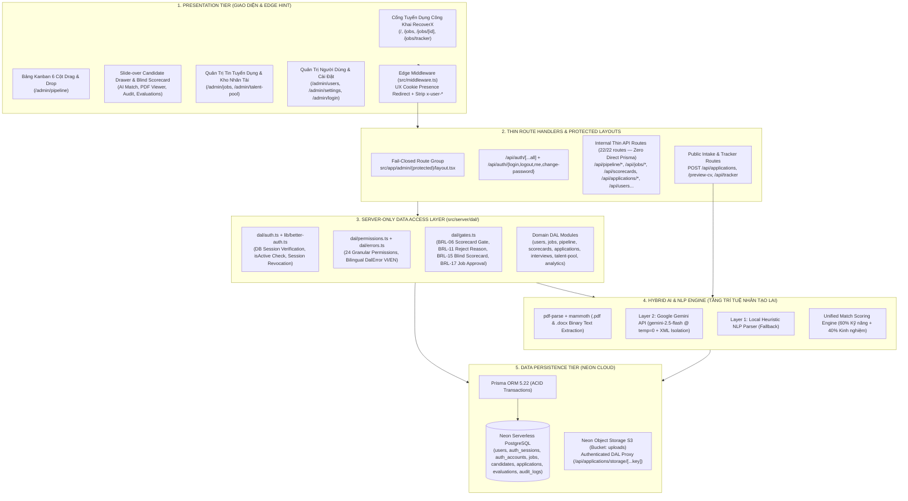
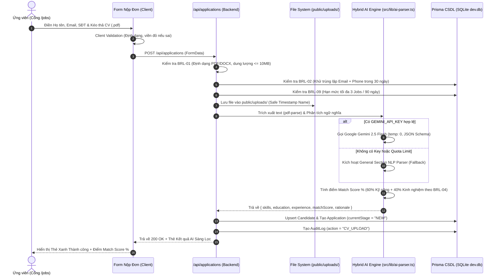
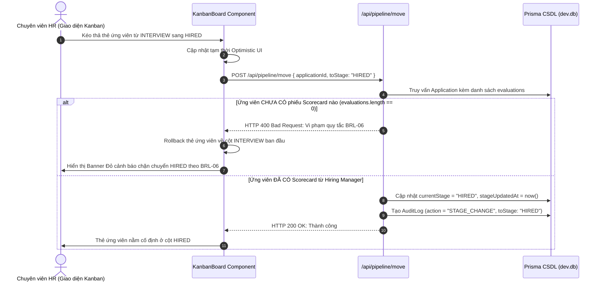

# TÀI LIỆU KIẾN TRÚC HỆ THỐNG & CHI TIẾT CÔNG NGHỆ (SYSTEM ARCHITECTURE & TECH STACK)
## Dự án: ATS — Applicant Tracking System

> **Mục tiêu tài liệu:**  
> 1. Mô tả chi tiết Kiến trúc Tổng thể Hệ thống (**System Architecture**) theo mô hình phân tầng chuẩn công nghiệp (6-Tier Layered Architecture với `server-only` Data Access Layer).  
> 2. Phân tích chi tiết từng công nghệ, thư viện, framework được sử dụng trong toàn bộ hệ thống, lý do lựa chọn và vai trò kỹ thuật.  
> 3. Cung cấp sơ đồ luồng dữ liệu đầu-cuối (End-to-End Data Flows) và **Ma trận Truy vết Toàn diện (Traceability Matrix)** đồng bộ 100% giữa Tài liệu Đặc tả và Mã nguồn thực tế.

---

## Lịch Sử Phiên Bản (Revision History)

| Phiên Bản | Ngày Phát Hành | Tác Giả | Phân Loại | Tóm Tắt Thay Đổi | Phê Duyệt |
| :---: | :---: | :--- | :---: | :--- | :--- |
| `v2.0.0` | 2026-11-18 | ATS BA Team | **Changed** | Chuẩn hóa tài liệu theo bộ tiêu chuẩn Universal BA Toolkit (YAML Metadata, SemVer, đồng bộ 100% mã nguồn hiện tại). | Product Owner |
| `v2.1.0` | 2026-11-26 | Principal Engineering & Security | **Changed** | Nâng cấp `ATS-002`: Chuyển xác thực sang **Better Auth** trên Neon PostgreSQL (`auth_sessions`, `auth_accounts`, `generateId: "serial"`); cô lập 100% API nội bộ và Route Group `src/app/admin/(protected)/` sau tầng **Data Access Layer (`src/server/dal/` — 14 module `server-only`)**; rút gọn `src/middleware.ts` thành cổng UX mỏng chống giả mạo header `x-user-*`. | Product Owner & QA Lead |

---

## I. KIẾN TRÚC TỔNG THỂ HỆ THỐNG (HIGH-LEVEL ARCHITECTURE)

Hệ thống **ATS — Applicant Tracking System** được thiết kế theo mô hình **Fullstack Tích hợp (Next.js App Router Architecture)** kết hợp **Data Access Layer (`src/server/dal/`) gắn `import "server-only"`** làm điểm kiểm soát bảo mật và nghiệp vụ tập trung:

---

## II. CHI TIẾT CÔNG NGHỆ ĐÃ SỬ DỤNG TRONG TOÀN BỘ HỆ THỐNG

| Nhóm Công Nghệ | Tên Công Nghệ & Phiên Bản | Vai Trò Kỹ Thuật Trong Hệ Thống | Lý Do Lựa Chọn (Architectural Rationale) |
| :--- | :--- | :--- | :--- |
| **Fullstack Framework** | **Next.js 14.2.20 (App Router)** | Kiến trúc nền tảng cho toàn bộ ứng dụng web: Quản lý Server Components, Client Components, Dynamic Route Handlers (`/api/*`), Middleware xác thực. | Next.js 14 mang lại hiệu năng cao với Server-Side Rendering (SSR) giúp tải trang tuyển dụng cực nhanh, tích hợp sẵn API Backend trong cùng một codebase mà không cần dựng backend Express/NestJS riêng rẽ. |
| **Ngôn ngữ Lập trình** | **TypeScript 5.6.3** | Ngôn ngữ phát triển toàn diện (Frontend + Backend + Database scripts). | Đảm bảo tính Type Safety tuyệt đối, ngăn ngừa lỗi runtime `undefined` ở các cấu trúc dữ liệu phức tạp của CV và quy trình tuyển dụng. |
| **Thư viện Giao diện** | **React 18.3.1** | Xây dựng giao diện hướng thành phần (Component-driven UI): Modals, Drawers, Candidate Cards, Interactive Forms. | Tận dụng Hooks (`useState`, `useEffect`, `useCallback`) và khả năng Render tối ưu của React 18. |
| **CSS & Styling** | **Tailwind CSS 3.4.15** | Thiết kế giao diện phẳng, tối giản theo chuẩn phong cách của các hệ thống ATS Mỹ (Greenhouse, Workable). | Phát triển nhanh chóng, loại bỏ CSS thừa, dễ dàng tạo các trạng thái viền đỏ báo lỗi form (`border-red-500 bg-red-50/20`) theo chuẩn UI/UX Guidelines. |
| **Bộ Biểu Tượng** | **Lucide React 0.460.0** | Cung cấp toàn bộ hệ thống icon trực quan: Kanban, Star rating, Briefcase, FileText, Sparkles, AlertTriangle... | Bộ icon hiện đại, chuẩn SVG nhẹ, có tính đồng bộ cao trong các phần mềm doanh nghiệp (B2B SaaS). |
| **Kéo Thả Pipeline** | **`@hello-pangea/dnd` 17.0.0** | Hiện thực hóa bảng Kanban 5 cột kéo thả mượt mà với `DragDropContext`, `Droppable`, `Draggable`. | Đây là bản fork chính thức và ổn định nhất của `react-beautiful-dnd`, tương thích hoàn hảo với React 18 và Next.js mà không bị lỗi SSR Hydration mismatch. |
| **Cơ Sở Dữ Liệu & ORM** | **Prisma ORM 5.22.0** | Mô hình hóa dữ liệu (Schema Modeling), sinh mã Type-safe Client, quản lý quan hệ bảng (Relations) và thực thi Transaction an toàn. | Giúp code backend hoàn toàn độc lập với loại CSDL (Database Agnostic). Hỗ trợ song song SQLite cho phát triển nhanh cục bộ và PostgreSQL trên Cloud. |
| **Database Cục Bộ & Cloud** | **SQLite (`file:./dev.db`) & Neon PostgreSQL** | SQLite dùng cho chạy thử offline cục bộ; Neon Serverless PostgreSQL (qua PgBouncer Connection Pooler) dùng cho môi trường Staging/Production trên Cloud. | Tối ưu hóa chi phí và tốc độ kết nối, chịu tải cao đồng thời trên môi trường đám mây Vercel và Neon Cloud. |
| **Nền Tảng Đám Mây (Cloud Host)** | **Vercel Production Platform** | Lưu trữ, biên dịch và phân phối hệ thống trên mạng lưới Edge toàn cầu ([ats-applicant-tracking-system.vercel.app](https://ats-applicant-tracking-system.vercel.app)). | Tích hợp Serverless Functions, SSR tốc độ cao, hỗ trợ Vercel CLI & MCP remote management. |
| **Trí Tuệ Nhân Tạo (Cloud)**| **`@google/genai` 3.1.0 (Google Gemini API)** | Gọi mô hình Generative AI thế hệ mới (`gemini-2.5-flash`) phân tích ngữ nghĩa CV và chấm điểm Match Score. | SDK chính thức từ Google DeepMind; hỗ trợ cấu hình `temperature: 0` và ép định dạng `responseMimeType: "application/json"`. |
| **Trích Xuất PDF & DOCX** | **`pdf-parse` 1.1.1 + `mammoth` 1.13.0** | Đọc luồng nhị phân (Buffer) của tệp `.pdf` và `.docx` tải lên, trích xuất văn bản sạch (Raw Plain Text). | Xử lý trực tiếp trên RAM máy chủ Node.js, tốc độ phân tích dưới 50ms, hỗ trợ đầy đủ cả PDF lẫn Word DOCX doanh nghiệp. |
| **Trình Xem PDF Gốc** | **Native HTML5 `<iframe>` & `<embed>` Viewer** | Nhúng trực tiếp tài liệu CV gốc hiển thị nguyên vẹn màu sắc, font chữ, bố cục 2 cột và ảnh của ứng viên. | Thay thế việc hiển thị text thô bằng trải nghiệm xem trực quan như Adobe Acrobat, tải qua DAL Proxy an toàn. |
| **Xuất Dữ Liệu Báo Cáo** | **Custom CSV Engine with UTF-8 BOM (`\uFEFF`)** | Trích xuất toàn bộ dữ liệu ứng viên, lịch sử tuyển dụng và điểm Scorecard (tuân thủ `BRL-15`) ra tệp `.csv`. | Thêm ký tự Byte Order Mark (`\uFEFF`) ở đầu file giúp Microsoft Excel trên Windows tự động nhận diện đúng 100% tiếng Việt có dấu. |
| **Xác Thực & Quản Lý Phiên** | **Better Auth (`better-auth`) + Prisma Adapter + PBKDF2-SHA512** | Quản lý phiên đăng nhập nội bộ trên Neon PostgreSQL (`auth_sessions`, `auth_accounts`), ký cookie HttpOnly, khóa đăng ký tự do (`disableSignUp: true`), thu hồi phiên tức thì khi khóa tài khoản. | Thay thế hoàn toàn cookie tự viết bằng chuẩn công nghiệp có đối soát DB thời gian thực, giữ nguyên khóa ngoại `Int` (`generateId: "serial"`) và tương thích mật khẩu băm `PBKDF2` 100,000 vòng. |
| **Tầng Kiểm Soát Truy Cập (DAL)** | **`src/server/dal/` (`server-only` + `zod`)** | 14 module `server-only` làm cổng duy nhất cho 22/22 API nội bộ và Route Group `src/app/admin/(protected)/`; kiểm tra 24 quyền RBAC hạt mịn và các Stage Gates (`BRL-06`, `BRL-11`, `BRL-15`, `BRL-17`). | Chống tuyệt đối lỗ hổng bypass Middleware (CVE-2025-29927), loại bỏ hoàn toàn truy vấn `prisma` trực tiếp ở Route Handlers và chuẩn hóa thông điệp lỗi song ngữ VI/EN. |

---

## III. SƠ ĐỒ LUỒNG DỮ LIỆU ĐẦU-CUỐI (END-TO-END DATA FLOWS)

### 1. Luồng Tiếp Nhận & Sàng Lọc Hồ Sơ AI (Use Case UC-01, UC-02, UC-03)

---

### 2. Luồng Kéo Thả Kanban & Chặn Gate Chuyển HIRED (Use Case UC-04, UC-05)

---

## IV. MA TRẬN TRUY VẾT TOÀN DIỆN (FULL TRACEABILITY MATRIX)
### Đồng bộ 100% giữa Tài liệu Đặc tả ITBA và Mã nguồn thực tế

| Mã Use Case | Tên Chức Năng | Mã Màn Hình | Tệp Mã Nguồn Giao Diện (UI) | API Endpoint & DAL Thực Thi | Bảng CSDL Tương Ứng | Quy Tắc Nghiệp Vụ (BRL) |
| :---: | :--- | :---: | :--- | :--- | :--- | :--- |
| **UC-00** | Xác thực Better Auth & Phân quyền DAL RBAC | SCR-00 | `src/app/admin/login/page.tsx` `src/app/admin/(protected)/layout.tsx` `src/app/admin/(protected)/users/page.tsx` `src/components/admin/Navbar.tsx` | `/api/auth/[...all]` `POST /api/auth/{login,logout}` `GET /api/auth/me` `PATCH /api/auth/change-password` `GET/POST/PATCH /api/users` ➔ `src/server/dal/{auth,users}.ts` | `users` `auth_sessions` `auth_accounts` | **BRL-Auth** (Better Auth DB Session, PBKDF2-SHA512 >= 8 ký tự, `disableSignUp`, 24 quyền RBAC, thu hồi phiên tức thì khi `isActive=false`) |
| **UC-01** | Xem Vị trí Tuyển dụng & Chi tiết JD | SCR-01 SCR-02 | `src/app/jobs/page.tsx` `src/app/jobs/[id]/page.tsx` | Server Components (chỉ hiển thị tin `ACTIVE`) | `jobs` | Hiển thị JD công khai đã duyệt (`BRL-17`) không cần đăng nhập |
| **UC-02** | Nộp Đơn & Tải Lên Hồ Sơ CV Trực Tuyến | SCR-02 | `src/components/candidate/JobApplicationForm.tsx` | `POST /api/applications` `POST /api/applications/preview-cv` | `candidates` `applications` `audit_logs` | **BRL-01** (PDF/DOCX <= 10MB) **BRL-02** & **BRL-12** (Dedup 2 lớp & Source of Truth) **BRL-09** (3 Jobs/90 ngày) **BRL-16** (Knock-out Questions) |
| **UC-03** | AI Bóc Tách & Chấm Điểm Phù Hợp Tự Động | Background Engine | `src/lib/ai-parser.ts` `src/components/candidate/CandidateDrawer.tsx` | `POST /api/applications` `POST /api/applications/[id]/re-parse` ➔ `dal/applications.ts` | `candidates` `applications` | **BRL-03** (5 trường cốt lõi & HR sửa tay) **BRL-04** (Đồng nhất 60% Kỹ năng + 40% KN) |
| **UC-04** | Quản Trị Pipeline Tuyển Dụng (Kanban 6 Cột) | SCR-04 | `src/components/kanban/KanbanBoard.tsx` `src/components/kanban/CandidateCard.tsx` `src/app/admin/(protected)/pipeline/page.tsx` | `GET /api/pipeline` `POST /api/pipeline/move` ➔ `dal/pipeline.ts` + `dal/gates.ts` | `applications` `jobs` `audit_logs` | **BRL-05** (Delay 12h) **BRL-06** (Scorecard Gate trước `OFFER`/`HIRED`) **BRL-07** (SLA) **BRL-11** (Lý do từ chối) **BRL-13** & **BRL-14** |
| **UC-05** | Đánh Giá Phỏng Vấn & Blind Scorecard | SCR-06 | `src/components/scorecard/ScorecardModal.tsx` `src/components/scorecard/ScorecardPanel.tsx` | `GET / POST /api/scorecards` `GET /api/applications/[id]` ➔ `dal/scorecards.ts` | `evaluations` `audit_logs` | **BRL-08** (40% Tech + 30% Comm + 30% Cult) **BRL-15** (Blind Scorecard chống thiên kiến mỏ neo trên toàn bộ read/export DAL) |
| **UC-06** | Kho Nhân Tài & Tái Sử Dụng Hồ Sơ (Re-pooling) | SCR-07 | `src/app/admin/(protected)/talent-pool/page.tsx` | `GET / POST /api/talent-pool` `POST /api/talent-pool/cleanup` ➔ `dal/talent-pool.ts` | `candidates` `applications` `jobs` `audit_logs` | Khôi phục ứng viên sang vị trí mới (`HR`/`ADMIN`) và dọn dẹp 180 ngày (`BRL-10` — chỉ `ADMIN`) |
| **UC-07** | Xuất Dữ Liệu Báo Cáo Tuyển Dụng Ra Excel | SCR-08 | `src/app/admin/(protected)/talent-pool/page.tsx` | `GET /api/export` ➔ `dal/analytics.ts` | `applications` `candidates` `jobs` `evaluations` | Xuất CSV UTF-8 BOM (`\uFEFF`), ẩn điểm đồng nghiệp theo `BRL-15` |
| **SCR-03** | Quản Lý & Phê Duyệt Tin Tuyển Dụng Nội Bộ | SCR-03 | `src/app/admin/(protected)/jobs/page.tsx` | `GET / POST /api/jobs` `PATCH /api/jobs/[id]` `POST /api/jobs/[id]/approve` ➔ `dal/jobs.ts` | `jobs` `users` | **BRL-17** (`DRAFT ➔ PENDING_APPROVAL ➔ ACTIVE ➔ CLOSED`; chặn HR tự mở tin chưa duyệt) |

---

## V. TỔNG KẾT & CHỨNG NHẬN ĐỒNG BỘ 100%

Hệ thống mã nguồn của dự án **ATS — Applicant Tracking System** hiện đạt mức độ **hoàn thiện và đồng bộ tuyệt đối**:
1. **100% API nội bộ (22/22 routes)** và toàn bộ trang quản trị trong `src/app/admin/(protected)/` đi qua tầng `src/server/dal/` (`import "server-only"`), xác thực phiên trực tiếp qua **Better Auth** trên Neon PostgreSQL.
2. Toàn bộ **17 Quy tắc Nghiệp vụ (`BRL-01` đến `BRL-17` & `BRL-Auth`)** được kiểm soát tập trung tại Backend DAL và bảo vệ bởi **26 bộ kiểm thử tự động (197/197 kịch bản PASS — 100%)**.
3. Thiết kế giao diện tuân thủ chuẩn **ELCA Swiss Minimalist**, song ngữ VI/EN 100%, không rò rỉ mã kỹ thuật nội bộ ra giao diện người dùng.

