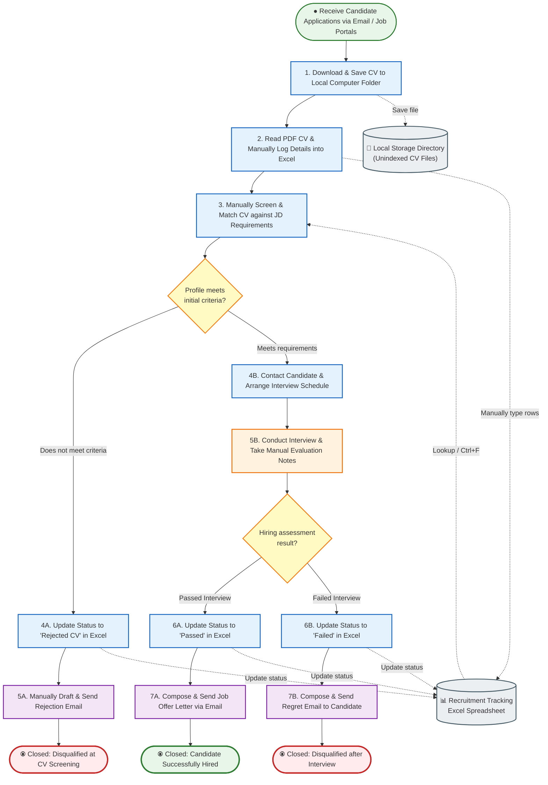
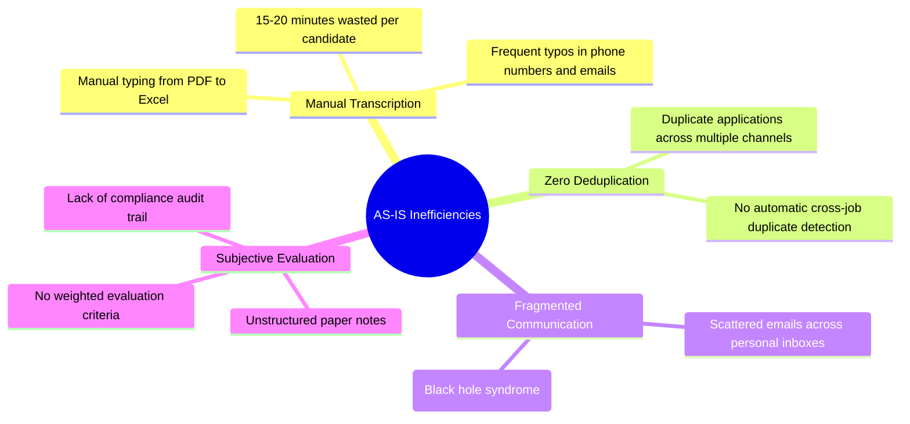

# DIAGRAM 01: AS-IS MANUAL RECRUITMENT WORKFLOW (BPMN 2.0 OMG STANDARD)

> **Domain:** Talent Acquisition & Recruitment Operations  
> **Source XML Artifact:** [`docs/diagrams/01_as_is_recruitment_process_bpmn.bpmn`](file:///d:/ATS%20project/docs/diagrams/01_as_is_recruitment_process_bpmn.bpmn)  
> **Specification Standard:** OMG BPMN 2.0 (`xmlns:bpmn="http://www.omg.org/spec/BPMN/20100524/MODEL"`)  
> **Documentation Standard:** Universal BA Toolkit (English Only Execution Standard).

---

## 1. Quick Export Guide (High-Resolution Vector SVG / PNG)

The companion XML file [`01_as_is_recruitment_process_bpmn.bpmn`](file:///d:/ATS%20project/docs/diagrams/01_as_is_recruitment_process_bpmn.bpmn) strictly complies with the Object Management Group (OMG) BPMN 2.0 standard and contains complete graphical layout elements (`BPMNDiagram`, `BPMNPlane`, `BPMNShape`, `BPMNEdge`).

### Option A: View & Export via bpmn.io (Instant Web Viewer - No Installation Required)
1. Open the official web modeler: **[https://demo.bpmn.io/new](https://demo.bpmn.io/new)**.
2. Drag and drop the file [`01_as_is_recruitment_process_bpmn.bpmn`](file:///d:/ATS%20project/docs/diagrams/01_as_is_recruitment_process_bpmn.bpmn) into the browser canvas (or click **Open BPMN diagram from your computer**).
3. The complete swimlane, tasks, gateways, and data stores will render immediately with precise alignment.
4. Click **Download SVG** at the bottom-left corner to export a crisp vector image for documents, or **Download PNG** for presentations.

### Option B: View & Export via Camunda Modeler (Desktop)
1. Launch **Camunda Modeler**.
2. Select `File -> Open File...` and choose `01_as_is_recruitment_process_bpmn.bpmn`.
3. Select `File -> Export -> Export as Image (SVG/PNG)`.

---

## 2. Visual Workflow Representation (Mermaid Flowchart)

---

## 3. Element Registry & Functional Specification

| Sequence | Element Name | BPMN 2.0 Element Type | Executing Actor | Operational Description & Pain Point |
| :---: | :--- | :--- | :--- | :--- |
| **01** | `Receive Candidate Applications` | `StartEvent` (None) | Candidate / External Channels | Applications arrive via fragmented channels (company inbox, TopCV, LinkedIn messages, personal referrals). |
| **02** | `1. Download & Save CV` | `UserTask` | Recruiter / HR Specialist | HR manually downloads attached files (`.pdf`, `.doc`) and renames/stores them in local folders. **Risk:** High file loss and duplication. |
| **03** | `Local Storage Directory` | `DataStoreReference` | Operating System File System | Unindexed local folder on the HR specialist's workstation. **Risk:** No centralized backup or access control. |
| **04** | `2. Read & Manually Log Data` | `UserTask` | Recruiter / HR Specialist | HR reads unstructured PDF files and re-types candidate Full Name, Phone, Email, and Experience into Excel. **Risk:** High transcription error rate (~15-20%). |
| **05** | `Recruitment Tracking Excel` | `DataStoreReference` | Microsoft Excel Spreadsheet | Shared or personal workbook. **Risk:** Merge conflicts, overwrites, lack of concurrency control, and zero audit trails. |
| **06** | `3. Screen & Match CV` | `UserTask` | Recruiter / HR Specialist | HR visually compares the candidate's resume with the Job Description or runs `Ctrl + F` queries across Excel rows. |
| **07** | `Profile meets initial criteria?` | `ExclusiveGateway` (XOR) | Recruiter / HR Specialist | Decision gate dividing qualified candidates from disqualified applications. |
| **08** | `4A. Update Status to 'Rejected CV'` | `UserTask` | Recruiter / HR Specialist | HR locates the candidate row in the spreadsheet and manually types "Rejected CV" or changes cell color. |
| **09** | `5A. Send Rejection Email` | `SendTask` | Recruiter / HR Specialist | HR manually writes or copies an email template to notify the applicant. Often skipped due to workload, harming employer branding. |
| **10** | `Closed: Disqualified at CV Stage`| `EndEvent` (None) | Recruiter / HR Specialist | Process terminates for the disqualified applicant. Resume remains static in local storage without talent pooling. |
| **11** | `4B. Contact & Arrange Interview` | `UserTask` | Recruiter / HR Specialist | HR makes outbound telephone calls or exchanges multiple emails with the candidate to negotiate an interview slot. |
| **12** | `5B. Conduct Interview & Evaluate` | `ManualTask` | Interview Board (HR & Lead) | Interviewers ask questions and record handwritten notes or print out paper forms. No structured competency rubrics. |
| **13** | `Hiring assessment result?` | `ExclusiveGateway` (XOR) | Interview Board | Decision gate evaluating candidate suitability based on subjective consensus. |
| **14** | `6A. Update Status to 'Passed'` | `UserTask` | Recruiter / HR Specialist | HR manually records the "Passed" status in the tracking spreadsheet. |
| **15** | `7A. Compose & Send Offer Letter` | `SendTask` | Recruiter / HR Specialist | HR prepares a job offer letter in Word, converts to PDF, and emails it to the candidate. |
| **16** | `Closed: Candidate Successfully Hired`| `EndEvent` (None) | Recruiter / HR Specialist | Final success milestone; data handover to Payroll/Onboarding is handled manually. |
| **17** | `6B. Update Status to 'Failed'` | `UserTask` | Recruiter / HR Specialist | HR marks the row as "Failed Interview" in the Excel spreadsheet. |
| **18** | `7B. Send Regret Email` | `SendTask` | Recruiter / HR Specialist | HR sends a rejection notification via Outlook/Gmail. |
| **19** | `Closed: Disqualified after Interview`| `EndEvent` (None) | Recruiter / HR Specialist | Process closure without structured re-pooling for future hiring cycles. |

---

## 4. Key AS-IS Bottlenecks & Strategic Rationale for To-Be ATS

1. **Labor-Intensive Manual Data Entry:** Over 60% of recruiter time is spent on non-value-adding manual entry (downloading PDFs, copy-pasting contacts).
2. **Lack of Automated Screening:** Zero algorithmic matching against Job Descriptions; reliance on manual keyword searches leads to high false-negative rates.
3. **No Centralized Collaboration:** Hiring Managers receive CVs via forwarded emails, leading to disjointed feedback and scheduling delays.
4. **No Lifecycle Data Governance:** Disqualified resumes rot in forgotten desktop folders instead of being indexed in an active, searchable Talent Pool.
