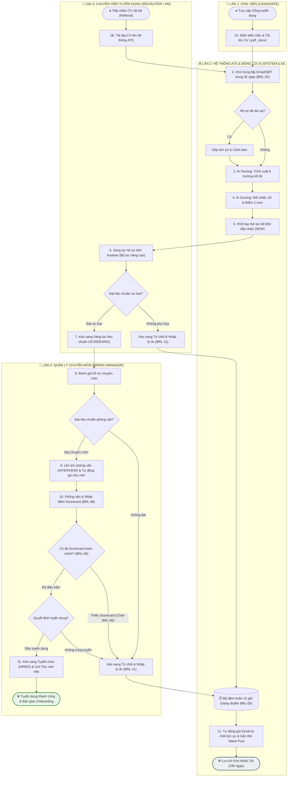

# SƠ ĐỒ 01: QUY TRÌNH TUYỂN DỤNG CHUẨN QUỐC TẾ BPMN 2.0 (TO-BE)

> **Hệ thống:** ATS — Applicant Tracking System  
> **Tệp mô hình XML chuẩn:** [`docs/diagrams/01_recruitment_process_bpmn.bpmn`](file:///d:/ATS%20project/docs/diagrams/01_recruitment_process_bpmn.bpmn)  
> **Tiêu chuẩn tuân thủ:** OMG BPMN 2.0 Specification (`xmlns:bpmn="http://www.omg.org/spec/BPMN/20100524/MODEL"`), Universal BA Toolkit Rule 18 & 19.

---

## 1. Hướng Dẫn Mở & Xuất File Ảnh Đẹp / Chuẩn Sắc Nét

Tệp XML BPMN 2.0 đi kèm (`01_recruitment_process_bpmn.bpmn`) đã được cấu hình đầy đủ tọa độ đồ họa (`BPMNDiagram`, `BPMNPlane`, `BPMNShape`, `BPMNEdge`). Bạn có thể mở và xuất ảnh chỉ trong 2 bước:

### Cách 1: Sử dụng công cụ trực tuyến bpmn.io (Nhanh nhất - Không cần cài đặt)
1. Truy cập trang web chính thức: **[https://demo.bpmn.io/new](https://demo.bpmn.io/new)**
2. Nhấn biểu tượng thư mục **"Open BPMN diagram from your computer"** (hoặc kéo thả tệp [`01_recruitment_process_bpmn.bpmn`](file:///d:/ATS%20project/docs/diagrams/01_recruitment_process_bpmn.bpmn) vào trình duyệt).
3. Sơ đồ sẽ hiển thị đầy đủ 4 làn (Lanes), các Tasks, Gateways và Luồng điều khiển rõ ràng.
4. Nhấn nút **"Download SVG"** ở góc trái dưới cùng để tải file ảnh Vector siêu sắc nét (dùng dán vào Word/Báo cáo không bị vỡ) hoặc chụp màn hình xuất PNG.

### Cách 2: Sử dụng Camunda Modeler (Dành cho Doanh nghiệp)
1. Tải và mở ứng dụng **Camunda Modeler**.
2. Chọn `File -> Open File...` và chọn tệp `01_recruitment_process_bpmn.bpmn`.
3. Chọn `File -> Export -> Export as Image (SVG/PNG)`.

---

## 2. Bản Vẽ Trực Quan Trực Tiếp (Mermaid Flowchart Swimlane)

Nếu bạn cần xem nhanh trực tiếp trên giao diện tài liệu Markdown hoặc GitHub/VS Code:

---

## 3. Bảng Ma Trận Phần Tử Quy Trình (BPMN Element Registry)

| STT | Tên Phần Tử | Loại Ký Hiệu BPMN 2.0 | Chủ Thể (Lane) | Đặc Tả Nghiệp Vụ & Ràng Buộc (Business Rules) |
| :---: | :--- | :--- | :--- | :--- |
| **01** | `Truy cập Cổng tuyển dụng` | `StartEvent` (None) | Ứng viên (Candidate) | Kích hoạt khi ứng viên truy cập trang tuyển dụng công khai (`/jobs`). |
| **02** | `1A. Điền biểu mẫu & Tải lên CV` | `UserTask` | Ứng viên (Candidate) | Hỗ trợ tệp `.pdf`, `.doc`, `.docx` dung lượng tối đa 10MB. Kiểm tra Magic Bytes chống mã độc. |
| **03** | `Tiếp nhận CV nội bộ` | `StartEvent` (None) | HR Recruiter | Tiếp nhận hồ sơ qua kênh Employee Referral hoặc Headhunting. |
| **04** | `1B. Tải tệp CV lên hệ thống` | `UserTask` | HR Recruiter | HR nạp tệp qua màn hình Tiếp nhận CV nội bộ trên bảng điều khiển. |
| **05** | `2. Khử trùng lặp Email/SĐT` | `ServiceTask` | Hệ thống (System) | Áp dụng **BRL-02**: Quét cặp `(email, phone)` trong cửa sổ 30 ngày gần nhất. |
| **06** | `Hồ sơ đã tồn tại?` | `ExclusiveGateway` (XOR) | Hệ thống (System) | Nếu trùng lặp: gộp lịch sử & cảnh báo. Nếu mới hoàn toàn: chuyển sang AI trích xuất. |
| **07** | `3. AI Parsing: Bóc tách 5 trường` | `ServiceTask` | Hệ thống & Động cơ AI | Áp dụng kiến trúc Hybrid AI: Bóc tách Họ tên, Email, SĐT, Kỹ năng, Năm kinh nghiệm. |
| **08** | `4. AI Scoring: Đối chiếu tiêu chí JD` | `ServiceTask` | Hệ thống & Động cơ AI | Phân loại 3 mức đèn giao thông: Xanh (≥75%), Vàng (50-74%), Đỏ (<50%). Nhiệt độ `temperature: 0`. |
| **09** | `5. Khởi tạo thẻ tại cột NEW` | `ServiceTask` | Hệ thống (System) | Khởi tạo thẻ ứng viên tại trạng thái `NEW`. Tuyệt đối tôn trọng nguyên tắc **Human-in-the-loop**, không tự loại ứng viên. |
| **10** | `6. Sàng lọc hồ sơ trên Kanban` | `UserTask` | HR Recruiter | HR sử dụng bộ lọc tìm kiếm tức thì theo Vị trí, Kỹ năng, Trạng thái để sơ loại. |
| **11** | `Đạt tiêu chuẩn sơ loại?` | `ExclusiveGateway` (XOR) | HR Recruiter | Đạt: Chuyển sang `SCREENING`. Không đạt: Chuyển sang `REJECTED`. |
| **12** | `7. Kéo sang cột SCREENING` | `UserTask` | HR Recruiter | Quyền HR tối đa chỉ được chuyển thẻ từ `NEW` sang `SCREENING` (BRL-12). |
| **13** | `8. Đánh giá hồ sơ chuyên môn` | `UserTask` | Hiring Manager | Quản lý chuyên môn tiếp nhận thẻ tại vòng `SCREENING`, thẩm định độ phù hợp kỹ thuật. |
| **14** | `Đạt tiêu chuẩn phỏng vấn?` | `ExclusiveGateway` (XOR) | Hiring Manager | Đạt: Tiến hành lên lịch phỏng vấn. Không đạt: Chuyển sang `REJECTED`. |
| **15** | `9. Lên lịch phỏng vấn & Tự động gửi thư mời` | `UserTask` | Hiring Manager | Kéo sang `INTERVIEW`, chọn ngày giờ, hình thức họp, hệ thống tự động gửi email thư mời kèm lịch hẹn. |
| **16** | `10. Phỏng vấn & Nhập điểm Scorecard` | `UserTask` | Hiring Manager | Hội đồng phỏng vấn chấm điểm 3 tiêu chí trọng số: Kỹ thuật (40%), Giao tiếp (30%), Văn hóa (30%) - BRL-08. |
| **17** | `Có đủ Scorecard hoàn chỉnh?` | `ExclusiveGateway` (XOR) | Hiring Manager | Áp dụng **BRL-06**: Hệ thống chặn hoàn toàn việc kéo sang `HIRED` nếu chưa có ít nhất 01 Scorecard hợp lệ. |
| **18** | `Quyết định tuyển dụng?` | `ExclusiveGateway` (XOR) | Hiring Manager | Đậu: Kéo sang `HIRED`. Rớt: Kéo sang `REJECTED`. |
| **19** | `11. Kéo sang HIRED & Gửi Thư mời việc` | `UserTask` | Hiring Manager / HR Lead | Kéo sang `HIRED`, khóa hồ sơ, gửi Offer Letter và bàn giao sang quy trình Tiếp nhận nhân sự Onboarding. |
| **20** | `Bộ đệm hoãn 12 giờ (Delay Buffer)` | `IntermediateCatchEvent` (Timer) | Hệ thống (System) | Áp dụng **BRL-05**: Khi thẻ bị kéo sang `REJECTED`, hệ thống giữ đệm hoãn 12-24h trước khi gửi email để HR kịp hoàn tác nếu thao tác nhầm. |
| **21** | `12. Tự động gửi Email từ chối lịch sự` | `SendTask` | Hệ thống (System) | Gửi thư từ chối lịch sự, chuyên nghiệp đến ứng viên. |
| **22** | `Lưu trữ Kho Nhân Tài (Talent Pool)` | `EndEvent` | Hệ thống (System) | Đóng hồ sơ, tự động phân nhóm vào Kho Nhân Tài (Tiềm năng / Chờ đợt sau / Lưu trữ 180 ngày). |

---

## 4. Các Chốt Chặn Nghiệp Vụ Bắt Buộc Được Mã Hóa Trong Sơ Đồ

1. **Khử trùng lặp tự động (`BRL-02`):** Quét định danh `(email, phone)` trong 30 ngày. Nếu phát hiện nộp lặp, hệ thống gộp phiên ứng tuyển thay vì tạo thẻ rác.
2. **Nguyên tắc "Human-in-the-loop":** AI không có quyền tự động quyết định sa thải hay loại ứng viên ở vòng đầu; AI chỉ xếp hạng gợi ý và chuyển quyền quyết định cho Chuyên viên Tuyển dụng.
3. **Phân quyền vai trò theo giai đoạn (`BRL-12`):**
   - Tài khoản `HR`: Chỉ được phép thao tác hồ sơ từ `NEW` sang `SCREENING`.
   - Tài khoản `HIRING_MANAGER`: Chịu trách nhiệm từ `SCREENING` sang `INTERVIEW` và sang `HIRED`.
4. **Chốt chặn chất lượng tuyển dụng (`BRL-06`):** Tuyệt đối không thể chuyển trạng thái sang Tuyển chọn (`HIRED`) nếu ứng viên chưa có biên bản đánh giá Scorecard đạt chuẩn.
5. **Bộ đệm an toàn tâm lý ứng viên (`BRL-05`):** Thư từ chối không được bắn đi tức thì mà phải qua bộ đệm thời gian 12 giờ để tránh cảm giác bị hệ thống tự động loại phũ phàng, đồng thời bảo vệ HR trước các lỗi thao tác kéo nhầm thẻ.
6. **Bắt buộc nhập lý do từ chối (`BRL-11`):** Khi kéo sang cột Từ chối (`REJECTED`), giao diện buộc người dùng phải chọn một lý do chuẩn hóa để phục vụ báo cáo phân tích tỷ lệ rớt (Drop-off Analysis).
