# DIAGRAM 02: TO-BE AI-ASSISTED RECRUITMENT WORKFLOW (BPMN 2.0 OMG STANDARD)

> **Domain:** Talent Acquisition & Automated Recruitment Lifecycle  
> **Source XML Artifact:** [`docs/diagrams/02_to_be_recruitment_process_bpmn.bpmn`](file:///d:/ATS%20project/docs/diagrams/02_to_be_recruitment_process_bpmn.bpmn)  
> **Specification Standard:** OMG BPMN 2.0 (`xmlns:bpmn="http://www.omg.org/spec/BPMN/20100524/MODEL"`)  
> **Documentation Standard:** Universal BA Toolkit (English Only Execution Standard).

---

## 1. Quick Export Guide (High-Resolution Vector SVG / PNG)

The companion XML file [`02_to_be_recruitment_process_bpmn.bpmn`](file:///d:/ATS%20project/docs/diagrams/02_to_be_recruitment_process_bpmn.bpmn) strictly adheres to the Object Management Group (OMG) BPMN 2.0 metamodel and graphical notation standards. It defines a multi-lane collaboration pool with explicit visual coordinates (`BPMNShape`, `BPMNEdge`).

### Option A: View & Export via bpmn.io (Instant Web Modeler - Zero Setup)
1. Open the browser modeler: **[https://demo.bpmn.io/new](https://demo.bpmn.io/new)**.
2. Drag and drop [`02_to_be_recruitment_process_bpmn.bpmn`](file:///d:/ATS%20project/docs/diagrams/02_to_be_recruitment_process_bpmn.bpmn) onto the canvas (or choose **Open BPMN diagram from your computer**).
3. The 4 functional swimlanes (*Candidate*, *ATS Platform & AI Engine*, *Recruiter / HR*, *Hiring Manager*), service tasks, timers, and data stores render immediately with professional routing.
4. Click **Download SVG** at the bottom-left corner for crystal-clear vector graphics, or **Download PNG** for reports and slide decks.

### Option B: View & Export via Camunda Modeler (Desktop)
1. Launch **Camunda Modeler** (v5.0+).
2. Go to `File -> Open File...` and select `02_to_be_recruitment_process_bpmn.bpmn`.
3. Select `File -> Export -> Export as Image (SVG/PNG)` for high-resolution documentation exports.

---

## 2. Visual Workflow Representation (Mermaid Flowchart)

```mermaid
flowchart TD
    %% LANES STYLING DEFINITIONS
    classDef startEvent fill:#dcfce7,stroke:#16a34a,stroke-width:2px,color:#14532d;
    classDef endEvent fill:#fee2e2,stroke:#ef4444,stroke-width:2px,color:#7f1d1d;
    classDef endPass fill:#bbf7d0,stroke:#15803d,stroke-width:3px,color:#14532d;
    classDef userTask fill:#e0f2fe,stroke:#0284c7,stroke-width:1.5px,color:#0369a1;
    classDef serviceTask fill:#f3e8ff,stroke:#9333ea,stroke-width:1.5px,color:#581c87;
    classDef gateway fill:#fef3c7,stroke:#d97706,stroke-width:2px,color:#78350f;
    classDef timerEvent fill:#ffedd5,stroke:#ea580c,stroke-width:2px,color:#7c2d12;
    classDef dataStore fill:#f1f5f9,stroke:#475569,stroke-width:2px,color:#0f172a;

    %% SWIMLANE 1: CANDIDATE & INTAKE
    subgraph LANE_1 ["1. Candidate & Sourcing Lane"]
        Start_Public(["● Apply via Public Portal (/jobs)"]):::startEvent
        T1A["1A. Fill Web Form & Upload Resume<br>(PDF / DOCX, Magic Byte Guard)"]:::userTask
        Start_Internal(["● Internal Referral / Direct Headhunt"]):::startEvent
        T1B["1B. Recruiter Uploads CV to Intake Modal"]:::userTask
    end

    %% SWIMLANE 2: ATS PLATFORM & AI ENGINE
    subgraph LANE_2 ["2. Automated ATS Engine & AI Service Lane"]
        T2["2. Automated Deduplication Check<br>(Email/Phone within 30 Days - BRL-02)"]:::serviceTask
        GW_Dedup{"Duplicate profile<br>detected?"}:::gateway
        T_Merge["Flag Duplicate & Merge Application History"]:::serviceTask
        T3["3. Hybrid AI Parsing<br>(Extract 5 Core Fields: Name, Email, Phone, Skills, Exp)"]:::serviceTask
        T4["4. Semantic Match Scoring<br>(Calculate 3-Tier Match Score: Green / Yellow / Red)"]:::serviceTask
        T5["5. Instantiate Application Card in Kanban NEW Column<br>(Human-in-the-Loop Safeguard)"]:::serviceTask
        Timer_12H{{"⏱ 12-Hour Delayed Rejection Buffer<br>(Psychological Comfort Window - BRL-05)"}}:::timerEvent
        T_SendReject["12. Automated Polite Rejection Dispatch & Talent Pool Indexing"]:::serviceTask
    end

    %% DATA STORES
    DB_TalentPool[("🗄️ Centralized Talent Pool<br>(3-Tier Retention Lifecycle: 180 Days)")]:::dataStore

    %% SWIMLANE 3: RECRUITER / HR SPECIALIST
    subgraph LANE_3 ["3. Recruiter / HR Specialist Lane"]
        T6["6. Human Review of Candidate Card & Match Score on Kanban"]:::userTask
        GW_HR{"Screening decision?"}:::gateway
        T7["7. Transition Card to SCREENING Stage<br>(HR Permission Boundary)"]:::userTask
        T_RejHR["Move Card to REJECTED & Input Mandatory Reason<br>(BRL-11)"]:::userTask
    end

    %% SWIMLANE 4: HIRING MANAGER
    subgraph LANE_4 ["4. Hiring Manager Lane"]
        T8["8. Review Technical Qualifications in SCREENING Tab"]:::userTask
        GW_HM{"Approve for interview?"}:::gateway
        T9["9. Move to INTERVIEW, Pick Schedule & Trigger Automated Invite"]:::userTask
        T10["10. Conduct Interview & Submit Structured Scorecard<br>(3 Weighted Criteria - BRL-08)"]:::userTask
        GW_Scorecard{"Valid completed Scorecard exists?<br>(BRL-06 Gatekeeper)"}:::gateway
        GW_Final{"Final hiring consensus?"}:::gateway
        T11["11. Transition Card to HIRED & Issue Offer Letter"]:::userTask
        End_Hired(["⦿ Recruitment Successful: Hired & Onboarding"]):::endPass
        T_RejHM["Move Card to REJECTED with Evaluation Reason<br>(BRL-11)"]:::userTask
    end

    End_Archived(["⦿ Profile Archived into Talent Pool"]):::endEvent

    %% RELATIONSHIPS & FLOWS
    Start_Public --> T1A
    Start_Internal --> T1B
    T1A --> T2
    T1B --> T2

    T2 --> GW_Dedup
    GW_Dedup -- "Duplicate Found" --> T_Merge
    GW_Dedup -- "Unique Candidate" --> T3
    T_Merge --> T3
    T3 --> T4
    T4 --> T5

    T5 --> T6
    T6 --> GW_HR
    GW_HR -- "Qualified" --> T7
    GW_HR -- "Not Suitable" --> T_RejHR

    T7 --> T8
    T8 --> GW_HM
    GW_HM -- "Approved" --> T9
    GW_HM -- "Declined" --> T_RejHM

    T9 --> T10
    T10 --> GW_Scorecard
    GW_Scorecard -- "Scorecard Verified" --> GW_Final
    GW_Scorecard -- "Missing Scorecard" --> T10

    GW_Final -- "Offer Accepted / Hired" --> T11
    T11 --> End_Hired

    GW_Final -- "Declined / Failed" --> T_RejHM

    T_RejHR --> Timer_12H
    T_RejHM --> Timer_12H
    Timer_12H --> T_SendReject
    T_SendReject --> DB_TalentPool
    DB_TalentPool --> End_Archived
```

---

## 3. Comprehensive BPMN 2.0 Element Specification

| Element ID | Type | Element Name | Lane / Actor | Business Rule & Description |
| :--- | :--- | :--- | :--- | :--- |
| `Start_CandidateApply` | Start Event | Public Portal Access | Candidate | Triggered when a job seeker lands on `/jobs` and selects a job vacancy. |
| `Task_SubmitOnlineCV` | User Task | Submit Application & Upload Resume | Candidate | Submits candidate form data; validated via file magic bytes (`%PDF`, `PK`) and 5MB size limit. |
| `Start_HRInternalIntake` | Start Event | Sourcing Intake | Recruiter / HR | Internal referral or headhunted candidate uploaded directly by HR specialist. |
| `Task_HRUploadCV` | User Task | Ingest Resume Modal | Recruiter / HR | Manual resume upload bypassing public reCAPTCHA. |
| `Task_Deduplication` | Service Task | Automated Deduplication Check | System / AI | **BRL-02:** Scans database for matching Email or Phone within 30 days of prior active applications. |
| `Gateway_DuplicateCheck` | Exclusive Gateway | Duplicate Check Gateway | System / AI | Routes flow: merges if duplicate; proceeds with extraction if unique. |
| `Task_MergeApplication` | Service Task | Merge Application Record | System / AI | Associates new submission with existing candidate profile and flags warning badge for HR. |
| `Task_AIParsing` | Service Task | Hybrid AI Parsing | System / AI | **Hybrid AI Layer 1 & 2:** Extracts 5 mandatory core fields (Full Name, Phone, Email, Skills, Experience). |
| `Task_AIScoring` | Service Task | Semantic Match Scoring | System / AI | Computes 0–100 match percentage against Job Description and assigns 3-tier indicator (Green ≥75%, Yellow 50–74%, Red <50%). |
| `Task_CreateKanbanNew` | Service Task | Instantiate Kanban Card | System / AI | Places candidate card in `NEW` column. **Human-in-the-Loop:** System never auto-rejects. |
| `Task_HRScreenKanban` | User Task | Review Candidate Card | Recruiter / HR | HR inspects extracted data, original CV preview, and match score explanation. |
| `Gateway_HRSortingDecision` | Exclusive Gateway | Initial Screening Gate | Recruiter / HR | Determines whether candidate advances to hiring manager review or is rejected. |
| `Task_MoveToScreening` | User Task | Move to `SCREENING` | Recruiter / HR | **RBAC Constraint:** HR role can advance cards up to `SCREENING` stage only. |
| `Task_MoveToRejectScreening` | User Task | Move to `REJECTED` (Screening) | Recruiter / HR | **BRL-11:** Requires selection of structured rejection reason (e.g., *Underqualified*, *Salary Mismatch*). |
| `Task_HMReviewProfile` | User Task | Technical Review | Hiring Manager | Hiring Manager assesses technical competence, portfolio links, and domain alignment. |
| `Gateway_HMApproveInterview` | Exclusive Gateway | Technical Approval Gate | Hiring Manager | Decides whether to proceed with technical interview or decline profile. |
| `Task_ScheduleInterviewAuto` | User Task | Schedule Interview & Trigger Workflow | Hiring Manager | Advances to `INTERVIEW`, sets date/time/location, and triggers automated calendar invite workflow. |
| `Task_ConductInterviewScorecard`| User Task | Conduct Interview & Fill Scorecard | Hiring Manager | **BRL-08:** Scores candidate across 3 weighted criteria (Technical Competence 40%, Cultural Fit 30%, Problem Solving 30%). |
| `Gateway_CheckScorecardRule` | Exclusive Gateway | Scorecard Gatekeeper | System Guard | **BRL-06:** Enforces that at least 1 completed Scorecard exists before allowing transition to `HIRED`. |
| `Gateway_FinalHiringDecision` | Exclusive Gateway | Final Consensus Gate | Hiring Manager | Evaluates interview outcome and final executive approval. |
| `Task_MoveToHiredOffer` | User Task | Advance to `HIRED` & Offer | Hiring Manager | Marks candidate as hired, generates employment offer record, and triggers onboarding handover. |
| `End_HiredSuccess` | End Event | Candidate Hired Successfully | System / HR | Termination event for successfully onboarded talent. |
| `Task_MoveToRejectInterview` | User Task | Move to `REJECTED` (Interview) | Hiring Manager | **BRL-11:** Enforces recording of interview feedback reason prior to stage transition. |
| `Event_DelayRejectBuffer` | Intermediate Timer Event | 12-Hour Delayed Rejection Buffer | System / Timer | **BRL-05:** Suspends email notification for exactly 12 hours to maintain employer brand courtesy. |
| `Task_SendRejectNotice` | Service Task | Dispatch Regret Email & Talent Pool Index | System Automation | Dispatches automated polite rejection email and categorizes profile into Talent Pool tiers. |
| `DataStore_TalentPool` | Data Store | Centralized Talent Pool | System Database | Stores qualified disqualified candidates for up to 180 days across 3 distinct operational buckets. |
| `End_RejectedArchive` | End Event | Candidate Archived | System Lifecycle | Concludes application workflow with indexed talent preservation. |

---

## 4. Key Business Rules & Architectural Enforcement

### 1. Human-in-the-Loop Core Philosophy (BRL-12)
The AI engine functions strictly as an **analytical co-pilot**, never an autonomous decision-maker:
- AI extracts structured fields and computes a semantic match score (0–100%).
- AI never moves, transitions, or rejects a candidate card automatically.
- Every state transition requires explicit human confirmation from an authorized user.

### 2. Strict Role-Based Access Control (RBAC) Workflow Boundaries
- **Recruiter / HR Specialist (`RECRUITER`):**
  - Permitted transitions: `NEW` ➔ `SCREENING`, `NEW` ➔ `REJECTED`, `SCREENING` ➔ `REJECTED`.
  - Prohibited: Cannot advance cards to `INTERVIEW` or `HIRED`.
- **Hiring Manager (`HIRING_MANAGER`):**
  - Permitted transitions: `SCREENING` ➔ `INTERVIEW`, `INTERVIEW` ➔ `HIRED`, `INTERVIEW` ➔ `REJECTED`.
  - Full authority over interview scheduling and technical scorecard evaluation.

### 3. Hiring Governance: Scorecard Prerequisite (BRL-06)
- Attempting to drag or transition a candidate card into the `HIRED` stage without at least one submitted, non-empty evaluation scorecard immediately triggers a system validation block (`422 Unprocessable Entity - ERR_MISSING_SCORECARD`).

### 4. Mandatory Rejection Feedback (BRL-11) & Delayed Buffer (BRL-05)
- Every transition to `REJECTED` requires selecting a predefined, audit-compliant reason code.
- Outbound regret notifications are buffered for **12 hours** via automated queue/worker logic to prevent candidate frustration and protect the employer brand.
- Disqualified candidates are automatically indexed into the **Talent Pool** under 3 segmented pools (*Silver Medalist*, *Future Fit*, *General Archive*) with a 180-day retention countdown.

---

## 5. Process Performance Metrics: AS-IS vs. TO-BE

| Metric | AS-IS Baseline (Manual) | TO-BE Automated Benchmark | Improvement Factor |
| :--- | :--- | :--- | :--- |
| **CV Intake & Data Logging** | 8 – 15 minutes per CV | Instantaneous (< 3 seconds) | **~300x faster** |
| **JD Screening & Qualification**| 12 – 20 minutes per CV | Instant semantic scoring (< 2s) | **~500x faster** |
| **Interview Scheduling Overhead**| 2 – 4 days of email ping-pong | Single-click automated invite | **85% reduction in cycle time** |
| **Feedback Capture Rate** | < 25% (unstructured verbal notes) | 100% mandatory digital scorecards | **Audit-proof compliance** |
| **Talent Pool Discovery** | 0% (resumes lost in folders) | 100% searchable indexed database | **Zero talent leakage** |
| **Total Hiring Time-to-Fill** | 28 – 42 business days | 12 – 18 business days | **57% overall reduction** |
