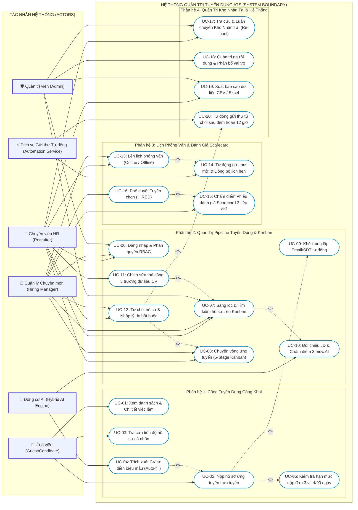

# SƠ ĐỒ 02: CA SỬ DỤNG & PHÂN ĐỊNH RANH GIỚI HỆ THỐNG (USE CASE DIAGRAM)

> **Hệ thống:** ATS — Applicant Tracking System  
> **Tệp mã nguồn Mermaid:** [`docs/diagrams/02_usecase_diagram.mmd`](file:///d:/ATS%20project/docs/diagrams/02_usecase_diagram.mmd)  
> **Tiêu chuẩn tuân thủ:** Alistair Cockburn Use Case Specification, Universal BA Toolkit Rule 06 & 17.

---

## 1. Hướng Dẫn Mở & Xuất Ảnh Đẹp / Nét Căng

Mã nguồn Mermaid chuẩn hóa tại [`02_usecase_diagram.mmd`](file:///d:/ATS%20project/docs/diagrams/02_usecase_diagram.mmd) được thiết kế theo cú pháp chuẩn của Mermaid:

### Các bước xuất file ảnh:
1. Truy cập **[https://mermaid.live](https://mermaid.live)**.
2. Sao chép nội dung tệp [`02_usecase_diagram.mmd`](file:///d:/ATS%20project/docs/diagrams/02_usecase_diagram.mmd) và dán vào khung **Code** bên trái.
3. Ở khung xem trước bên phải, bạn sẽ thấy toàn bộ ranh giới hệ thống (System Boundary) bao gồm 4 phân hệ, 6 Actors và các quan hệ phụ thuộc `<<include>>`, `<<extend>>`.
4. Bấm **Actions -> Download SVG** (để có ảnh vector sắc nét nhất) hoặc **Download PNG** để chèn vào báo cáo.

---

## 2. Bản Vẽ Trực Quan (Mermaid Use Case Diagram)

---

## 3. Bảng Ma Trận Tác Nhân & Phân Quyền Ca Sử Dụng (Use Case RBAC Matrix)

| Mã UC | Tên Ca Sử Dụng | Phân Hệ | Tác Nhân Kích Hoạt | Quan Hệ Phụ Thuộc | Quy Tắc Nghiệp Vụ Liên Quan |
| :---: | :--- | :--- | :--- | :--- | :--- |
| **UC-01** | Xem danh sách & Chi tiết việc làm | Cổng công khai | Ứng viên (Guest) | - | Chỉ hiển thị các tin tuyển dụng có trạng thái `ACTIVE`. |
| **UC-02** | Nộp hồ sơ ứng tuyển trực tuyến | Cổng công khai | Ứng viên (Guest) | `<<include>>` UC-05, UC-09 | Chấp nhận tệp PDF/DOCX ≤ 10MB, kiểm tra Magic Bytes (`BRL-01`). |
| **UC-03** | Tra cứu tiến độ hồ sơ cá nhân | Cổng công khai | Ứng viên (Guest) | - | Tra cứu qua Email + Số điện thoại, không cần đăng nhập. |
| **UC-04** | Trích xuất CV tự điền biểu mẫu (Auto-fill) | Cổng công khai | Động cơ AI (Lớp 1) | `<<extend>>` UC-02 | Tải CV trước -> tự động bóc tách Họ tên, SĐT, Email để điền form. |
| **UC-05** | Kiểm tra hạn mức nộp đơn 3 vị trí/90 ngày | Cổng công khai | Hệ thống | `<<include>>` UC-02 | Chặn Spam ứng tuyển quá 3 vị trí trong 90 ngày (`BRL-09`). |
| **UC-06** | Đăng nhập & Phân quyền RBAC | Quản trị nội bộ | HR, Hiring Manager, Admin | - | Xác thực mật khẩu mã hóa BCrypt, phiên làm việc Cookie HMAC-SHA256. |
| **UC-07** | Sàng lọc & Tìm kiếm hồ sơ trên Kanban | Quản trị Pipeline | HR, Hiring Manager, Admin | `<<include>>` UC-10 | Tìm kiếm tức thì theo Vị trí, Kỹ năng, Email, Tên ứng viên. |
| **UC-08** | Chuyển vòng ứng tuyển (Kanban 5 vòng) | Quản trị Pipeline | HR, Hiring Manager | `<<extend>>` UC-12 | HR chuyển tối đa đến `SCREENING`; Hiring Manager phụ trách `INTERVIEW` & `HIRED` (`BRL-12`). |
| **UC-09** | Khử trùng lặp Email/SĐT tự động | Quản trị Pipeline | Hệ thống | `<<include>>` UC-02 | Quét định danh `(email, phone)` trong cửa sổ 30 ngày (`BRL-02`). |
| **UC-10** | Đối chiếu JD & Chấm điểm 3 mức AI | Quản trị Pipeline | Động cơ AI (Lớp 2) | `<<include>>` UC-07 | Điểm phù hợp 3 mức: Xanh (≥75%), Vàng (50-74%), Đỏ (<50%). |
| **UC-11** | Chỉnh sửa thủ công 5 trường dữ liệu CV | Quản trị Pipeline | Chuyên viên HR | `<<extend>>` UC-07 | Cho phép HR sửa Họ tên, SĐT, Email, Kỹ năng, Năm kinh nghiệm nếu AI nhận dạng sai. |
| **UC-12** | Từ chối hồ sơ & Nhập lý do bắt buộc | Quản trị Pipeline | HR, Hiring Manager | `<<extend>>` UC-08, `<<include>>` UC-20 | Bắt buộc chọn lý do chuẩn hóa khi kéo thẻ sang `REJECTED` (`BRL-11`). |
| **UC-13** | Lên lịch phỏng vấn (Online / Offline) | Phỏng vấn & Đánh giá | Hiring Manager, HR | `<<include>>` UC-14 | Nhập ngày giờ, hình thức họp, liên kết Google Meet/Zoom hoặc địa chỉ văn phòng. |
| **UC-14** | Tự động gửi thư mời & Đồng bộ lịch hẹn | Phỏng vấn & Đánh giá | Dịch vụ Gửi thư Tự động | `<<include>>` UC-13 | Tự động kích hoạt dịch vụ nền gửi email HTML kèm sự kiện lịch hẹn cho ứng viên. |
| **UC-15** | Chấm điểm Phiếu đánh giá Scorecard 3 tiêu chí | Phỏng vấn & Đánh giá | Hiring Manager | - | 3 tiêu chí: Chuyên môn (40%), Giao tiếp (30%), Văn hóa (30%) (`BRL-08`). |
| **UC-16** | Phê duyệt Tuyển chọn (HIRED) | Phỏng vấn & Đánh giá | Hiring Manager | `<<include>>` UC-15 | Bắt buộc có ít nhất 01 Scorecard hợp lệ trước khi được chuyển sang `HIRED` (`BRL-06`). |
| **UC-17** | Tra cứu & Luân chuyển Kho Nhân Tài | Quản trị Kho Nhân Tài | HR, Hiring Manager, Admin | - | Phân 3 nhóm: Tiềm năng, Chờ đợt khác, Lưu trữ 180 ngày. Luân chuyển về Pipeline (Re-pooling). |
| **UC-18** | Quản trị người dùng & Phân bổ vai trò | Quản trị Hệ thống | Quản trị viên (Admin) | - | Tạo tài khoản, khóa tài khoản, phân bổ vai trò (`ADMIN`, `HR_LEAD`, `HIRING_MANAGER`). |
| **UC-19** | Xuất báo cáo dữ liệu CSV / Excel | Quản trị Hệ thống | HR, Admin | - | Xuất danh sách ứng viên, lịch sử tuyển dụng theo định dạng chuẩn UTF-8. |
| **UC-20** | Tự động gửi thư từ chối sau đệm hoãn 12 giờ | Quản trị Kho Nhân Tài | Dịch vụ Gửi thư Tự động | `<<include>>` UC-12 | Kích hoạt bộ đệm hoãn 12 giờ trước khi gửi thư từ chối (`BRL-05`), tự hủy lịch nếu hoàn tác. |
