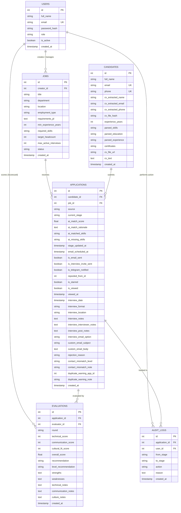

# SƠ ĐỒ 03: MÔ HÌNH THỰC THỂ DỮ LIỆU CƠ SỞ DỮ LIỆU (DATABASE ERD)

> **Hệ thống:** ATS — Applicant Tracking System  
> **Tệp mã nguồn Mermaid:** [`docs/diagrams/03_database_erd.mmd`](file:///d:/ATS%20project/docs/diagrams/03_database_erd.mmd)  
> **Cơ sở dữ liệu hỗ trợ:** Neon Serverless PostgreSQL (Production) / SQLite (Local Dev).  
> **Tiêu chuẩn chuẩn hóa:** Chuẩn 3NF, Phân rã quan hệ qua Khóa ngoại (`FK`), Phân loại bảo mật PII.

---

## 1. Hướng Dẫn Mở & Xuất Ảnh Đẹp / Sắc Nét

Tệp mã nguồn Mermaid chuẩn hóa tại [`03_database_erd.mmd`](file:///d:/ATS%20project/docs/diagrams/03_database_erd.mmd) tuân thủ hoàn toàn cú pháp Crow's Foot ERD của Mermaid:

### Các bước xuất file ảnh:
1. Mở trang web: **[https://mermaid.live](https://mermaid.live)**.
2. Sao chép toàn bộ nội dung tệp [`03_database_erd.mmd`](file:///d:/ATS%20project/docs/diagrams/03_database_erd.mmd) và dán vào ô **Code** bên trái.
3. Khung bên phải sẽ kết xuất biểu đồ thực thể với đầy đủ liên kết, kiểu dữ liệu và chú thích nghiệp vụ.
4. Nhấn **Actions ➔ Download SVG** để tải ảnh vector độ phân giải cao hoặc **Download PNG** để chèn vào tài liệu kỹ thuật.

---

## 2. Bản Vẽ Trực Quan (Mermaid Database ERD)

---

## 3. Ma Trận Quan Hệ & Bản Số Thực Thể (Cardinality Matrix)

| Thực Thể Gốc | Ký Hiệu Lực Lượng | Thực Thể Đích | Khóa Ngoại (Foreign Key) | Ý Nghĩa Nghiệp Vụ |
| :--- | :---: | :--- | :--- | :--- |
| **USERS** | `1` ➔ `0..N` | **JOBS** | `jobs.creator_id` ➔ `users.id` | Một nhân sự nội bộ (HR/Admin) có thể tạo và quản lý nhiều tin tuyển dụng. |
| **USERS** | `1` ➔ `0..N` | **EVALUATIONS** | `evaluations.evaluator_id` ➔ `users.id` | Một giám khảo (Hiring Manager) có thể thực hiện nhiều phiếu chấm Scorecard. |
| **USERS** | `1` ➔ `0..N` | **AUDIT_LOGS** | `audit_logs.user_id` ➔ `users.id` | Ghi vết hành động của người dùng (kéo thả, cập nhật, chấm điểm). |
| **JOBS** | `1` ➔ `0..N` | **APPLICATIONS** | `applications.job_id` ➔ `jobs.id` | Một tin tuyển dụng có thể nhận được nhiều hồ sơ ứng tuyển từ các ứng viên khác nhau. |
| **CANDIDATES** | `1` ➔ `0..N` | **APPLICATIONS** | `applications.candidate_id` ➔ `candidates.id` | Một ứng viên duy nhất (Email + SĐT) có thể có nhiều phiên ứng tuyển ở các Job khác nhau. |
| **APPLICATIONS**| `1` ➔ `0..N` | **EVALUATIONS** | `evaluations.application_id` ➔ `applications.id` | Một hồ sơ ứng tuyển có thể nhận được nhiều phiếu đánh giá qua các vòng phỏng vấn. |
| **APPLICATIONS**| `1` ➔ `0..N` | **AUDIT_LOGS** | `audit_logs.application_id` ➔ `applications.id` | Toàn bộ lịch sử vòng đời của một hồ sơ được ghi vết tuần tự trong Audit Trail. |

---

## 4. Từ Điển Dữ Liệu & Phân Loại Bảo Mật Thông Tin Cá Nhân (PII)

Hệ thống tuân thủ chặt chẽ nguyên tắc bảo vệ thông tin cá nhân (PII - Personally Identifiable Information):

| Bảng Thực Thể | Tên Trường (Field) | Kiểu Dữ Liệu | Ràng Buộc | Phân Loại PII | Quy Tắc Nghiệp Vụ & Cơ Chế Bảo Vệ |
| :--- | :--- | :--- | :---: | :---: | :--- |
| `candidates` | `full_name` | `VARCHAR(255)` | `NOT NULL` | **High PII** | Nguồn chân lý định danh (Source of Truth). |
| `candidates` | `email` | `VARCHAR(255)` | `UNIQUE` | **High PII** | Khử trùng lặp cùng với SĐT trong vòng 30 ngày (`BRL-02`). |
| `candidates` | `phone` | `VARCHAR(50)` | `UNIQUE` | **High PII** | Chuẩn hóa định dạng số điện thoại Việt Nam (`+84` / `0x`). |
| `candidates` | `cv_file_hash` | `VARCHAR(64)` | `NULLABLE` | Tech Hash | Băm SHA-256 nội dung tệp CV để phát hiện ứng tuyển trùng tệp (`BRL-12`). |
| `candidates` | `cv_file_url` | `VARCHAR(500)` | `NOT NULL` | Private File | Lưu trữ an toàn trên Neon Object Storage, truy cập qua Signed Proxy. |
| `applications`| `current_stage` | `VARCHAR(50)` | `DEFAULT 'NEW'` | Business State| Quản lý 5 trạng thái Kanban: `NEW`, `SCREENING`, `INTERVIEW`, `HIRED`, `REJECTED`. |
| `applications`| `ai_match_score`| `FLOAT` | `NULLABLE` | System Metric | Điểm đối chiếu JD theo mô hình 3 mức đèn giao thông. |
| `applications`| `is_interview_invite_sent` | `BOOLEAN` | `DEFAULT FALSE` | Auto Flag | **Workflow 1:** Cờ xác nhận đã gửi thư mời và đồng bộ lịch tự động. |
| `applications`| `is_telegram_notified` | `BOOLEAN` | `DEFAULT FALSE` | Auto Flag | **Workflow 2:** Cờ xác nhận đã bắn tin thông báo cho HR qua Telegram. |
| `applications`| `is_email_sent` | `BOOLEAN` | `DEFAULT FALSE` | Auto Flag | **Workflow 3:** Cờ xác nhận đã gửi thư từ chối sau đệm hoãn 12 giờ. |
| `applications`| `email_scheduled_at` | `TIMESTAMP` | `NULLABLE` | Timer Buffer | Thời điểm kích hoạt gửi thư từ chối sau đệm hoãn 12 giờ (`BRL-05`). |
| `evaluations` | `overall_score` | `FLOAT` | `NULLABLE` | Decision Gate | Điểm trung bình trọng số: Kỹ thuật (40%), Giao tiếp (30%), Văn hóa (30%) (`BRL-08`). |
| `evaluations` | `recommendation`| `VARCHAR(50)` | `NOT NULL` | Decision Gate | Bắt buộc có kết quả đánh giá hợp lệ trước khi được chuyển sang `HIRED` (`BRL-06`). |
