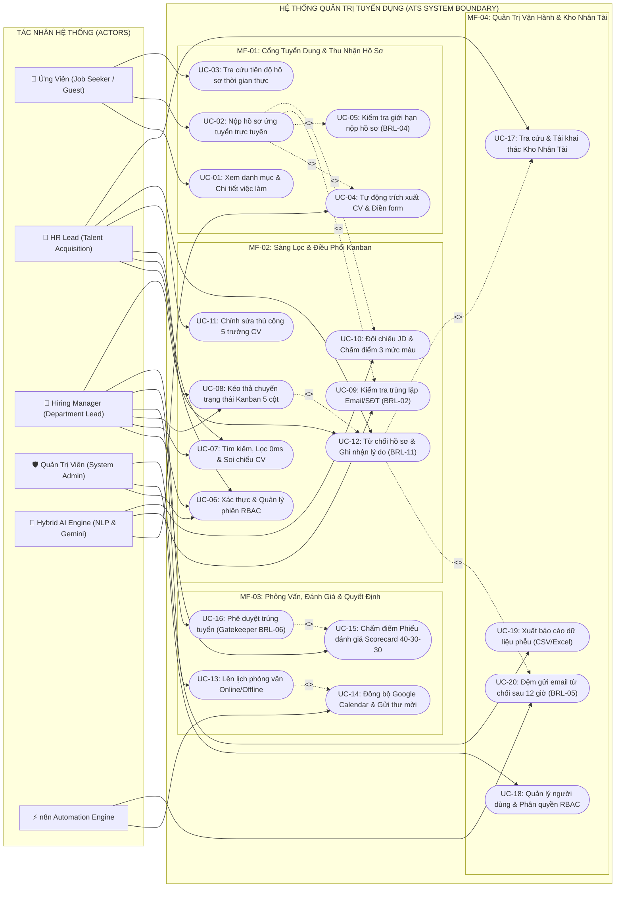
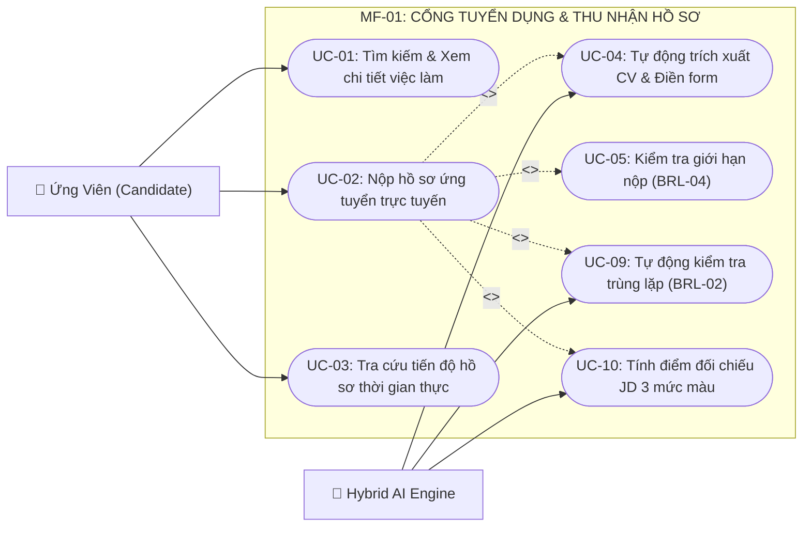
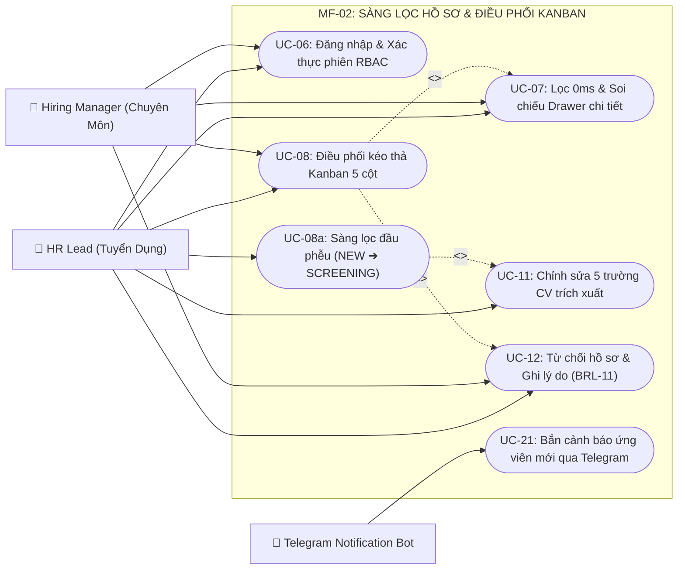
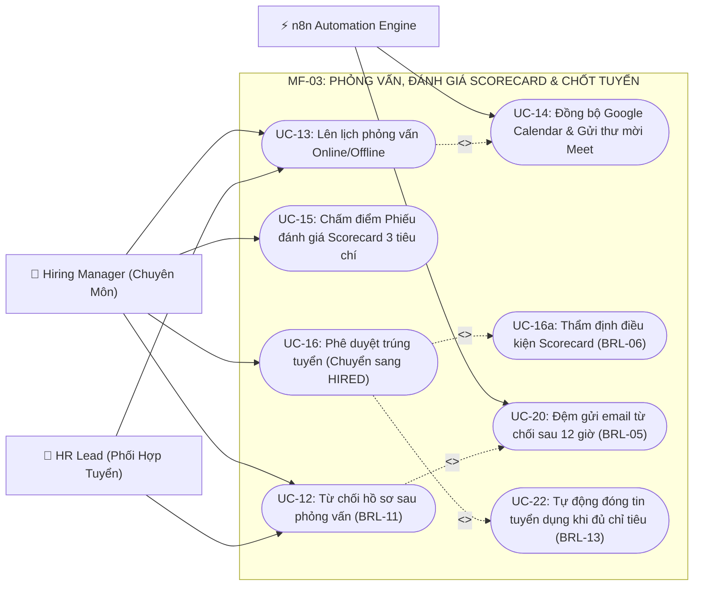
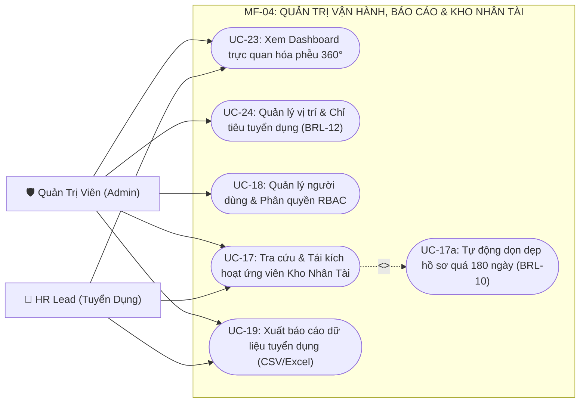

# DIAGRAM 03: HỆ THỐNG SƠ ĐỒ CA SỬ DỤNG (USE CASE MODEL & DECOMPOSITION)

> **Phạm vi nghiệp vụ:** Quản Trị Vòng Đời Tuyển Dụng & Sàng Lọc Hồ Sơ Hỗ Trợ Bởi AI  
> **Tài liệu nguồn:** [`docs/ba/04_FDD_and_Use_Case_List.md`](file:///d:/ATS%20project/docs/ba/04_FDD_and_Use_Case_List.md), [`docs/ba/05_Use_Case_Specifications.md`](file:///d:/ATS%20project/docs/ba/05_Use_Case_Specifications.md)  
> **Mã quy tắc kinh doanh:** `BRL-01` đến `BRL-14`

---

## 1. Phân Tích Thực Tiễn BA: Nên Phân Rã Use Case Theo MF, Actor Hay Module?

Trong thực tiễn kỹ nghệ yêu cầu phần mềm chuẩn quốc tế (**BABOK Guide v3** & **UML 2.5**), câu hỏi cốt lõi khi thiết kế mô hình Ca sử dụng (Use Case Model) cho một hệ thống quy mô doanh nghiệp như ATS là: **"Nên phân rã sơ đồ theo Actor, theo Module kỹ thuật, hay theo Major Feature (MF)?"**

Dưới đây là bảng đối chiếu phân tích từ góc độ Senior Business Analyst / Enterprise Solution Architect:

| Tiêu Chí Đánh Giá | Phương Án 1: Chia Theo Actor (Actor-Centric) | Phương Án 2: Chia Theo Module (Module/Subsystem-Centric) | Phương Án 3: Chia Theo MF (Major Feature / Value Stream) |
| :--- | :--- | :--- | :--- |
| **Góc nhìn chính** | Theo đối tượng người dùng (Candidate, HR, Hiring Manager, Admin). | Theo cấu trúc phân chia mã nguồn / bảng CSDL (Public, Pipeline, Interview, System). | Theo chặng tạo ra giá trị nghiệp vụ (Business Value Stream / End-to-End Workflow). |
| **Ưu điểm** | Dễ rà soát ma trận bảo mật và phân quyền vai trò (RBAC matrix). | Gần gũi với kiến trúc thư mục của lập trình viên (Developer mental model). | **Tối ưu theo chuẩn BABOK v3:** Thể hiện trọn vẹn luồng công việc xuyên phòng ban (Cross-functional flow); làm nổi bật mục tiêu người dùng. |
| **Nhược điểm** | **Gây đứt gãy luồng cộng tác:** Tuyển dụng là quy trình liên tiếp (Candidate nộp ➔ HR sàng lọc ➔ HM phỏng vấn). Chia theo Actor sẽ cắt nhỏ nghiệp vụ và gây trùng lặp Use Case ở nhiều sơ đồ (ví dụ cả HR và HM đều xem Kanban, đều từ chối hồ sơ). | **Dễ rơi vào bẫy kỹ thuật (Technical Drift):** Chia theo bảng CSDL hoặc màn hình giao diện khiến sơ đồ mất đi bản chất phân tích mục tiêu kinh doanh. | Cần BA nắm chắc ranh giới chức năng và luồng chuyển giao dữ liệu giữa các chặng. |
| **Đánh giá phù hợp** | ⚠️ Phù hợp cho tài liệu bảo mật RBAC, **không tối ưu** cho mô hình hóa nghiệp vụ ATS. | ⚠️ Phù hợp cho tài liệu kiến trúc kỹ thuật (SDD/Architecture), **kém tự nhiên** cho phân tích BA. | **KHUYẾN NGHỊ CAO NHẤT (Best Practice):** Áp dụng mô hình **Hierarchical Goal-Oriented Decomposition** (Phân rã mục tiêu phân tầng). |

### Đề Xuất Mô Hình Kiến Trúc Phân Tầng Chuẩn (Hierarchical Decomposition):
1. **Level 0 — Master System Use Case Diagram (Sơ đồ Tổng Thể Toàn Hệ Thống):**  
   Bao quát toàn bộ Ranh giới hệ thống (System Boundary), 6 tác nhân tương tác (Actors gồm Người dùng, AI Engine và n8n Automation Engine) và 4 nhóm chức năng vĩ mô (MF-01 đến MF-04). Giúp Hội đồng Đánh giá, Giám đốc khối và Lead Developer nắm bắt toàn bộ bức tranh kiến trúc trong 30 giây.
2. **Level 1 — Decomposed Use Case Diagrams (4 Sơ đồ Chi Tiết Theo 4 Major Features):**
   - **MF-01:** Cổng Tuyển Dụng Công Khai & Tiếp Nhận Hồ Sơ (*Public Careers & Intake Portal*)
   - **MF-02:** Sàng Lọc & Điều Phối Tuyển Dụng Kanban (*Screening & Pipeline Operations*)
   - **MF-03:** Phỏng Vấn, Đánh Giá Scorecard & Quyết Định Tuyển Dụng (*Interview, Scorecard & Hiring Decisions*)
   - **MF-04:** Quản Trị Vận Hành, Báo Cáo Phễu & Kho Nhân Tài (*Governance, Analytics & Talent Pool CRM*)

---

## 2. Hướng Dẫn Sử Dụng & Phần Mềm Khuyến Nghị Để Vẽ / Nhúng Code

Để hiển thị và xuất sơ đồ đạt chất lượng xuất bản ấn phẩm kỹ thuật cao nhất:

1. **Vẽ & Biên Tập Trực Tuyến Nhanh Nhất (Recommended):**
   - **[Mermaid Live Editor](https://mermaid.live):** Dán trực tiếp mã nguồn từ các file `.mmd` trong thư mục `docs/diagrams/` để xem kết quả tức thời, tải ảnh vector `.svg` hoặc `.png` độ phân giải cao (2x/3x scale).
2. **Biên Tập Trong IDE (VS Code / Antigravity):**
   - Cài extension **Markdown Preview Mermaid Support** hoặc **Mermaid Preview** của Matt Bierner để xem sơ đồ render trực tiếp ngay khi gõ văn bản.
3. **Mô Hình Hóa Doanh Nghiệp (Enterprise CASE Tools):**
   - **draw.io (diagrams.net):** Chọn `Arrange ➔ Insert ➔ Advanced ➔ Mermaid` để import trực tiếp mã Mermaid thành sơ đồ vector có thể kéo thả và tô màu theo bộ nhận diện thương hiệu.
   - **PlantUML / Visual Paradigm:** Sử dụng bảng mã Use Case Catalog tại Mục 7 để import vào các công cụ sinh mã tự động.

> [!NOTE]
> Tài liệu này cung cấp **Song song cả 2 định dạng cú pháp Mermaid**:
> - **Cú pháp chuẩn mới (`usecase-beta`):** Theo đúng đặc tả chính thức tại [Mermaid Use Case Docs](https://mermaid.js.org/syntax/usecase.html).
> - **Cú pháp tương thích ngược (`flowchart LR` với hình oval `([Use Case])`):** Đảm bảo render 100% không lỗi trên mọi phiên bản GitHub, Notion, Obsidian và trình duyệt cũ.

---

## 3. Sơ Đồ Use Case Tổng Thể Hệ Thống (Master System-Level Diagram)

### 3.1. Cú pháp Mermaid Native (`usecase-beta`)
*File nguồn độc lập:* [`docs/diagrams/03_usecase_master_system.mmd`](file:///d:/ATS%20project/docs/diagrams/03_usecase_master_system.mmd)

```mermaid
usecase-beta
    direction LR

    %% 1. ACTORS DECLARATION
    actor Candidate("👤 Ứng Viên (Candidate)")
    actor Recruiter("👔 HR Lead (Tuyển Dụng)")
    actor HiringMgr("🎯 Hiring Manager (Chuyên Môn)")
    actor Admin("🛡️ Quản Trị Viên (Admin)")
    actor AIEngine("🤖 Google Gemini AI")
    actor Automation("⚡ n8n Automation Engine")

    %% 2. SYSTEM BOUNDARY & MAJOR FEATURES (MF)
    systemBoundary "HỆ THỐNG QUẢN TRỊ TUYỂN DỤNG (ATS SYSTEM BOUNDARY)"
        %% MF-01: Cổng Tuyển Dụng Công Khai & Tiếp Nhận
        UC_Browse("Xem danh sách & chi tiết việc làm")
        UC_Apply("Nộp hồ sơ ứng tuyển trực tuyến")
        UC_Track("Tra cứu tiến độ hồ sơ thời gian thực")

        %% MF-02: Sàng Lọc & Điều Phối Kanban
        UC_Screen("Sàng lọc hồ sơ đầu phễu (NEW -> SCREENING)")
        UC_EditCV("Chỉnh sửa 5 trường thông tin CV trích xuất")
        UC_Kanban("Điều phối hồ sơ trên bảng Kanban 5 cột")

        %% MF-03: Phỏng Vấn, Đánh Giá & Quyết Định
        UC_Schedule("Lên lịch phỏng vấn Online/Offline")
        UC_Scorecard("Chấm điểm Phiếu đánh giá Scorecard")
        UC_Hire("Duyệt trúng tuyển (Chốt chỉ tiêu)")
        UC_Reject("Từ chối hồ sơ (Ghi nhận lý do)")

        %% MF-04: Quản Trị Vận Hành & Kho Nhân Tài
        UC_Dashboard("Xem Dashboard phân tích phễu 360°")
        UC_ManageJobs("Quản lý vị trí & Thiết lập chỉ tiêu")
        UC_TalentPool("Quản lý & Tái khai thác Kho Nhân Tài")
        UC_Users("Quản lý người dùng & Phân quyền RBAC")
    end

    %% 3. ASSOCIATIONS — CANDIDATE
    Candidate --> UC_Browse
    Candidate --> UC_Apply
    Candidate --> UC_Track

    %% 4. ASSOCIATIONS — HR LEAD
    Recruiter --> UC_Screen
    Recruiter --> UC_EditCV
    Recruiter --> UC_Kanban
    Recruiter --> UC_Reject
    Recruiter --> UC_TalentPool

    %% 5. ASSOCIATIONS — HIRING MANAGER
    HiringMgr --> UC_Kanban
    HiringMgr --> UC_Schedule
    HiringMgr --> UC_Scorecard
    HiringMgr --> UC_Hire
    HiringMgr --> UC_Reject

    %% 6. ASSOCIATIONS — ADMIN
    Admin --> UC_Dashboard
    Admin --> UC_ManageJobs
    Admin --> UC_Users
    Admin --> UC_TalentPool

    %% 7. SYSTEM ACTORS ASSOCIATIONS
    AIEngine --> UC_Apply
    AIEngine --> UC_Screen
    Automation --> UC_Schedule
    Automation --> UC_Reject
```

---

### 3.2. Cú pháp Tương Thích Rộng Rãi (`flowchart LR`)
*File nguồn độc lập:* [`docs/diagrams/03_usecase_diagram.mmd`](file:///d:/ATS%20project/docs/diagrams/03_usecase_diagram.mmd)



---

## 4. Các Sơ Đồ Use Case Phân Rã Chi Tiết Theo Major Feature (Level 1)

### 4.1. MF-01: Cổng Tuyển Dụng Công Khai & Tiếp Nhận Hồ Sơ (Public Careers & Intake Portal)
*File nguồn độc lập:* [`docs/diagrams/03_usecase_mf01_public_intake.mmd`](file:///d:/ATS%20project/docs/diagrams/03_usecase_mf01_public_intake.mmd)

Phân hệ dành cho Ứng viên tự do tiếp cận cổng thông tin tuyển dụng, nộp hồ sơ, và theo dõi tiến trình tuyển dụng độc lập.

#### A. Cú pháp Mermaid Native (`usecase-beta`)
```mermaid
usecase-beta
    direction LR

    %% 1. ACTORS SPECIFICATION
    actor Candidate("👤 Ứng Viên (Job Seeker / Guest)")
    actor AIEngine("🤖 Hybrid AI Engine (pdf-parse / Gemini)")

    %% 2. SUBSYSTEM BOUNDARY: MF-01
    systemBoundary "MF-01: CỔNG TUYỂN DỤNG CÔNG KHAI & THU NHẬN HỒ SƠ"
        UC_Browse("UC-01: Tìm kiếm & Xem chi tiết việc làm")
        UC_Apply("UC-02: Nộp hồ sơ ứng tuyển trực tuyến")
        UC_Track("UC-03: Tra cứu tiến độ hồ sơ thời gian thực")
        UC_AutoFill("UC-04: Tự động trích xuất CV & Điền form")
        UC_RateLimit("UC-05: Kiểm soát giới hạn nộp (BRL-04: 3 việc/90 ngày)")
        UC_Deduplicate("UC-09: Tự động kiểm tra trùng lặp (BRL-02: 30 ngày)")
        UC_SemanticMatch("UC-10: Tính điểm đối chiếu JD 3 mức màu")
    end

    %% 3. PRIMARY ASSOCIATIONS
    Candidate --> UC_Browse
    Candidate --> UC_Apply
    Candidate --> UC_Track

    %% 4. SYSTEM ACTOR ASSOCIATIONS
    AIEngine --> UC_AutoFill
    AIEngine --> UC_Deduplicate
    AIEngine --> UC_SemanticMatch

    %% 5. RELATIONSHIPS (INCLUDE & EXTEND)
    UC_Apply ..> : include UC_RateLimit
    UC_Apply ..> : include UC_Deduplicate
    UC_Apply ..> : include UC_SemanticMatch
    UC_Apply ..> : extend UC_AutoFill
```

#### B. Cú pháp Flowchart Tương Thích Cao


---

### 4.2. MF-02: Sàng Lọc & Điều Phối Tuyển Dụng Kanban (Screening & Pipeline Operations)
*File nguồn độc lập:* [`docs/diagrams/03_usecase_mf02_screening_kanban.mmd`](file:///d:/ATS%20project/docs/diagrams/03_usecase_mf02_screening_kanban.mmd)

Phân hệ tác nghiệp trọng tâm của HR Lead và Hiring Manager, bao gồm tiếp nhận hồ sơ đầu phễu, soi chiếu Drawer chi tiết, điều chỉnh 5 trường CV và kéo thả Kanban 5 cột.

#### A. Cú pháp Mermaid Native (`usecase-beta`)
```mermaid
usecase-beta
    direction LR

    %% 1. ACTORS SPECIFICATION
    actor Recruiter("👔 HR Lead (Tuyển Dụng)")
    actor HiringMgr("🎯 Hiring Manager (Chuyên Môn)")
    actor TelegramBot("📢 Telegram Notification Bot")

    %% 2. SUBSYSTEM BOUNDARY: MF-02
    systemBoundary "MF-02: SÀNG LỌC HỒ SƠ & ĐIỀU PHỐI KANBAN"
        UC_Auth("UC-06: Đăng nhập & Xác thực phiên RBAC")
        UC_Inspect("UC-07: Lọc 0ms & Soi chiếu Drawer chi tiết")
        UC_Kanban("UC-08: Điều phối kéo thả Kanban 5 cột")
        UC_Screen("UC-08a: Sàng lọc đầu phễu (NEW -> SCREENING)")
        UC_EditCV("UC-11: Chỉnh sửa 5 trường CV trích xuất")
        UC_Reject("UC-12: Từ chối hồ sơ (Bắt buộc lý do BRL-11)")
        UC_AlertTelegram("UC-21: Bắn cảnh báo ứng viên mới qua Telegram")
    end

    %% 3. RECRUITER (HR LEAD) ASSOCIATIONS
    Recruiter --> UC_Auth
    Recruiter --> UC_Inspect
    Recruiter --> UC_Kanban
    Recruiter --> UC_Screen
    Recruiter --> UC_EditCV
    Recruiter --> UC_Reject

    %% 4. HIRING MANAGER ASSOCIATIONS
    HiringMgr --> UC_Auth
    HiringMgr --> UC_Inspect
    HiringMgr --> UC_Kanban
    HiringMgr --> UC_Reject

    %% 5. SYSTEM ACTOR ASSOCIATIONS
    TelegramBot --> UC_AlertTelegram

    %% 6. RELATIONSHIPS (INCLUDE & EXTEND)
    UC_Kanban ..> : extend UC_Reject
    UC_Screen ..> : extend UC_EditCV
    UC_Kanban ..> : include UC_Inspect
```

#### B. Cú pháp Flowchart Tương Thích Cao


---

### 4.3. MF-03: Phỏng Vấn, Đánh Giá Scorecard & Chốt Tuyển (Interview, Scorecard & Hiring Decisions)
*File nguồn độc lập:* [`docs/diagrams/03_usecase_mf03_interview_scorecard.mmd`](file:///d:/ATS%20project/docs/diagrams/03_usecase_mf03_interview_scorecard.mmd)

Phân hệ đảm nhiệm vòng phỏng vấn chuyên môn, đồng bộ lịch Google Calendar tự động, chấm điểm ứng viên theo phiếu Scorecard chuẩn 3 tiêu chí, kiểm soát điều kiện tiên quyết trước khi duyệt trúng tuyển (Gatekeeper `BRL-06`), và xử lý đệm thư từ chối 12 giờ (`BRL-05`).

#### A. Cú pháp Mermaid Native (`usecase-beta`)
```mermaid
usecase-beta
    direction LR

    %% 1. ACTORS SPECIFICATION
    actor HiringMgr("🎯 Hiring Manager (Chuyên Môn)")
    actor Recruiter("👔 HR Lead (Phối Hợp Tuyển)")
    actor AutoService("⚡ n8n Automation Engine (GCal / Gmail)")

    %% 2. SUBSYSTEM BOUNDARY: MF-03
    systemBoundary "MF-03: PHỎNG VẤN, ĐÁNH GIÁ SCORECARD & CHỐT TUYỂN"
        UC_Schedule("UC-13: Lên lịch phỏng vấn Online / Offline")
        UC_SyncCalendar("UC-14: Đồng bộ Google Calendar & Tạo link Meet")
        UC_Scorecard("UC-15: Chấm điểm Phiếu đánh giá Scorecard 3 tiêu chí")
        UC_Hire("UC-16: Phê duyệt trúng tuyển (Chuyển sang HIRED)")
        UC_GateCheck("UC-16a: Thẩm định điều kiện Scorecard hợp lệ (BRL-06)")
        UC_Reject("UC-12: Từ chối hồ sơ sau phỏng vấn (BRL-11)")
        UC_BufferReject("UC-20: Đệm gửi thư từ chối sau 12 giờ (BRL-05)")
        UC_AutoClose("UC-22: Tự động đóng tin tuyển dụng khi đủ chỉ tiêu (BRL-13)")
    end

    %% 3. HIRING MANAGER ASSOCIATIONS
    HiringMgr --> UC_Schedule
    HiringMgr --> UC_Scorecard
    HiringMgr --> UC_Hire
    HiringMgr --> UC_Reject

    %% 4. HR LEAD ASSOCIATIONS
    Recruiter --> UC_Schedule
    Recruiter --> UC_Reject

    %% 5. AUTOMATION SERVICE ASSOCIATIONS
    AutoService --> UC_SyncCalendar
    AutoService --> UC_BufferReject

    %% 6. RELATIONSHIPS (INCLUDE & EXTEND)
    UC_Schedule ..> : include UC_SyncCalendar
    UC_Hire ..> : include UC_GateCheck
    UC_Hire ..> : extend UC_AutoClose
    UC_Reject ..> : include UC_BufferReject
```

#### B. Cú pháp Flowchart Tương Thích Cao


---

### 4.4. MF-04: Quản Trị Vận Hành, Báo Cáo Phễu & Kho Nhân Tài (Governance, Analytics & Talent Pool CRM)
*File nguồn độc lập:* [`docs/diagrams/03_usecase_mf04_governance_talentpool.mmd`](file:///d:/ATS%20project/docs/diagrams/03_usecase_mf04_governance_talentpool.mmd)

Phân hệ quản trị cấp cao dành cho Quản trị viên (Admin) và HR Lead: Theo dõi chỉ số chuyển đổi phễu trên Dashboard trực quan, thiết lập tin tuyển dụng và chỉ tiêu tuyển dụng (`BRL-12`), quản lý người dùng RBAC, khai thác Kho Nhân Tài (3 phân nhóm) và dọn dẹp hồ sơ quá hạn 180 ngày (`BRL-10`).

#### A. Cú pháp Mermaid Native (`usecase-beta`)
```mermaid
usecase-beta
    direction LR

    %% 1. ACTORS SPECIFICATION
    actor Admin("🛡️ Quản Trị Viên (System Administrator)")
    actor Recruiter("👔 HR Lead (Vận Hành & Khai Thác)")

    %% 2. SUBSYSTEM BOUNDARY: MF-04
    systemBoundary "MF-04: QUẢN TRỊ VẬN HÀNH, BÁO CÁO & KHO NHÂN TÀI"
        UC_Dashboard("UC-23: Xem Dashboard trực quan hóa phễu 360°")
        UC_ManageJobs("UC-24: Quản lý tin tuyển dụng & Chỉ tiêu Headcount")
        UC_Users("UC-18: Quản lý tài khoản & Phân quyền RBAC")
        UC_TalentPool("UC-17: Tra cứu & Tái kích hoạt ứng viên Kho Nhân Tài")
        UC_PurgePool("UC-17a: Dọn dẹp hồ sơ lưu trữ quá 180 ngày (BRL-10)")
        UC_Export("UC-19: Xuất dữ liệu báo cáo phễu (CSV / Excel)")
    end

    %% 3. ADMINISTRATOR ASSOCIATIONS
    Admin --> UC_Dashboard
    Admin --> UC_ManageJobs
    Admin --> UC_Users
    Admin --> UC_TalentPool
    Admin --> UC_Export

    %% 4. RECRUITER (HR LEAD) ASSOCIATIONS
    Recruiter --> UC_Dashboard
    Recruiter --> UC_TalentPool
    Recruiter --> UC_Export

    %% 5. RELATIONSHIPS (INCLUDE & EXTEND)
    UC_TalentPool ..> : extend UC_PurgePool
```

#### B. Cú pháp Flowchart Tương Thích Cao


---

## 5. Bảng Phân Loại Tác Nhân & Ma Trận Phân Quyền (Actor Taxonomy & RBAC Matrix)

| Tác Nhân (Actor) | Phân Loại | Phạm Vi Trách Nhiệm Nghiệp Vụ | Vòng Đời Trạng Thái Được Phép Thao Tác |
| :--- | :--- | :--- | :--- |
| **Ứng Viên (Candidate)** | Con người (Bên ngoài) | Tìm kiếm việc làm, nộp hồ sơ, tải CV và tra cứu tiến độ ứng tuyển cá nhân. | Xem trạng thái công khai (`NEW`, `SCREENING`, `INTERVIEW`, `HIRED`, `REJECTED`). Không xem ghi chú nội bộ. |
| **HR Lead (Recruiter)** | Con người (Nội bộ) | Tiếp nhận hồ sơ đầu vào, kiểm tra trùng lặp, chỉnh sửa 5 trường trích xuất CV, duyệt vòng sàng lọc, quản lý Kho Nhân Tài. | Quyền chuyển trạng thái: `NEW ➔ SCREENING`, `* ➔ REJECTED`. Quyền khai thác Kho Nhân Tài. |
| **Hiring Manager** | Con người (Nội bộ) | Trưởng bộ phận chuyên môn: tham gia phỏng vấn, chấm điểm phiếu Scorecard, phê duyệt tuyển dụng cuối cùng. | Quyền chuyển trạng thái: `SCREENING ➔ INTERVIEW ➔ HIRED`, `INTERVIEW ➔ REJECTED`. Bắt buộc Scorecard trước khi `HIRED`. |
| **Quản Trị Viên (Admin)** | Con người (Nội bộ) | Quản lý hạ tầng hệ thống, cấu hình người dùng, phân quyền RBAC, giám sát Dashboard 360° và truy vết Audit Logs. | Toàn quyền trên toàn bộ hệ thống; không can thiệp trực tiếp vào quyết định chấm điểm chuyên môn. |
| **Hybrid AI Engine** | Hệ thống (Hỗ trợ) | Bộ phân tích kép: Lớp 1 (Local Regex/NLP) trích xuất 5 trường; Lớp 2 (Gemini LLM) chấm điểm khớp JD 3 mức màu. | Chạy ngầm trong quá trình ứng tuyển (`UC-02`), tự động cập nhật `matchScore`, `matchTier` và gắn nhãn trùng lặp. |
| **n8n Automation Engine** | Hệ thống (Tự động hóa) | Máy chủ Webhook tự động: đồng bộ lịch Google Calendar, gửi Meet link cho ứng viên, đệm 12 giờ gửi email từ chối (`BRL-05`). | Kích hoạt tự động khi có sự kiện: Lên lịch phỏng vấn (`UC-13`) hoặc chuyển hồ sơ sang `REJECTED` (`UC-12`). |

---

## 6. Danh Mục 24 Ca Sử Dụng Chi Tiết & Ma Trận Truy Vết (Traceability Matrix)

| Mã UC | Tên Ca Sử Dụng | Phân Hệ | Tác Nhân Chính | Tác Nhân Phụ | Tiền Điều Kiện (Pre-condition) | Hậu Điều Kiện (Post-condition) | Quy Tắc Kinh Doanh Liên Quan |
| :--- | :--- | :--- | :--- | :--- | :--- | :--- | :--- |
| **UC-01** | Xem danh mục & chi tiết việc làm | MF-01 | Candidate | — | Tin tuyển dụng ở trạng thái `PUBLISHED`. | Chi tiết JD hiển thị đầy đủ, không lộ mức lương nội bộ. | Truy cập công khai, không cần đăng nhập. |
| **UC-02** | Nộp hồ sơ ứng tuyển trực tuyến | MF-01 | Candidate | AI Engine | Vị trí tuyển dụng đang mở. | Bản ghi `Application` được tạo ở trạng thái `NEW`. | Kiểm tra Magic Bytes (`%PDF`, `PK`) & dung lượng ≤ 5MB (`BRL-01`). |
| **UC-03** | Tra cứu tiến độ hồ sơ thời gian thực | MF-01 | Candidate | — | Ứng viên có Email hoặc mã Token ứng tuyển hợp lệ. | Hiển thị Timeline chặng tuyển dụng thân thiện. | Không hiển thị ghi chú hay điểm số nội bộ của hội đồng. |
| **UC-04** | Tự động trích xuất CV & điền nhanh | MF-01 | Candidate | AI Engine | Ứng viên đã chọn file CV hợp lệ. | Form thông tin tự động điền Tên, Email, SĐT, Kỹ năng. | Tăng trải nghiệm ứng viên (Time-to-apply < 60s). |
| **UC-05** | Kiểm tra giới hạn nộp hồ sơ | MF-01 | Candidate | — | Ứng viên bấm xác nhận nộp hồ sơ. | Chấp thuận hoặc chặn nộp kèm thông báo rõ ràng. | **BRL-04:** Tối đa 3 hồ sơ trong vòng 90 ngày. |
| **UC-06** | Xác thực & Quản lý phiên RBAC | MF-02 | Internal Users | — | Người dùng nhập thông tin xác thực doanh nghiệp. | Cấp JWT Token có phạm vi quyền vai trò cụ thể. | **BRL-07:** Phân định quyền nghiêm ngặt giữa HR, HM, Admin. |
| **UC-07** | Tìm kiếm, Lọc 0ms & Soi Drawer | MF-02 | Recruiter, HM | — | Đã đăng nhập vào trang điều phối tuyển dụng. | Danh sách thẻ ứng viên lọc tức thì; Drawer hiển thị CV. | In-memory filtering (0ms latency), hiển thị nhãn màu 3 mức. |
| **UC-08** | Điều phối chuyển trạng thái Kanban | MF-02 | Recruiter, HM | — | Thẻ ứng viên tồn tại trên bảng Kanban. | Thẻ chuyển sang cột mới; lịch sử Audit Log ghi nhận. | Ràng buộc phân quyền: HR tối đa tới `SCREENING`; HM từ `SCREENING` tới `HIRED`. |
| **UC-08a**| Duyệt sàng lọc đầu vào | MF-02 | Recruiter | — | Hồ sơ đang ở trạng thái `NEW`. | Hồ sơ chuyển sang `SCREENING`. | HR chịu trách nhiệm làm sạch và chuẩn hóa dữ liệu đầu vào. |
| **UC-09** | Tự động kiểm tra trùng lặp | MF-01 | AI Engine | System DB | Hồ sơ mới vừa được gửi lên hệ thống. | Gắn cờ cảnh báo nếu trùng Email/SĐT trong 30 ngày. | **BRL-02:** Phát hiện trùng lặp hồ sơ đa nguồn. |
| **UC-10** | Đối chiếu JD & Chấm điểm 3 mức | MF-01 | AI Engine | — | CV đã được trích xuất text và JD có yêu cầu. | Điểm số 0–100% và nhãn Xanh/Vàng/Đỏ được lưu. | Green (≥75%), Yellow (50–74%), Red (<50%). |
| **UC-11** | Chỉnh sửa 5 trường trích xuất CV | MF-02 | Recruiter | — | Hồ sơ đang ở trạng thái `NEW` hoặc `SCREENING`. | 5 trường (Tên, Email, SĐT, Kinh nghiệm, Kỹ năng) cập nhật. | Cho phép nhân sự hiệu chỉnh sai lệch của AI; lưu Audit Log. |
| **UC-12** | Từ chối hồ sơ & Ghi lý do bắt buộc | MF-02, MF-03 | Recruiter, HM | AutoService | Hồ sơ đang ở bất kỳ trạng thái nào chưa đóng. | Hồ sơ chuyển sang `REJECTED`; lý do được lưu trữ. | **BRL-11:** Bắt buộc chọn ít nhất 1 lý do từ chối chuẩn hóa. |
| **UC-13** | Lên lịch phỏng vấn Online/Offline | MF-03 | Hiring Manager | Recruiter | Ứng viên đang ở `SCREENING` hoặc `INTERVIEW`. | Bản ghi lịch phỏng vấn được tạo với thời gian cụ thể. | Kiểm tra tránh trùng lịch phòng họp và người phỏng vấn. |
| **UC-14** | Đồng bộ Calendar & Gửi thư mời | MF-03 | AutoService | Candidate, HM | Lịch phỏng vấn được xác nhận (UC-13). | Google Calendar được đồng bộ; Email thư mời kèm Meet link. | Tự động hóa qua n8n webhook; không cần thao tác tay. |
| **UC-15** | Chấm điểm Phiếu đánh giá Scorecard | MF-03 | Hiring Manager | — | Ứng viên đang ở vòng `INTERVIEW`. | Phiếu Scorecard được lưu với điểm bình quân gia quyền. | **BRL-08:** Kỹ thuật (40%), Văn hóa (30%), Giải quyết vấn đề (30%). |
| **UC-16** | Phê duyệt trúng tuyển | MF-03 | Hiring Manager | — | Thẻ ứng viên đang ở cột `INTERVIEW`. | Hồ sơ chuyển sang trạng thái `HIRED`. | **BRL-06 Gatekeeper:** Bắt buộc có ít nhất 1 Phiếu Scorecard hợp lệ. |
| **UC-16a**| Thẩm định điều kiện Scorecard | MF-03 | System DB | — | Người dùng kéo thả ứng viên vào cột `HIRED`. | Cho phép hoặc chặn thao tác kèm thông báo lỗi. | Ngăn chặn hành vi tuyển dụng cảm tính không có căn cứ đánh giá. |
| **UC-17** | Tra cứu & Tái khai thác Kho Nhân Tài | MF-04 | Recruiter, Admin | — | Có các ứng viên không trúng tuyển được lưu trữ. | Hồ sơ được tái gắn vào một vị trí tuyển dụng mới. | Phân loại 3 nhóm: Tiềm năng, Chờ đợt khác, Lưu trữ 180 ngày. |
| **UC-17a**| Dọn dẹp hồ sơ quá hạn 180 ngày | MF-04 | System DB | — | Đến kỳ quét tự động (Cron job). | Đánh dấu hết hạn / xóa vĩnh viễn theo chính sách bảo mật. | **BRL-10:** Tuân thủ quyền riêng tư dữ liệu cá nhân (GDPR/PDPA). |
| **UC-18** | Quản lý người dùng & Phân quyền | MF-04 | Admin | — | Quản trị viên đăng nhập thành công. | Tài khoản nội bộ được thêm, sửa quyền, hoặc vô hiệu hóa. | Phân bổ chính xác các vai trò Admin, Recruiter, Hiring Manager. |
| **UC-19** | Xuất báo cáo dữ liệu phễu | MF-04 | Admin, Recruiter | — | Có dữ liệu tuyển dụng trong khoảng thời gian chọn. | File `.csv` hoặc `.xlsx` được tải về máy trạm. | Báo cáo tỷ lệ chuyển đổi các vòng, Time-to-hire, Nguồn ứng viên. |
| **UC-20** | Đệm gửi email từ chối sau 12 giờ | MF-03 | AutoService | Candidate | Hồ sơ được chuyển sang `REJECTED`. | Email thông báo từ chối lịch thiệp được gửi sau đúng 12 giờ. | **BRL-05:** Giữ gìn hình ảnh thương hiệu nhà tuyển dụng. |
| **UC-21** | Bắn thông báo Telegram khi có CV | MF-02 | TelegramBot | Recruiter | Có ứng viên nộp hồ sơ mới thành công. | Tin nhắn tóm tắt hồ sơ kèm link xem nhanh gửi vào nhóm HR. | Đảm bảo SLA phản hồi ứng viên trong 24 giờ đầu tiên. |
| **UC-22** | Tự động đóng tin khi đủ chỉ tiêu | MF-03 | System DB | — | Ứng viên được chuyển sang `HIRED` và đạt đủ Headcount. | Trạng thái tin tuyển dụng tự động chuyển sang `CLOSED`. | **BRL-13:** Chặn tình trạng tuyển thừa chỉ tiêu đã duyệt. |
| **UC-23** | Xem Dashboard phân tích phễu 360° | MF-04 | Admin, Recruiter | — | Đã đăng nhập vào trang điều hành hệ thống. | Biểu đồ trực quan hóa chuyển đổi phễu, SLA, cảnh báo trễ hạn. | Cung cấp cái nhìn toàn cảnh để tối ưu hóa chi phí tuyển dụng. |
| **UC-24** | Quản lý tin & Chỉ tiêu tuyển dụng | MF-04 | Admin | — | Đã đăng nhập với quyền Quản trị viên. | Tin tuyển dụng được tạo mới/chỉnh sửa chỉ tiêu Headcount. | **BRL-12:** Thiết lập trần phỏng vấn và chỉ tiêu tuyển dụng. |

---

## 7. Tổng Hợp Danh Mục File Sơ Đồ Độc Lập

Tất cả các sơ đồ trên đã được trích xuất thành các file mã nguồn độc lập nằm trong thư mục [`docs/diagrams/`](file:///d:/ATS%20project/docs/diagrams/), sẵn sàng để nhúng vào báo cáo, tài liệu Word/PDF, hoặc biên dịch qua CLI:

| Tên File | Loại Sơ Đồ | Cú Pháp | Mô Tả & Mục Đích |
| :--- | :--- | :--- | :--- |
| [`03_usecase_master_system.mmd`](file:///d:/ATS%20project/docs/diagrams/03_usecase_master_system.mmd) | **Master System L0** | `usecase-beta` | Sơ đồ Use Case tổng thể toàn hệ thống chuẩn Mermaid v12+. |
| [`03_usecase_diagram.mmd`](file:///d:/ATS%20project/docs/diagrams/03_usecase_diagram.mmd) | **Master System L0** | `flowchart LR` | Sơ đồ Use Case tổng thể tương thích cao (render mọi nền tảng). |
| [`03_usecase_mf01_public_intake.mmd`](file:///d:/ATS%20project/docs/diagrams/03_usecase_mf01_public_intake.mmd) | **Subsystem L1 (MF-01)** | `usecase-beta` | Sơ đồ chi tiết Cổng Tuyển Dụng & Thu Nhận Hồ Sơ. |
| [`03_usecase_mf02_screening_kanban.mmd`](file:///d:/ATS%20project/docs/diagrams/03_usecase_mf02_screening_kanban.mmd) | **Subsystem L1 (MF-02)** | `usecase-beta` | Sơ đồ chi tiết Sàng Lọc & Điều Phối Pipeline Kanban. |
| [`03_usecase_mf03_interview_scorecard.mmd`](file:///d:/ATS%20project/docs/diagrams/03_usecase_mf03_interview_scorecard.mmd) | **Subsystem L1 (MF-03)** | `usecase-beta` | Sơ đồ chi tiết Phỏng Vấn, Đánh Giá Scorecard & Chốt Tuyển. |
| [`03_usecase_mf04_governance_talentpool.mmd`](file:///d:/ATS%20project/docs/diagrams/03_usecase_mf04_governance_talentpool.mmd) | **Subsystem L1 (MF-04)** | `usecase-beta` | Sơ đồ chi tiết Quản Trị Vận Hành, Báo Cáo Phễu & Kho Nhân Tài. |
