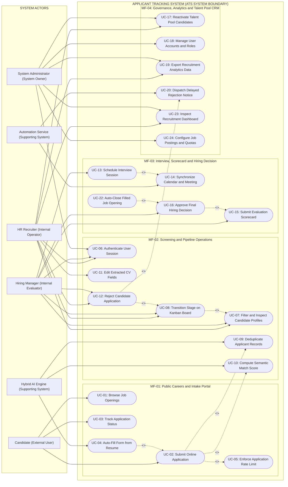
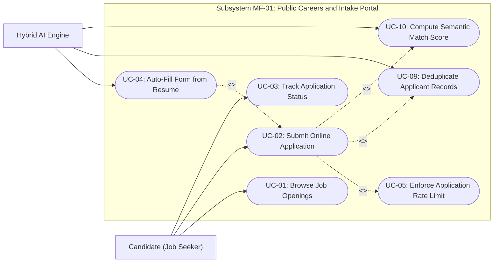
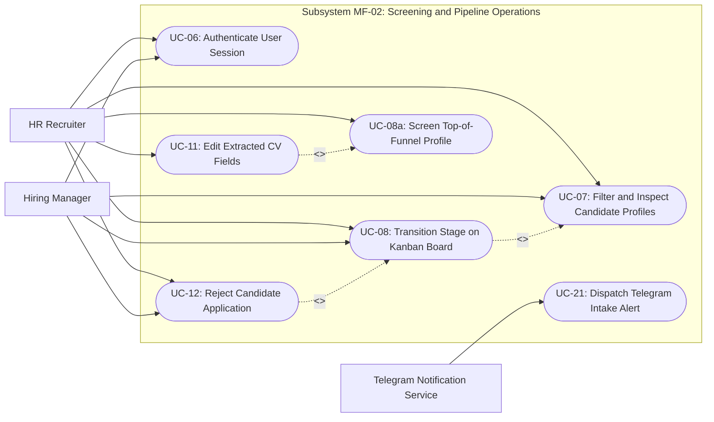
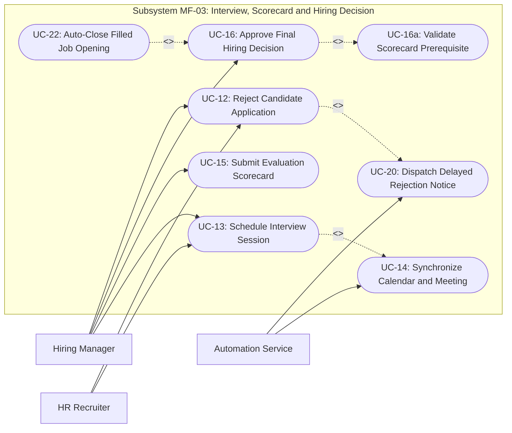
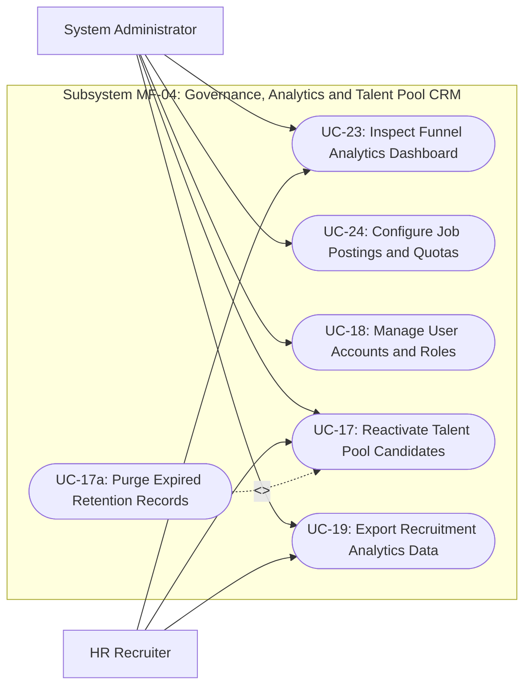

# DIAGRAM 03: SYSTEM USE CASE MODEL & FUNCTIONAL DECOMPOSITION

> **Domain:** Recruitment Lifecycle Management & AI-Assisted Candidate Tracking  
> **Source Documents:** [`docs/ba/04_FDD_and_Use_Case_List.md`](file:///d:/ATS%20project/docs/ba/04_FDD_and_Use_Case_List.md), [`docs/ba/05_Use_Case_Specifications.md`](file:///d:/ATS%20project/docs/ba/05_Use_Case_Specifications.md)  
> **Business Rules Reference:** `BRL-01` through `BRL-14`

---

## 1. BA Methodological Assessment: Decomposition by Major Feature vs. Actor vs. Module

In enterprise business analysis and systems engineering (**BABOK Guide v3** & **OMG UML 2.5.1**), selecting the proper decomposition strategy for a collaborative system like an Applicant Tracking System (ATS) is critical. Below is a rigorous comparative analysis across the three classical approaches:

| Evaluation Criteria | Approach A: Actor-Centric Decomposition | Approach B: Module/Subsystem-Centric Decomposition | Approach C: Major Feature / Value Stream Decomposition |
| :--- | :--- | :--- | :--- |
| **Primary Perspective** | Grouped strictly by user role (Candidate, Recruiter, Hiring Manager, Administrator). | Grouped by software codebase directory or database tables (Public, Pipeline, Interview, System). | Grouped by business value stream and end-to-end operational stages. |
| **Key Strengths** | Useful for security auditing and verifying Role-Based Access Control (RBAC) boundaries. | Aligns directly with software developer directory structures and component packages. | **BABOK v3 Gold Standard:** Captures the full cross-functional recruitment lifecycle; highlights primary actor business goals. |
| **Critical Weaknesses** | **Breaks collaborative workflows:** Recruitment is an interdependent pipeline where an application traverses multiple actors. Actor-centric grouping fragments the business process and forces duplicate use cases across diagrams (e.g., both Recruiter and Hiring Manager reject candidates and review Kanban). | **Technical drift trap:** Organizing diagrams around database tables or UI views obscures business objectives and violates UML behavioral modeling intent. | Requires the Business Analyst to maintain strict interface boundaries and clear input/output stage contracts. |
| **Architectural Verdict** | Appropriate for RBAC security reports; suboptimal for functional workflow specification. | Appropriate for technical software design documents (SDD); suboptimal for business requirements. | **STRONGLY RECOMMENDED (Enterprise Best Practice):** Hierarchical Goal-Oriented Decomposition. |

### The Standard Hierarchical Decomposition Framework:
1. **Level 0 — Master System-Level Use Case Diagram:**  
   Defines the comprehensive ATS System Boundary, 6 interacting actors (Human users, AI Engine, and n8n Automation Engine), and 4 macro capability domains (MF-01 through MF-04). Provides executive stakeholders and lead architects an end-to-end landscape view.
2. **Level 1 — Decomposed Subsystem Use Case Diagrams (4 Major Features):**
   - **MF-01:** Public Careers and Intake Portal (*Public intake, resume parsing, rate limiting, and tracking*)
   - **MF-02:** Screening and Pipeline Operations (*Top-of-funnel intake, data correction, and 5-stage Kanban coordination*)
   - **MF-03:** Interview, Scorecard and Hiring Decision (*Calendar synchronization, weighted scorecard evaluation, and gatekeeping*)
   - **MF-04:** Governance, Analytics and Talent Pool CRM (*Funnel reporting, quota governance, user RBAC, and candidate retention*)

---

## 2. UML Use Case Modeling Principles & Compliance Verification Checklist

All diagrams in this repository strictly adhere to **OMG UML 2.5.1** formal syntax and **Cockburn Elementary Business Process (EBP)** standards:

| Rule ID | Modeling Principle | Description & Formal Specification | ATS Implementation Compliance |
| :---: | :--- | :--- | :--- |
| **UCD-01** | **Strict Verb-Noun Naming** | Every Use Case label must begin with an active present-tense verb followed by a specific direct object (e.g., `Submit Online Application`, not `Application Submission` or `CV Form`). | Verified: All 24 use cases strictly adhere to active verb-noun grammatical structure. |
| **UCD-02** | **System Boundary Integrity** | The system boundary cleanly encapsulates all system behaviors. Actors must reside outside the boundary; Use Cases must reside inside. | Verified: Clean rectangular system boundaries enclose use cases; all human and system actors are external. |
| **UCD-03** | **Actor Isolation Rule** | Actors represent external roles (human, external service, or hardware). Actors never interact directly with other actors on a Use Case diagram. | Verified: Zero actor-to-actor links exist. All interactions flow between actors and use cases. |
| **UCD-04** | **Elementary Business Process (EBP)** | Use Cases represent complete user goals delivering measurable business value at sea-level. Individual UI clicks or validation steps are never standalone use cases. | Verified: No atomic UI actions (e.g., "Click Button", "Validate Form") are depicted as standalone use cases. |
| **UCD-05** | **Semantic Direction of `<<include>>`** | The Base Use Case points to the Included Use Case (`Base ..> Included : <<include>>`). The included behavior is executed unconditionally every time the base case runs. | Verified: Mandatory checks (`Enforce Application Rate Limit`, `Validate Scorecard Gate`) point from Base to Included. |
| **UCD-06** | **Semantic Direction of `<<extend>>`** | In UML 2.5.1, the Extending Use Case points to the Extended/Base Use Case (`Extending ..> Base : <<extend>>`). Represents conditional or optional behavior inserted at defined extension points. | Verified: Optional/conditional flows (`Auto-Fill Form from Resume`, `Reject Candidate Application`, `Auto-Close Filled Job`) point from Extending to Base. |
| **UCD-07** | **Zero Emoji / Graphic Artifacts** | Formal UML specifications prohibit decorative icons, emojis, or non-standard glyphs in actor or use case identifiers. | Verified: 100% plain-text typography with standard UML actor identifiers and clean oval nodes. |

---

## 3. Master System-Level Use Case Diagram (Level 0)

### 3.1. Native Mermaid Syntax (`usecase-beta`)
*Standalone Source File:* [`docs/diagrams/03_usecase_master_system.mmd`](file:///d:/ATS%20project/docs/diagrams/03_usecase_master_system.mmd)

```mermaid
usecase-beta
    direction LR

    %% 1. ACTORS SPECIFICATION (EXTERNAL TO BOUNDARY)
    actor Candidate("Candidate")
    actor Recruiter("HR Recruiter")
    actor HiringManager("Hiring Manager")
    actor Administrator("System Administrator")
    actor AIEngine("Hybrid AI Engine")
    actor AutomationService("Automation Service")

    %% 2. SYSTEM BOUNDARY (ENCAPSULATES SYSTEM USE CASES ONLY)
    systemBoundary "Applicant Tracking System (ATS)"
        %% MF-01: Public Careers and Intake Portal
        UC_BrowseJobs("Browse Job Openings")
        UC_SubmitApplication("Submit Online Application")
        UC_TrackApplication("Track Application Status")

        %% MF-02: Screening and Pipeline Operations
        UC_ScreenCandidate("Screen Top-of-Funnel Profile")
        UC_EditExtractedData("Edit Extracted CV Fields")
        UC_ManagePipeline("Manage Pipeline on Kanban Board")

        %% MF-03: Interview, Scorecard and Hiring Decision
        UC_ScheduleInterview("Schedule Interview Session")
        UC_EvaluateCandidate("Evaluate Candidate Scorecard")
        UC_ApproveHiring("Approve Final Hiring Decision")
        UC_RejectCandidate("Reject Candidate Profile")

        %% MF-04: Governance, Analytics and Talent Pool CRM
        UC_AnalyzeDashboard("Analyze Recruitment Dashboard")
        UC_ConfigureJobs("Configure Job Openings")
        UC_ManageTalentPool("Manage Talent Pool Repository")
        UC_ManageUsers("Manage User Roles and Access")
    end

    %% 3. PRIMARY ASSOCIATIONS - CANDIDATE
    Candidate --> UC_BrowseJobs
    Candidate --> UC_SubmitApplication
    Candidate --> UC_TrackApplication

    %% 4. PRIMARY ASSOCIATIONS - HR RECRUITER
    Recruiter --> UC_ScreenCandidate
    Recruiter --> UC_EditExtractedData
    Recruiter --> UC_ManagePipeline
    Recruiter --> UC_RejectCandidate
    Recruiter --> UC_ManageTalentPool

    %% 5. PRIMARY ASSOCIATIONS - HIRING MANAGER
    HiringManager --> UC_ManagePipeline
    HiringManager --> UC_ScheduleInterview
    HiringManager --> UC_EvaluateCandidate
    HiringManager --> UC_ApproveHiring
    HiringManager --> UC_RejectCandidate

    %% 6. PRIMARY ASSOCIATIONS - SYSTEM ADMINISTRATOR
    Administrator --> UC_AnalyzeDashboard
    Administrator --> UC_ConfigureJobs
    Administrator --> UC_ManageUsers
    Administrator --> UC_ManageTalentPool

    %% 7. SUPPORTING SYSTEM ASSOCIATIONS (SECONDARY ACTORS)
    AIEngine --> UC_SubmitApplication
    AIEngine --> UC_ScreenCandidate
    AutomationService --> UC_ScheduleInterview
    AutomationService --> UC_RejectCandidate
```

---

### 3.2. Universal Compatibility Syntax (`flowchart LR`)
*Standalone Source File:* [`docs/diagrams/03_usecase_diagram.mmd`](file:///d:/ATS%20project/docs/diagrams/03_usecase_diagram.mmd)



---

## 4. Decomposed Subsystem Use Case Diagrams (Level 1)

### 4.1. MF-01: Public Careers and Intake Portal
*Standalone Source File:* [`docs/diagrams/03_usecase_mf01_public_intake.mmd`](file:///d:/ATS%20project/docs/diagrams/03_usecase_mf01_public_intake.mmd)

Governs external job seeker access, candidate profile intake, resume text auto-extraction, rate limiting, and real-time status inquiry.

#### A. Native Mermaid Syntax (`usecase-beta`)
```mermaid
usecase-beta
    direction LR

    %% 1. ACTORS SPECIFICATION
    actor Candidate("Candidate")
    actor AIEngine("Hybrid AI Engine")

    %% 2. SUBSYSTEM BOUNDARY: MF-01
    systemBoundary "Subsystem MF-01: Public Careers and Intake Portal"
        UC_BrowseJobs("Browse Job Openings")
        UC_SubmitApplication("Submit Online Application")
        UC_TrackApplication("Track Application Status")
        UC_AutoFillForm("Auto-Fill Form from Resume")
        UC_EnforceRateLimit("Enforce Application Rate Limit")
        UC_DeduplicateApplicant("Deduplicate Applicant Records")
        UC_ComputeMatchScore("Compute Semantic Match Score")
    end

    %% 3. PRIMARY ASSOCIATIONS
    Candidate --> UC_BrowseJobs
    Candidate --> UC_SubmitApplication
    Candidate --> UC_TrackApplication

    %% 4. SUPPORTING SYSTEM ASSOCIATIONS
    AIEngine --> UC_AutoFillForm
    AIEngine --> UC_DeduplicateApplicant
    AIEngine --> UC_ComputeMatchScore

    %% 5. MANDATORY INCLUSIONS (<<include>>)
    UC_SubmitApplication ..> : include UC_EnforceRateLimit
    UC_SubmitApplication ..> : include UC_DeduplicateApplicant
    UC_SubmitApplication ..> : include UC_ComputeMatchScore

    %% 6. CONDITIONAL EXTENSIONS (<<extend>>)
    UC_AutoFillForm ..> : extend UC_SubmitApplication
```

#### B. Universal Compatibility Syntax (`flowchart LR`)


---

### 4.2. MF-02: Screening and Pipeline Operations
*Standalone Source File:* [`docs/diagrams/03_usecase_mf02_screening_kanban.mmd`](file:///d:/ATS%20project/docs/diagrams/03_usecase_mf02_screening_kanban.mmd)

Governs top-of-funnel resume evaluation, 0ms in-memory candidate filtering, 5-core-field profile editing, and drag-and-drop Kanban coordination.

#### A. Native Mermaid Syntax (`usecase-beta`)
```mermaid
usecase-beta
    direction LR

    %% 1. ACTORS SPECIFICATION
    actor Recruiter("HR Recruiter")
    actor HiringManager("Hiring Manager")
    actor TelegramService("Telegram Notification Service")

    %% 2. SUBSYSTEM BOUNDARY: MF-02
    systemBoundary "Subsystem MF-02: Screening and Pipeline Operations"
        UC_AuthenticateUser("Authenticate User Session")
        UC_FilterProfiles("Filter and Inspect Candidate Profiles")
        UC_TransitionStage("Transition Stage on Kanban Board")
        UC_ScreenTopFunnel("Screen Top-of-Funnel Profile")
        UC_EditExtractedFields("Edit Extracted CV Fields")
        UC_RejectCandidate("Reject Candidate Application")
        UC_DispatchAlert("Dispatch Telegram Intake Alert")
    end

    %% 3. PRIMARY ASSOCIATIONS - HR RECRUITER
    Recruiter --> UC_AuthenticateUser
    Recruiter --> UC_FilterProfiles
    Recruiter --> UC_TransitionStage
    Recruiter --> UC_ScreenTopFunnel
    Recruiter --> UC_EditExtractedFields
    Recruiter --> UC_RejectCandidate

    %% 4. PRIMARY ASSOCIATIONS - HIRING MANAGER
    HiringManager --> UC_AuthenticateUser
    HiringManager --> UC_FilterProfiles
    HiringManager --> UC_TransitionStage
    HiringManager --> UC_RejectCandidate

    %% 5. SUPPORTING SYSTEM ASSOCIATIONS
    TelegramService --> UC_DispatchAlert

    %% 6. MANDATORY INCLUSIONS (<<include>>)
    UC_TransitionStage ..> : include UC_FilterProfiles

    %% 7. CONDITIONAL EXTENSIONS (<<extend>>)
    UC_RejectCandidate ..> : extend UC_TransitionStage
    UC_EditExtractedFields ..> : extend UC_ScreenTopFunnel
```

#### B. Universal Compatibility Syntax (`flowchart LR`)


---

### 4.3. MF-03: Interview, Scorecard and Hiring Decision
*Standalone Source File:* [`docs/diagrams/03_usecase_mf03_interview_scorecard.mmd`](file:///d:/ATS%20project/docs/diagrams/03_usecase_mf03_interview_scorecard.mmd)

Governs interview scheduling, Google Calendar & Meet synchronization, structured 3-criteria scorecard evaluation, final hire gatekeeping (`BRL-06`), 12-hour buffered regret notices (`BRL-05`), and automatic job closure (`BRL-13`).

#### A. Native Mermaid Syntax (`usecase-beta`)
```mermaid
usecase-beta
    direction LR

    %% 1. ACTORS SPECIFICATION
    actor HiringManager("Hiring Manager")
    actor Recruiter("HR Recruiter")
    actor AutomationService("Automation Service")

    %% 2. SUBSYSTEM BOUNDARY: MF-03
    systemBoundary "Subsystem MF-03: Interview, Scorecard and Hiring Decision"
        UC_ScheduleInterview("Schedule Interview Session")
        UC_SynchronizeCalendar("Synchronize Calendar and Meeting")
        UC_EvaluateScorecard("Submit Evaluation Scorecard")
        UC_ApproveHiring("Approve Final Hiring Decision")
        UC_ValidateScorecardGate("Validate Scorecard Prerequisite")
        UC_RejectCandidate("Reject Candidate Application")
        UC_DispatchDelayedNotice("Dispatch Delayed Rejection Notice")
        UC_AutoCloseJob("Auto-Close Filled Job Opening")
    end

    %% 3. PRIMARY ASSOCIATIONS - HIRING MANAGER
    HiringManager --> UC_ScheduleInterview
    HiringManager --> UC_EvaluateScorecard
    HiringManager --> UC_ApproveHiring
    HiringManager --> UC_RejectCandidate

    %% 4. PRIMARY ASSOCIATIONS - HR RECRUITER
    Recruiter --> UC_ScheduleInterview
    Recruiter --> UC_RejectCandidate

    %% 5. SUPPORTING SYSTEM ASSOCIATIONS
    AutomationService --> UC_SynchronizeCalendar
    AutomationService --> UC_DispatchDelayedNotice

    %% 6. MANDATORY INCLUSIONS (<<include>>)
    UC_ScheduleInterview ..> : include UC_SynchronizeCalendar
    UC_ApproveHiring ..> : include UC_ValidateScorecardGate
    UC_RejectCandidate ..> : include UC_DispatchDelayedNotice

    %% 7. CONDITIONAL EXTENSIONS (<<extend>>)
    UC_AutoCloseJob ..> : extend UC_ApproveHiring
```

#### B. Universal Compatibility Syntax (`flowchart LR`)


---

### 4.4. MF-04: Governance, Analytics and Talent Pool CRM
*Standalone Source File:* [`docs/diagrams/03_usecase_mf04_governance_talentpool.mmd`](file:///d:/ATS%20project/docs/diagrams/03_usecase_mf04_governance_talentpool.mmd)

Governs executive dashboard analytics, job posting configuration, headcount quotas (`BRL-12`), user RBAC administration, talent pool reactivation, and 180-day retention cleanup (`BRL-10`).

#### A. Native Mermaid Syntax (`usecase-beta`)
```mermaid
usecase-beta
    direction LR

    %% 1. ACTORS SPECIFICATION
    actor Administrator("System Administrator")
    actor Recruiter("HR Recruiter")

    %% 2. SUBSYSTEM BOUNDARY: MF-04
    systemBoundary "Subsystem MF-04: Governance, Analytics and Talent Pool CRM"
        UC_InspectDashboard("Inspect Funnel Analytics Dashboard")
        UC_ConfigureJobPostings("Configure Job Postings and Quotas")
        UC_ManageUserAccounts("Manage User Accounts and Roles")
        UC_ReactivateTalentPool("Reactivate Talent Pool Candidates")
        UC_PurgeExpiredProfiles("Purge Expired Retention Records")
        UC_ExportRecruitmentData("Export Recruitment Analytics Data")
    end

    %% 3. PRIMARY ASSOCIATIONS - SYSTEM ADMINISTRATOR
    Administrator --> UC_InspectDashboard
    Administrator --> UC_ConfigureJobPostings
    Administrator --> UC_ManageUserAccounts
    Administrator --> UC_ReactivateTalentPool
    Administrator --> UC_ExportRecruitmentData

    %% 4. PRIMARY ASSOCIATIONS - HR RECRUITER
    Recruiter --> UC_InspectDashboard
    Recruiter --> UC_ReactivateTalentPool
    Recruiter --> UC_ExportRecruitmentData

    %% 5. CONDITIONAL EXTENSIONS (<<extend>>)
    UC_PurgeExpiredProfiles ..> : extend UC_ReactivateTalentPool
```

#### B. Universal Compatibility Syntax (`flowchart LR`)


---

## 5. Actor Taxonomy & Permission Matrix

| Actor Identifier | Actor Type | Operational Scope & Business Responsibility | Pipeline Stage Permissions & Boundaries |
| :--- | :--- | :--- | :--- |
| **Candidate** | Human (External) | Public job applicant interacting with the careers portal and tracking interface. | Unauthenticated public access; view published jobs; submit CV; check personal status via token. |
| **HR Recruiter** | Human (Internal) | Operations specialist managing candidate intake, CV data normalization, and top-of-funnel screening. | Authenticated RBAC session; advance cards from `NEW` to `SCREENING`; edit 5 extracted CV fields; reject profiles; manage Talent Pool. |
| **Hiring Manager** | Human (Internal) | Department team lead responsible for interview scheduling, scorecard evaluation, and hiring approval. | Authenticated RBAC session; advance cards from `SCREENING` to `INTERVIEW` and `HIRED`; fill Scorecards; reject profiles. |
| **System Administrator** | Human (Internal) | Platform owner responsible for system configuration, user provisioning, audit inspection, and reporting. | Full platform oversight; configure job quotas; manage user credentials and RBAC roles; inspect 360° analytics. |
| **Hybrid AI Engine** | System (Supporting) | Dual-layer processor: Layer 1 (Local Regex/NLP parser) and Layer 2 (Google Gemini LLM). | Autonomous background execution during intake; computes semantic match scores (0-100%); flags duplicate records. |
| **Automation Service** | System (Supporting) | Event-driven webhook dispatcher powered by n8n automation engine. | Autonomous background execution; synchronizes Google Calendar events; manages 12-hour delayed regret email queue. |

---

## 6. Master System Use Case Catalog & Traceability Matrix (24 Functional Scenarios)

| UC ID | Use Case Name | Subsystem | Primary Actor | Secondary Actor(s) | Pre-condition | Post-condition | Associated Rules & Business Logic |
| :---: | :--- | :---: | :--- | :--- | :--- | :--- | :--- |
| **UC-01** | Browse Job Openings | MF-01 | Candidate | — | Target job opening is `PUBLISHED`. | Job details, requirements, and benefits rendered. | Public access without login requirements. |
| **UC-02** | Submit Online Application | MF-01 | Candidate | AI Engine | Target job opening is active and open. | Application created in `NEW` stage. | Enforces file format (`%PDF`, `PK`) and size ≤ 5MB (`BRL-01`). |
| **UC-03** | Track Application Status | MF-01 | Candidate | — | Candidate possesses valid email or tracking token. | Real-time stage progression displayed. | Displays public milestones without exposing internal evaluator notes. |
| **UC-04** | Auto-Fill Form from Resume | MF-01 | Candidate | AI Engine | Candidate selected a valid resume document. | Form fields populated (Name, Email, Phone, Skills). | Local PDF parser extracts text instantly to reduce user friction. |
| **UC-05** | Enforce Application Rate Limit | MF-01 | Candidate | — | Candidate submits application. | Submission authorized or blocked with error. | Caps applicant to maximum 3 applications per 90 days (`BRL-04`). |
| **UC-06** | Authenticate User Session | MF-02 | Internal Users | — | User provides corporate credentials. | Authenticated session token issued with role scope. | Strict RBAC session enforcement (`BRL-07`). |
| **UC-07** | Filter and Inspect Profiles | MF-02 | Recruiter, HM | — | User is logged in to recruitment console. | Filtered card list rendered; Drawer displays CV. | 0ms in-memory filtering with 3-tier color badges. |
| **UC-08** | Transition Stage on Kanban | MF-02 | Recruiter, HM | — | Candidate card exists in active column. | Card moved to target stage; audit trail recorded. | Enforces stage transition guardrails and role boundaries. |
| **UC-08a**| Screen Top-of-Funnel Profile | MF-02 | Recruiter | — | Candidate application is in `NEW` stage. | Card transitioned to `SCREENING` column. | Recruiter verifies resume authenticity and completeness. |
| **UC-09** | Deduplicate Applicant Records | MF-01 | AI Engine | System DB | Candidate submits application. | Duplicate flag linked or cleared. | Checks matching Email or Phone within 30 days (`BRL-02`). |
| **UC-10** | Compute Semantic Match Score | MF-01 | AI Engine | — | Resume text parsed and JD loaded. | 0-100 score and 3-tier indicator computed. | Green (≥75%), Yellow (50-74%), Red (<50%). |
| **UC-11** | Edit Extracted CV Fields | MF-02 | Recruiter | — | Application is in `NEW` or `SCREENING` stage. | Core fields updated; audit trail logged. | Corrects AI extraction errors across 5 core fields. |
| **UC-12** | Reject Candidate Application | MF-02, MF-03 | Recruiter, HM | Auto Service | Application is in an active non-terminal stage. | Card moved to `REJECTED`; reason recorded. | Requires mandatory rejection reason selection (`BRL-11`). |
| **UC-13** | Schedule Interview Session | MF-03 | Hiring Manager | Recruiter | Application is in `SCREENING` or `INTERVIEW`. | Interview session scheduled with timestamp. | Checks against interviewer and room conflicts. |
| **UC-14** | Synchronize Calendar and Meeting | MF-03 | Auto Service | Candidate, HM | Interview session confirmed (UC-13). | Google Calendar invite and Meet link dispatched. | Dispatched automatically via n8n webhook. |
| **UC-15** | Submit Evaluation Scorecard | MF-03 | Hiring Manager | — | Interview session in progress or completed. | Scorecard recorded with weighted score. | Technical (40%), Communication (30%), Culture (30%) (`BRL-08`). |
| **UC-16** | Approve Final Hiring Decision | MF-03 | Hiring Manager | — | Candidate card is in `INTERVIEW` stage. | Application transitioned to `HIRED`. | **BRL-06 Gate:** Enforces that at least 1 valid Scorecard exists. |
| **UC-16a**| Validate Scorecard Prerequisite | MF-03 | System DB | — | User attempts transition to `HIRED`. | Allowed or blocked with validation alert. | Prevents intuitive hiring without documented evaluations. |
| **UC-17** | Reactivate Talent Pool Candidates| MF-04 | Recruiter, Admin | — | Disqualified candidate archived in pool. | Candidate linked to a new active job opening. | Categorized into 3 tiers with 180-day retention countdown. |
| **UC-17a**| Purge Expired Retention Records | MF-04 | System DB | — | Scheduled cron execution triggered. | Expired records marked or permanently purged. | Enforces data privacy and retention limits (`BRL-10`). |
| **UC-18** | Manage User Accounts and Roles | MF-04 | Administrator | — | Administrator is authenticated. | User account created, modified, or deactivated. | Allocates Recruiter, Hiring Manager, or Admin authority. |
| **UC-19** | Export Recruitment Analytics Data | MF-04 | Admin, Recruiter | — | System holds recruitment records. | CSV or Excel report downloaded. | Exports time-to-hire, funnel conversion, and source data. |
| **UC-20** | Dispatch Delayed Rejection Notice | MF-03 | Auto Service | Candidate | Application transitioned to `REJECTED`. | Professional regret email sent after 12-hour buffer. | Enforces employer brand courtesy window (`BRL-05`). |
| **UC-21** | Dispatch Telegram Intake Alert | MF-02 | Telegram Service | Recruiter | New application submitted successfully. | Instant notification sent to HR Telegram channel. | Ensures initial response SLA within 24 hours. |
| **UC-22** | Auto-Close Filled Job Opening | MF-03 | System DB | — | Final candidate transitioned to `HIRED`. | Job opening status updated to `CLOSED`. | Automatically closes job when headcount quota is met (`BRL-13`). |
| **UC-23** | Inspect Recruitment Dashboard | MF-04 | Admin, Recruiter | — | Internal user logged in to executive portal. | 360° analytics charts and SLA metrics rendered. | Real-time funnel bottleneck and velocity monitoring. |
| **UC-24** | Configure Job Postings and Quotas | MF-04 | Administrator | — | Administrator access authenticated. | Job posting and interview ceiling configured. | Sets target headcount and concurrent interview limit (`BRL-12`). |

---

## 7. Diagram Source File Registry

All diagrams are maintained as standalone, version-controlled source files in [`docs/diagrams/`](file:///d:/ATS%20project/docs/diagrams/):

| File Path | Architecture Level | Syntax Specification | Description & Purpose |
| :--- | :---: | :---: | :--- |
| [`03_usecase_master_system.mmd`](file:///d:/ATS%20project/docs/diagrams/03_usecase_master_system.mmd) | **Level 0 (Master)** | Native `usecase-beta` | System-level master diagram covering the entire ATS boundary. |
| [`03_usecase_diagram.mmd`](file:///d:/ATS%20project/docs/diagrams/03_usecase_diagram.mmd) | **Level 0 (Master)** | High-compatibility `flowchart LR` | Universal compatibility master diagram with UML oval nodes. |
| [`03_usecase_mf01_public_intake.mmd`](file:///d:/ATS%20project/docs/diagrams/03_usecase_mf01_public_intake.mmd) | **Level 1 (MF-01)** | Native `usecase-beta` | Subsystem diagram for Public Careers and Intake Portal. |
| [`03_usecase_mf02_screening_kanban.mmd`](file:///d:/ATS%20project/docs/diagrams/03_usecase_mf02_screening_kanban.mmd) | **Level 1 (MF-02)** | Native `usecase-beta` | Subsystem diagram for Screening and Pipeline Operations. |
| [`03_usecase_mf03_interview_scorecard.mmd`](file:///d:/ATS%20project/docs/diagrams/03_usecase_mf03_interview_scorecard.mmd) | **Level 1 (MF-03)** | Native `usecase-beta` | Subsystem diagram for Interview, Scorecard and Hiring Decision. |
| [`03_usecase_mf04_governance_talentpool.mmd`](file:///d:/ATS%20project/docs/diagrams/03_usecase_mf04_governance_talentpool.mmd) | **Level 1 (MF-04)** | Native `usecase-beta` | Subsystem diagram for Governance, Analytics and Talent Pool CRM. |
