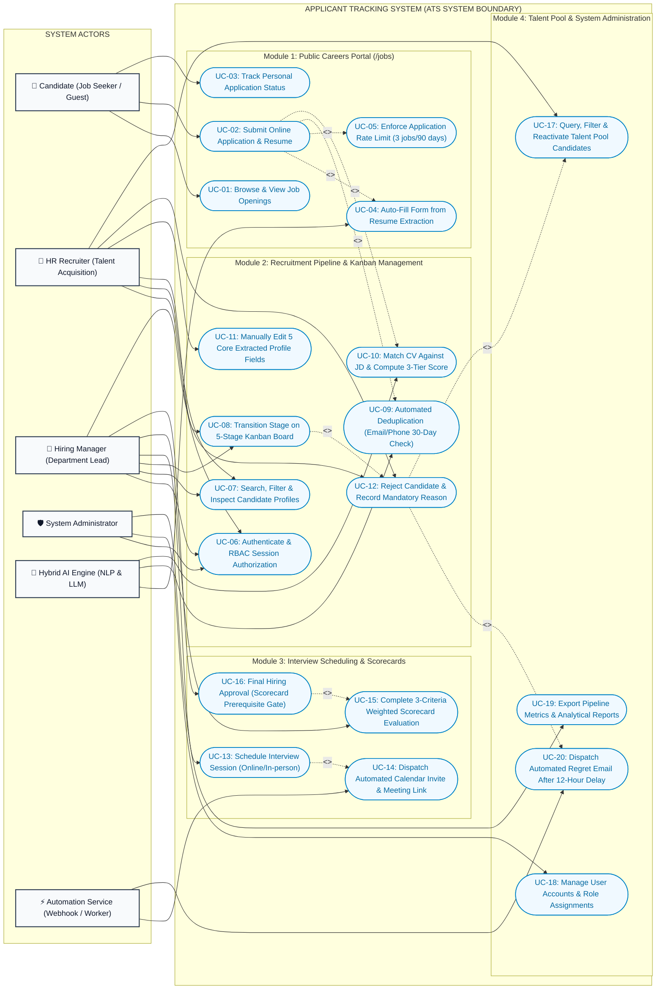

# DIAGRAM 03: SYSTEM USE CASE MODEL & ACTOR INTERACTION MATRIX

> **Domain:** Recruitment Workflow Management & AI-Assisted Candidate Tracking  
> **Source Mermaid Script:** [`docs/diagrams/03_usecase_diagram.mmd`](file:///d:/ATS%20project/docs/diagrams/03_usecase_diagram.mmd)  
> **Specification Standard:** UML 2.5 Use Case Metamodel  
> **Documentation Standard:** Universal BA Toolkit (English Only Execution Standard).

---

## 1. Quick Export Guide (Mermaid Vector SVG / High-Res PNG)

The companion file [`03_usecase_diagram.mmd`](file:///d:/ATS%20project/docs/diagrams/03_usecase_diagram.mmd) contains clean, standard Mermaid flowchart syntax optimized for visualizing system boundaries, actors, and functional inclusions.

### Option A: Render & Export via Mermaid Live Editor (Instant Web Tool)
1. Open **[https://mermaid.live](https://mermaid.live)**.
2. Copy the entire code block from [`03_usecase_diagram.mmd`](file:///d:/ATS%20project/docs/diagrams/03_usecase_diagram.mmd) and paste it into the left-hand editor panel.
3. The comprehensive use case model with 6 actors and 20 functional use cases will render immediately.
4. Click **Actions -> Download SVG** to obtain a scalable vector image, or **Download PNG** (choose 2x or 3x scale) for presentations.

### Option B: Local CLI Export via Mermaid CLI (`mmdc`)
```powershell
# Install CLI globally (if needed)
npm install -g @mermaid-js/mermaid-cli

# Export crisp SVG and 3x PNG
mmdc -i docs/diagrams/03_usecase_diagram.mmd -o docs/diagrams/03_usecase_diagram.svg
mmdc -i docs/diagrams/03_usecase_diagram.mmd -o docs/diagrams/03_usecase_diagram.png -s 3
```

---

## 2. Visual Use Case Diagram (Embedded Mermaid)



---

## 3. Actor Taxonomy & Permission Matrix

| Actor Name | Type | Scope & Responsibility | Permissions & Accessible Stages |
| :--- | :--- | :--- | :--- |
| **Candidate** | Human (External) | Public job seeker interacting with the careers portal. | Browse jobs, submit CV, auto-fill form, verify status via email tracking token. |
| **HR Recruiter** | Human (Internal) | Operations specialist managing top-of-funnel candidate intake and screening. | View all jobs/candidates, edit 5 core CV fields, advance `NEW ➔ SCREENING`, reject candidates, manage Talent Pool. |
| **Hiring Manager** | Human (Internal) | Department team lead responsible for technical evaluations and hiring selections. | Review screened profiles, advance `SCREENING ➔ INTERVIEW ➔ HIRED`, schedule interviews, fill Scorecards, reject candidates. |
| **System Administrator** | Human (Internal) | Platform owner responsible for system configuration, security, and audit oversight. | User provisioning, RBAC role assignment, system logs audit, and business reporting export. |
| **Hybrid AI Engine** | System / Subsystem | Local NLP extractor (Layer 1) & Google Gemini LLM API (Layer 2). | Extract 5 core fields from resume text; compute JD semantic similarity (0–100%); identify profile duplicate signals. |
| **Automation Service** | System / Webhook | Background dispatcher and timer-driven webhook execution layer. | Dispatches interview calendar invites to candidate/HM; buffers rejection notices for 12 hours before sending. |

---

## 4. Comprehensive System Use Case Catalog (20 Functional Scenarios)

| Use Case ID | Use Case Name | Primary Actor | Secondary Actor(s) | Pre-condition | Post-condition | Description & Business Rules |
| :--- | :--- | :--- | :--- | :--- | :--- | :--- |
| **UC-01** | Browse & View Jobs | Candidate | — | Job status is `PUBLISHED`. | Job details, requirements, and benefits displayed. | Public access without login requirements. |
| **UC-02** | Submit Online Application | Candidate | AI Engine | Candidate selected an active job. | Application record created in database. | Validates file size (≤ 5MB) and magic bytes (`%PDF`, `PK`). **BRL-01**. |
| **UC-03** | Track Application Status | Candidate | — | Candidate holds valid tracking token or email. | Current pipeline stage displayed with friendly timeline. | Displays public status without revealing internal evaluator notes. |
| **UC-04** | Auto-Fill Form from Resume | Candidate | AI Engine | Candidate uploads resume document. | Form fields populated (Name, Email, Phone). | Local PDF parser extracts text instantly to reduce user friction. |
| **UC-05** | Enforce Application Limit | Candidate | — | Candidate submits application. | Validated or blocked if limit exceeded. | Caps applicant to maximum 3 applications within 90 days (`BRL-04`). |
| **UC-06** | Authenticate & RBAC Session | Internal Users | — | User enters corporate credentials. | Authenticated session with role-scoped token. | Enforces strict RBAC: Admin, Recruiter, Hiring Manager (`BRL-07`). |
| **UC-07** | Search & Filter Candidates | Recruiter, HM | — | User is logged in to recruitment console. | Filtered list/cards rendered on board. | Multi-factor filtering: by job, score tier, stage, date, or keyword. |
| **UC-08** | Transition Stage on Kanban | Recruiter, HM | — | Target candidate card exists in pipeline. | Stage updated; activity history logged. | Enforces Drag-and-Drop stage guardrails and role transitions. |
| **UC-09** | Automated Deduplication | AI Engine | System Database | Candidate submits application. | Duplicate linked or flagged for review. | Checks matching Email or Phone within 30-day window (`BRL-02`). |
| **UC-10** | Semantic Match Scoring | AI Engine | — | CV parsed and JD requirements loaded. | 0–100 score and 3-tier indicator saved. | Generates Green (≥75%), Yellow (50–74%), Red (<50%) match badges. |
| **UC-11** | Manually Edit Extracted Fields | Recruiter | — | Candidate is in `NEW` or `SCREENING` stage. | Core fields updated; audit trail logged. | Allows recruiter to correct AI extraction errors (5 core fields). |
| **UC-12** | Reject Candidate with Reason | Recruiter, HM | Automation Service | Candidate is in any active stage. | Candidate moved to `REJECTED`; reason recorded. | Requires mandatory reason selection (`BRL-11`). Triggers UC-20 buffer. |
| **UC-13** | Schedule Interview Session | Hiring Manager | Recruiter | Candidate is in `SCREENING` or `INTERVIEW`. | Interview event scheduled with timestamp. | Captures date, time, format (Online/Offline), and interviewer list. |
| **UC-14** | Dispatch Automated Invite | Automation Service | Candidate, HM | Interview session scheduled (UC-13). | Calendar invite & email sent to participants. | Triggers n8n / webhook dispatcher to sync Google Calendar / Meet. |
| **UC-15** | Submit Weighted Scorecard | Hiring Manager | — | Interview completed or in progress. | Scorecard recorded with weighted score. | Scores Technical (40%), Culture (30%), Problem Solving (30%) (`BRL-08`). |
| **UC-16** | Final Hiring Approval | Hiring Manager | — | Candidate card in `INTERVIEW` stage. | Candidate transitioned to `HIRED`. | **BRL-06 Gate:** Enforces that at least 1 valid Scorecard exists. |
| **UC-17** | Query & Re-pool Talent Pool | Recruiter | — | Disqualified candidate archived in pool. | Candidate reactivated into new job pipeline. | Segregates into 3 talent tiers with 180-day retention countdown. |
| **UC-18** | Manage Users & Roles | Administrator | — | Administrator is authenticated. | User account created, modified, or revoked. | Allocates Recruiter, Hiring Manager, or Admin authority. |
| **UC-19** | Export Reports & Metrics | Administrator | — | System holds recruitment records. | CSV / Excel file downloaded. | Exports time-to-hire, funnel conversion, and source analytics. |
| **UC-20** | 12-Hour Delayed Regret Notice | Automation Service | Candidate | Candidate transitioned to `REJECTED`. | Polite regret email sent after 12-hour buffer. | Enforces brand-courtesy delay window (`BRL-05`). |

---

## 5. Architectural Inclusions & Extension Points

### Relationship Highlights
1. **Submission Pipeline Inclusions (`<<include>>`):**
   - When a candidate submits an online application (`UC-02`), the system automatically executes resume text auto-fill (`UC-04`), enforces application rate-limiting (`UC-05`), conducts deduplication matching (`UC-09`), and triggers AI semantic scoring against the job description (`UC-10`).
2. **Hiring Consensus Pre-condition (`<<include>>`):**
   - Executing final hiring approval (`UC-16`) strictly includes the verification of at least one complete evaluation scorecard (`UC-15`), fulfilling business rule `BRL-06`.
3. **Rejection & Grace Buffer Extensions (`<<extend>>` & `<<include>>`):**
   - Dragging a card to the `REJECTED` column during Kanban transition (`UC-08`) extends into the mandatory rejection modal (`UC-12`).
   - Selecting a rejection reason includes scheduling the 12-hour buffer service (`UC-20`) and extending the profile into the searchable Talent Pool repository (`UC-17`).
