# DIAGRAM 04: RELATIONAL DATABASE ENTITY RELATIONSHIP MODEL (3NF ERD)

> **Domain:** Recruitment Data Architecture, PII Governance & Candidate Tracking  
> **Source Mermaid Script:** [`docs/diagrams/04_database_erd.mmd`](file:///d:/ATS%20project/docs/diagrams/04_database_erd.mmd)  
> **Schema Definition:** [`prisma/schema.prisma`](file:///d:/ATS%20project/prisma/schema.prisma)  
> **Database Engines:** PostgreSQL (Cloud Production via Neon) / SQLite (Local Development)  
> **Documentation Standard:** Universal BA Toolkit (English Only Execution Standard).

---

## 1. Quick Export Guide (Vector SVG & Database Schematics)

The accompanying file [`04_database_erd.mmd`](file:///d:/ATS%20project/docs/diagrams/04_database_erd.mmd) is formatted in standard Mermaid Crow's foot notation.

### Option A: Render & Export via Mermaid Live Editor (Browser)
1. Navigate to **[https://mermaid.live](https://mermaid.live)**.
2. Copy and paste the script from [`04_database_erd.mmd`](file:///d:/ATS%20project/docs/diagrams/04_database_erd.mmd).
3. The 6 relational entities and cardinalities will render with clear Crow's foot links.
4. Export as **SVG** or high-resolution **PNG (3x)**.

### Option B: Visual Inspection via Prisma Studio
```powershell
# Launch interactive web GUI for the database
npx prisma studio
# Opens locally at http://localhost:5555
```

---

## 2. Visual Entity-Relationship Diagram (Embedded Mermaid)

```mermaid
erDiagram
    %% =========================================================================
    %% ATS — APPLICANT TRACKING SYSTEM DATABASE ERD (CROW'S FOOT NOTATION)
    %% Fully Normalized (3NF) relational model with automated workflows and audit logs
    %% =========================================================================

    USERS ||--o{ JOBS : "creates / manages"
    USERS ||--o{ EVALUATIONS : "conducts (Scorecard)"
    USERS ||--o{ AUDIT_LOGS : "executes action"

    JOBS ||--o{ APPLICATIONS : "receives"
    CANDIDATES ||--o{ APPLICATIONS : "submits"

    APPLICATIONS ||--o{ EVALUATIONS : "evaluated by"
    APPLICATIONS ||--o{ AUDIT_LOGS : "recorded in"

    USERS {
        int id PK "Primary Key (Auto-increment)"
        string full_name "Full legal name of staff member"
        string email UK "Corporate email address (Unique)"
        string password_hash "BCrypt hashed security credential"
        string role "RBAC Role: ADMIN | HR | HIRING_MANAGER"
        boolean is_active "Account state (active/inactive)"
        timestamp created_at "Account creation timestamp"
    }

    JOBS {
        int id PK "Primary Key (Job Opening ID)"
        int creator_id FK "References USERS.id"
        string title "Official job title"
        string department "Organizational department"
        string location "Office location or Remote status"
        string employment_type "Full-time | Part-time | Contract"
        text requirements_jd "Job description & qualifications"
        int min_experience_years "Minimum years of required experience"
        string required_skills "JSON Array: mandatory technical skills"
        int target_headcount "Approved hiring quota (BRL-13)"
        int max_active_interviews "Concurrency limit for interviews (3x headcount)"
        string status "Posting status: ACTIVE | CLOSED"
        timestamp created_at "Date and time of job posting"
    }

    CANDIDATES {
        int id PK "Primary Key (Candidate ID)"
        string full_name "Candidate full name from application form"
        string email UK "Contact email address (Part of BRL-02 key)"
        string phone UK "Contact telephone number (Part of BRL-02 key)"
        string cv_extracted_name "Secondary snapshot name extracted by AI"
        string cv_extracted_email "Secondary snapshot email extracted by AI"
        string cv_extracted_phone "Secondary snapshot phone extracted by AI"
        string cv_file_hash "SHA-256 fingerprint for Layer 2 duplicate detection"
        int experience_years "Calculated cumulative experience years"
        string parsed_skills "JSON Array: skills extracted by AI parser"
        string parsed_education "JSON Array: academic credentials & degrees"
        string parsed_experience "JSON Array: past employers and positions"
        string certificates "JSON Array: verified external certificates"
        string cv_file_url "Secure file path or object storage URL"
        text cv_text "Raw parsed textual content from PDF/DOCX"
        timestamp created_at "Candidate profile creation timestamp"
    }

    APPLICATIONS {
        int id PK "Primary Key (Application Record ID)"
        int candidate_id FK "References CANDIDATES.id (Cascade delete)"
        int job_id FK "References JOBS.id (Cascade delete)"
        string source "Channel: CAREER_SITE | LINKEDIN | REFERRAL | HEADHUNTER"
        string current_stage "Kanban: NEW | SCREENING | INTERVIEW | HIRED | REJECTED"
        float ai_match_score "Semantic JD match percentage (0.0 to 100.0%)"
        text ai_match_rationale "Detailed reasoning from AI semantic evaluator"
        string ai_matched_skills "JSON Array: candidate skills matching JD"
        string ai_missing_skills "JSON Array: JD criteria missing from CV"
        timestamp stage_updated_at "Timestamp of last pipeline stage change"
        timestamp email_scheduled_at "BRL-05 Rejection delay buffer target (+12h)"
        boolean is_email_sent "Status of outbound email dispatch"
        boolean is_interview_invite_sent "Automated calendar invitation flag"
        boolean is_telegram_notified "Internal team Telegram notification flag"
        int repooled_from_id "Previous Application ID if sourced from Talent Pool"
        boolean is_starred "High-priority bookmark indicator"
        boolean is_viewed "HR initial review indicator"
        timestamp viewed_at "Timestamp when HR first opened profile"
        timestamp interview_date "Scheduled interview date and time"
        string interview_format "Format: ONLINE | OFFLINE"
        string interview_location "Google Meet URL or Conference Room ID"
        text interview_notes "Candidate preparation instructions"
        text interview_interviewer_notes "Confidential briefing for interviewers"
        text interview_post_notes "Post-session debrief summary"
        string interview_email_option "Dispatch mode: AUTO_N8N | MANUAL_CUSTOM | NONE"
        string custom_email_subject "Custom email subject line"
        text custom_email_body "Custom email body text"
        string rejection_reason "BRL-11: Mandatory structured rejection reason code"
        string contact_mismatch_level "BRL-12: NONE | MINOR | CRITICAL | UNREADABLE"
        string contact_mismatch_note "Audit note on Form vs CV mismatch"
        int duplicate_warning_app_id "ID of potentially duplicated application"
        string duplicate_warning_note "Reasoning for duplicate warning flag"
        timestamp created_at "Application submission timestamp"
    }

    EVALUATIONS {
        int id PK "Primary Key (Scorecard ID)"
        int application_id FK "References APPLICATIONS.id"
        int evaluator_id FK "References USERS.id"
        string round "Interview round title (e.g., Round 1 Technical)"
        int technical_score "Rating 1-5 (Weight 40%)"
        int communication_score "Rating 1-5 (Weight 30%)"
        int cultural_fit_score "Rating 1-5 (Weight 30%)"
        float overall_score "Weighted aggregate: (tech*0.4 + comm*0.3 + cult*0.3)"
        string recommendation "HIRE | STRONG_HIRE | NO_HIRE | STRONG_NO_HIRE"
        string level_recommendation "Seniority level: JUNIOR | MIDDLE | SENIOR | LEAD"
        text strengths "Primary candidate strengths & qualifications"
        text weaknesses "Observed gaps or risk areas"
        text technical_notes "Detailed technical domain assessment notes"
        text communication_notes "Interpersonal & presentation assessment notes"
        text culture_notes "Workplace values & alignment assessment notes"
        text hire_reason "Summary rationale for final recommendation"
        text comments "Additional evaluator notes"
        timestamp created_at "Scorecard submission timestamp"
    }

    AUDIT_LOGS {
        int id PK "Primary Key (Audit Record ID)"
        int application_id FK "References APPLICATIONS.id"
        int user_id FK "References USERS.id (Null for automated events)"
        string from_stage "Origin pipeline stage"
        string to_stage "Destination pipeline stage"
        string action "Event: STAGE_CHANGE | SCORECARD_EVALUATE | PROFILE_EDITED"
        string reason "Audit justification or rejection reason code"
        timestamp created_at "Event timestamp"
    }
```



---

## 3. Relational Entity Specifications

### Entity 1: `users` (System Users & Identity)
- **Role:** Centralized authentication and RBAC identity directory.
- **Key Fields:** `id` (PK), `email` (Unique UK), `password_hash`, `role` (`ADMIN`, `HR`, `HIRING_MANAGER`).
- **Integrity Rule:** Soft deletion via `is_active = false` to preserve historical scorecard evaluations and audit log references.

### Entity 2: `jobs` (Requisition Headcount & JD Specifications)
- **Role:** Job openings, department assignments, and target recruitment quotas.
- **Key Fields:** `id` (PK), `creator_id` (FK), `target_headcount` (`BRL-13`), `max_active_interviews` (concurrency guard: `3 * target_headcount`).
- **Integrity Rule:** Cascades deletion to associated applications only under controlled administrative archiving.

### Entity 3: `candidates` (Master Candidate Profiles)
- **Role:** Deduplicated person record holding primary contact details and AI parsing snapshots.
- **Key Fields:** `id` (PK), `email` + `phone` composite uniqueness (`BRL-02`), `cv_file_hash` (SHA-256 for file duplicate detection), `cv_text` (unstructured text archive).
- **Secondary Snapshot Fields:** `cv_extracted_name`, `cv_extracted_email`, `cv_extracted_phone` prevent silent overwrites of user-entered form data while flagging contact discrepancies (`BRL-12`).

### Entity 4: `applications` (Pipeline Tracking & AI Scoring)
- **Role:** Central transaction entity mapping a candidate to a specific job opening across the 5 Kanban stages.
- **Key Fields:** `id` (PK), `candidate_id` (FK), `job_id` (FK), `current_stage` (`NEW`, `SCREENING`, `INTERVIEW`, `HIRED`, `REJECTED`), `ai_match_score` (0.0 to 100.0).
- **Automation Flags:** `is_interview_invite_sent` (automated calendar invite), `is_telegram_notified` (team alert), `email_scheduled_at` (12-hour delayed rejection buffer `BRL-05`).

### Entity 5: `evaluations` (Interview Scorecards)
- **Role:** Structured, quantitative interview feedback forms completed by technical evaluators.
- **Key Fields:** `id` (PK), `application_id` (FK), `evaluator_id` (FK), `overall_score` (calculated weighted rating `BRL-08`), `recommendation` (`STRONG_HIRE`, `HIRE`, `NO_HIRE`, `STRONG_NO_HIRE`).
- **Integrity Rule:** Mandatory prerequisite for advancing any candidate to `HIRED` (`BRL-06 Gate`).

### Entity 6: `audit_logs` (System Traceability & Compliance Trail)
- **Role:** Immutable append-only audit trail logging every stage transition, CV edit, and rejection reason.
- **Key Fields:** `id` (PK), `application_id` (FK), `user_id` (FK nullable for background automation), `action`, `from_stage`, `to_stage`, `reason`.

---

## 4. Personally Identifiable Information (PII) Protection & Data Masking Matrix

| Table Name | Field Name | PII Classification | Security & Masking Standard | Authorized Visibility Scope |
| :--- | :--- | :--- | :--- | :--- |
| `users` | `password_hash` | Critical Credential | BCrypt irreversible hash (Salt rounds ≥ 10) | Never exposed in any API response or log. |
| `users` | `email` | Corporate Contact | Standard TLS encryption in transit | Visible to all authenticated internal users. |
| `candidates` | `phone` | Direct PII | Masking in list views: `+84 *** *** 888` | Unmasked only in drawer detail view by HR/HM. |
| `candidates` | `email` | Direct PII | Masking in public export: `j***n@example.com` | Unmasked in verified internal dashboard. |
| `candidates` | `cv_file_url` | Sensitive Document | Secure signed URL with 60-minute expiry | Access restricted to session-authenticated users. |
| `evaluations`| `technical_notes` | Confidential Internal | Full text stored with RBAC isolation | Restricted to HR and assigned Interviewers. |
| `audit_logs` | `reason` | Internal Feedback | Plain text audit record | Read-only access for HR, HM, and System Admin. |

---

## 5. Relational Integrity Rules (BRL Enforcement)

1. **Composite Uniqueness Deduplication (`BRL-02`):**
   - The database maintains a composite index on `(email, phone)` in the `candidates` table to prevent duplicate candidate creation. Subsequent submissions link to existing candidate records or produce duplicate warning flags.
2. **Hiring Guard (`BRL-06`):**
   - Application status cannot be updated to `HIRED` unless a query to `evaluations` returns `COUNT(id) >= 1` for the specified `application_id`.
3. **Mandatory Rejection Tracking (`BRL-11`):**
   - Whenever `current_stage` becomes `REJECTED`, the field `rejection_reason` must not be null. An associated record is simultaneously created in `audit_logs`.
4. **Headcount & Concurrency Limit (`BRL-13`):**
   - Total applications in `INTERVIEW` stage for a given job cannot exceed `max_active_interviews` (`3 * target_headcount`).
