# DIAGRAM 05: CANDIDATE APPLICATION LIFECYCLE FINITE STATE MACHINE (FSM)

> **Domain:** Application State Transitions, RBAC Stage Guardrails & Lifecycle Integrity  
> **Source Mermaid Script:** [`docs/diagrams/05_finite_state_machine.mmd`](file:///d:/ATS%20project/docs/diagrams/05_finite_state_machine.mmd)  
> **Specification Standard:** UML 2.5 State Machine Diagram (`stateDiagram-v2`)  
> **Documentation Standard:** Universal BA Toolkit (English Only Execution Standard).

---

## 1. Quick Export Guide (Vector SVG & State Diagrams)

The companion file [`05_finite_state_machine.mmd`](file:///d:/ATS%20project/docs/diagrams/05_finite_state_machine.mmd) utilizes clean Mermaid `stateDiagram-v2` syntax incorporating composite nested states, guard condition annotations, and terminal lifecycle transitions.

### Option A: Render & Export via Mermaid Live Editor (Browser)
1. Navigate to **[https://mermaid.live](https://mermaid.live)**.
2. Copy and paste the complete content of [`05_finite_state_machine.mmd`](file:///d:/ATS%20project/docs/diagrams/05_finite_state_machine.mmd).
3. The nested composite states (`NEW`, `SCREENING`, `INTERVIEW`, `REJECTED`) and transition vectors will render cleanly.
4. Export as **SVG** or **PNG (3x)**.

### Option B: Local CLI Export via Mermaid CLI (`mmdc`)
```powershell
mmdc -i docs/diagrams/05_finite_state_machine.mmd -o docs/diagrams/05_finite_state_machine.svg
mmdc -i docs/diagrams/05_finite_state_machine.mmd -o docs/diagrams/05_finite_state_machine.png -s 3
```

---

## 2. Visual State Machine Diagram (Embedded Mermaid)

```mermaid
stateDiagram-v2
    %% =========================================================================
    %% ATS — CANDIDATE APPLICATION FINITE STATE MACHINE (FSM)
    %% Standard UML State Machine with Composite States, Guards, and Transitions
    %% =========================================================================

    [*] --> NEW: Submit Application [Valid Resume & Rate Limit < 3/90d]

    state NEW {
        [*] --> IntakePending
        IntakePending --> DeduplicationCheck: Automated Intake
        DeduplicationCheck --> AIParsingAndScoring: [Unique Profile BRL-02]
        DeduplicationCheck --> DuplicateMerged: [Duplicate Profile Detected]
        DuplicateMerged --> AIParsingAndScoring
        AIParsingAndScoring --> ReadyForScreening: Extract 5 Core Fields & 3-Tier Match Score
        ReadyForScreening --> [*]
    }

    state SCREENING {
        [*] --> UnderHRReview
        UnderHRReview --> TechnicalLeadEvaluation: Recruiter Shortlists Candidate
        TechnicalLeadEvaluation --> [*]
    }

    state INTERVIEW {
        [*] --> InterviewScheduled: Pick Date/Time & Trigger Calendar Invite
        InterviewScheduled --> ScorecardPending: Session Conducted
        ScorecardPending --> ScorecardCompleted: Evaluator Submits 3-Criteria Weighted Rating [BRL-08]
        ScorecardCompleted --> [*]
    }

    state REJECTED {
        [*] --> RejectionBuffered: Mandate Reason Selected [BRL-11]
        RejectionBuffered --> OutboundEmailDispatched: 12-Hour Timer Elapses [BRL-05]
        OutboundEmailDispatched --> TalentPoolArchived: Categorize into 3 Retention Tiers
        TalentPoolArchived --> [*]
    }

    %% STATE TRANSITIONS WITH GUARDS
    NEW --> SCREENING: HR approves profile [Actor: HR / Admin]
    NEW --> REJECTED: HR rejects profile [Reason required BRL-11]

    SCREENING --> INTERVIEW: HM approves for interview [Actor: HM / Admin; Guard: Active Interviews <= 3x Quota BRL-13]
    SCREENING --> REJECTED: HM rejects candidate [Reason required BRL-11]

    INTERVIEW --> HIRED: Final Hiring Approval [Actor: HM / Admin; Guard: Valid Scorecard count >= 1 BRL-06]
    INTERVIEW --> REJECTED: Candidate declined [Reason required BRL-11]

    %% TALENT POOL REACTIVATION (RE-POOL)
    REJECTED --> SCREENING: Recruiter re-pools candidate [Guard: Age <= 180 days & Active Job Available]

    %% TERMINAL STATES
    HIRED --> [*]: Candidate Onboarded & Handoff Complete
    REJECTED --> [*]: Exceeds 180-Day Retention Lifecycle
```



---

## 3. State Taxonomy & Lifecycle Definitions

| State Name | State Category | Technical Code | Description & Invariant Properties |
| :--- | :--- | :--- | :--- |
| `NEW` | Initial Composite | `STAGE_NEW` | Application record initialized. AI extraction and 3-tier scoring executed. Awaits initial HR human inspection. |
| `SCREENING` | Intermediate Composite | `STAGE_SCREENING` | Candidate has passed preliminary intake. Under active review by Recruiter and Hiring Manager. |
| `INTERVIEW` | Intermediate Composite | `STAGE_INTERVIEW` | Candidate approved for technical interviews. Scheduling created; Scorecard evaluation pending or submitted. |
| `HIRED` | Terminal Successful | `STAGE_HIRED` | Candidate selected and accepted offer. Closed successfully; transitions to onboarding workflow. |
| `REJECTED` | Terminal Buffered / Archived | `STAGE_REJECTED` | Application closed for current requisition. 12-hour delayed regret email queued; candidate archived in Talent Pool. |

---

## 4. Comprehensive 6-Column State Transition Matrix

| Current State | Trigger Event | Guard Condition (Business Rule) | Target State | Authorized Actor | Error Code on Violation |
| :--- | :--- | :--- | :--- | :--- | :--- |
| `[*]` (None) | Candidate submits application | Valid file magic bytes & application velocity ≤ 3/90d (`BRL-04`) | `NEW` | Guest / Candidate | `ERR_RATE_LIMIT_EXCEEDED` (429) / `ERR_INVALID_FILE` (400) |
| `NEW` | Recruiter reviews and approves | User holds `HR` or `ADMIN` role | `SCREENING` | HR Recruiter, Admin | `ERR_FORBIDDEN_ROLE` (403) |
| `NEW` | Recruiter rejects profile | Reason string is provided and non-empty (`BRL-11`) | `REJECTED` | HR Recruiter, Admin | `ERR_MANDATORY_REJECTION_REASON` (422) |
| `NEW` | Direct jump to `INTERVIEW` or `HIRED` | Stage skipping disallowed by workflow policy | *Blocked* | Any Actor | `ERR_INVALID_STAGE_TRANSITION` (400) |
| `SCREENING` | Hiring Manager approves for interview | User is `HIRING_MANAGER` or `ADMIN`; Active interviews in job ≤ `3 * targetHeadcount` (`BRL-13`) | `INTERVIEW` | Hiring Manager, Admin | `ERR_INTERVIEW_QUOTA_EXCEEDED` (422) / `ERR_FORBIDDEN_ROLE` (403) |
| `SCREENING` | Hiring Manager / HR rejects | Structured rejection reason provided (`BRL-11`) | `REJECTED` | Hiring Manager, HR, Admin | `ERR_MANDATORY_REJECTION_REASON` (422) |
| `INTERVIEW` | Final hiring consensus reached | **Scorecard Gate:** At least 1 completed Scorecard exists for this application (`BRL-06`) | `HIRED` | Hiring Manager, Admin | `ERR_MISSING_SCORECARD` (422) |
| `INTERVIEW` | Candidate fails interview | Reason recorded with evaluator notes (`BRL-11`) | `REJECTED` | Hiring Manager, Admin | `ERR_MANDATORY_REJECTION_REASON` (422) |
| `REJECTED` | Recruiter re-pools candidate for active job | Application created ≤ 180 days ago; Target job is `ACTIVE` | `SCREENING` | HR Recruiter, Admin | `ERR_CANDIDATE_LIFECYCLE_EXPIRED` (410) |
| `HIRED` | Attempt to modify stage | Hired state is terminal | *Blocked* | Any Actor | `ERR_IMMUTABLE_TERMINAL_STATE` (400) |

---

## 5. Critical State Transition Guards Deep Dive

### 1. Scorecard Prerequisite Gate (`BRL-06`)
- **Vulnerability Prevented:** Prevents informal or biased verbal hiring without auditable evaluation records.
- **Enforcement Mechanism:** The backend transition handler queries `prisma.evaluation.count({ where: { applicationId } })`. If result equals `0`, the HTTP request fails with `422 Unprocessable Entity` and the UI displays an actionable alert instructing the user to complete the Scorecard first.

### 2. Mandatory Rejection Reason (`BRL-11`)
- **Vulnerability Prevented:** Prevents ambiguous or unrecorded candidate dismissals that compromise recruitment analytics and legal compliance.
- **Enforcement Mechanism:** Rejecting a candidate card pops up a mandatory dialog with 6 structured reason codes (e.g., *Underqualified*, *Salary Mismatch*, *Culture Fit*, *Declined Offer*). The transition payload must contain a valid `rejectionReason`.

### 3. Automated 12-Hour Rejection Buffer (`BRL-05`)
- **Purpose:** Candidates rejected immediately after submission experience poor employer branding. 
- **Enforcement Mechanism:** When transitioning to `REJECTED`, `emailScheduledAt` is set to `now() + 12 hours`. The outbound automation queue processes regret emails only after the timestamp matures.
