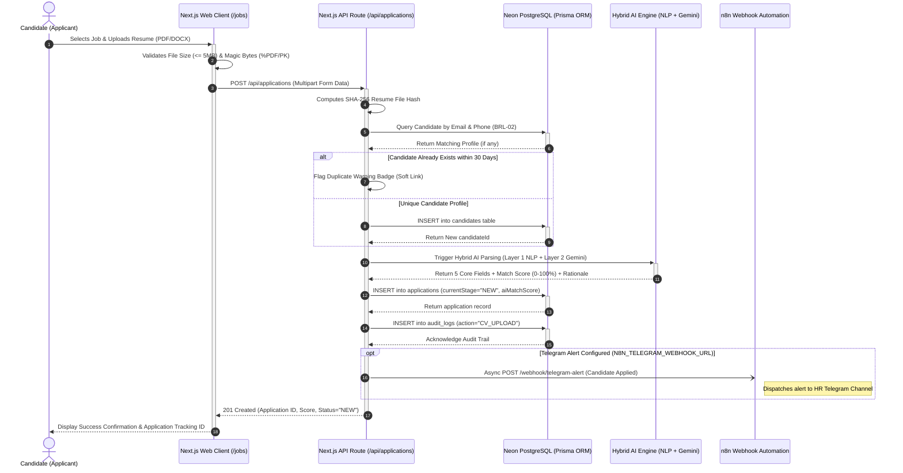
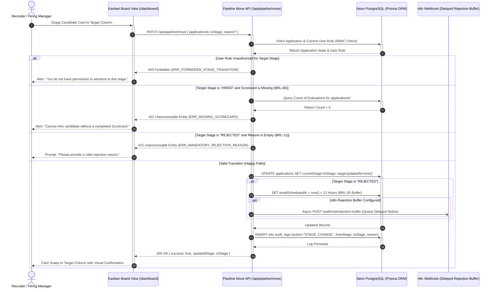
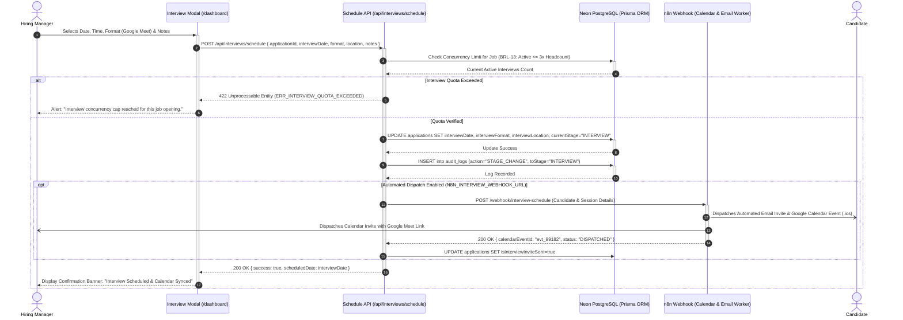

# DIAGRAM 06: CORE SYSTEM SEQUENCE DIAGRAMS & API MESSAGE CONTRACTS

> **Domain:** API Message Orchestration, Micro-Interactions & Service Workflows  
> **Source Mermaid Script:** [`docs/diagrams/06_system_sequence_diagrams.mmd`](file:///d:/ATS%20project/docs/diagrams/06_system_sequence_diagrams.mmd)  
> **Specification Standard:** UML 2.5 Interaction Sequence Diagram  
> **Documentation Standard:** Universal BA Toolkit (English Only Execution Standard).

---

## 1. Quick Export Guide (Vector SVG & Sequence Charts)

The companion file [`06_system_sequence_diagrams.mmd`](file:///d:/ATS%20project/docs/diagrams/06_system_sequence_diagrams.mmd) contains standard Mermaid `sequenceDiagram` definitions featuring automatic message numbering (`autonumber`), activation lifelines, and conditional fragments (`alt`, `else`, `opt`).

### Option A: Render & Export via Mermaid Live Editor (Browser)
1. Navigate to **[https://mermaid.live](https://mermaid.live)**.
2. Paste any individual flow or the complete sequence script into the editor.
3. Observe the left-to-right lifeline progression and structured error branches.
4. Export as **SVG** for crisp documentation embedding or **PNG (3x)**.

### Option B: Local CLI Export via Mermaid CLI (`mmdc`)
```powershell
mmdc -i docs/diagrams/06_system_sequence_diagrams.mmd -o docs/diagrams/06_system_sequence_diagrams.svg
```

---

## 2. Visual Sequence Flows (Embedded Mermaid)

### Flow 1: Candidate Application Intake, Deduplication & Hybrid AI Scoring



---

### Flow 2: Kanban Drag-and-Drop Stage Transition with Guard Checks



---

### Flow 3: Interview Scheduling & Automated Calendar Integration



---

## 3. Core API Message Specifications

| Flow ID | HTTP Method & Route | Request Payload Schema | Success Code | Error Code & Scenarios |
| :--- | :--- | :--- | :--- | :--- |
| **Flow 1** | `POST /api/applications` | `FormData: { jobId, fullName, email, phone, resumeFile }` | `201 Created` | `400 ERR_INVALID_FILE_TYPE`<br>`429 ERR_RATE_LIMIT_EXCEEDED` |
| **Flow 2** | `PATCH /api/pipeline/move` | `{ applicationId: number, toStage: string, reason?: string }` | `200 OK` | `403 ERR_FORBIDDEN_STAGE_TRANSITION`<br>`422 ERR_MISSING_SCORECARD`<br>`422 ERR_MANDATORY_REJECTION_REASON` |
| **Flow 3** | `POST /api/interviews/schedule` | `{ applicationId: number, interviewDate: string, format: string, location: string }` | `200 OK` | `422 ERR_INTERVIEW_QUOTA_EXCEEDED`<br>`404 ERR_APPLICATION_NOT_FOUND` |
| **Flow 4** | `POST /api/evaluations` | `{ applicationId: number, technicalScore: 1-5, communicationScore: 1-5, culturalFitScore: 1-5, recommendation: string }` | `201 Created` | `400 ERR_INVALID_SCORE_RANGE`<br>`401 ERR_UNAUTHORIZED` |

---

## 4. Asynchronous Integration Architecture

### 1. Hybrid AI Extraction Engine
- **Synchronous Phase:** Local Node.js stream parsing extracts raw text from PDF/DOCX via `pdf-parse` / `mammoth` (< 500ms).
- **Asynchronous Phase:** Structured prompting to Google Gemini API (`@google/genai`) runs with `temperature: 0` to yield deterministic 5-core-field JSON extraction and a 3-tier Match Score against the job description.

### 2. External n8n Webhook Automation
- Configured via environment variables (`N8N_INTERVIEW_WEBHOOK_URL`, `N8N_TELEGRAM_WEBHOOK_URL`, `N8N_REJECTION_WEBHOOK_URL`).
- **Resilience Strategy:** The Next.js backend issues outbound HTTP requests with a strict 7-second timeout. If the webhook endpoint is unreachable or delayed, the backend logs the warning without crashing the core user experience or blocking database persistence.
