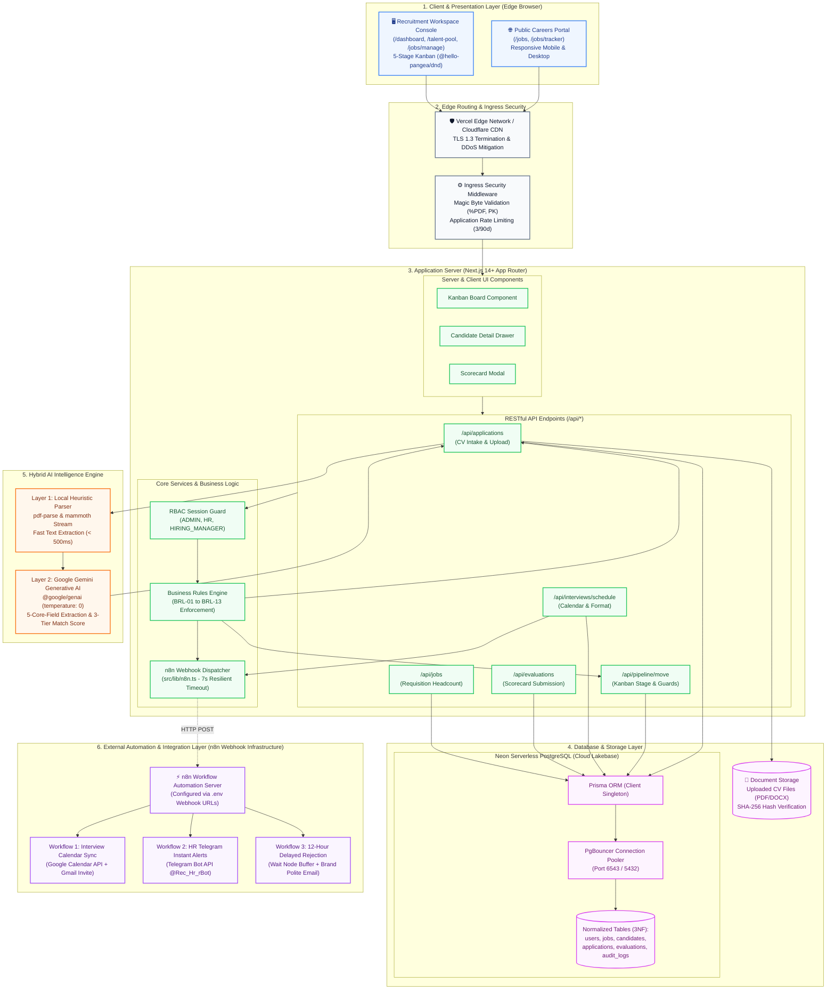

# DIAGRAM 07: CLOUD & FULLSTACK SYSTEM ARCHITECTURE TOPOLOGY

> **Domain:** Cloud Infrastructure, Micro-Services Topology & Automation Ecosystem  
> **Source Mermaid Script:** [`docs/diagrams/07_cloud_architecture.mmd`](file:///d:/ATS%20project/docs/diagrams/07_cloud_architecture.mmd)  
> **Specification Standard:** Multi-Tier Distributed Cloud Architecture  
> **Documentation Standard:** Universal BA Toolkit (English Only Execution Standard).

---

## 1. Quick Export Guide (Vector SVG & Infrastructure Topology)

The companion file [`07_cloud_architecture.mmd`](file:///d:/ATS%20project/docs/diagrams/07_cloud_architecture.mmd) illustrates the multi-tier physical and logical layout of the ATS system across edge delivery, application compute, persistence, AI inference, and background webhooks.

### Option A: Render & Export via Mermaid Live Editor (Browser)
1. Open **[https://mermaid.live](https://mermaid.live)**.
2. Copy the code block from [`07_cloud_architecture.mmd`](file:///d:/ATS%20project/docs/diagrams/07_cloud_architecture.mmd) and paste it into the editor.
3. The 6 architectural tiers with visual boundary boxes and directional dataflows will render instantly.
4. Export as **SVG** or **PNG (3x)**.

### Option B: Local CLI Export via Mermaid CLI (`mmdc`)
```powershell
mmdc -i docs/diagrams/07_cloud_architecture.mmd -o docs/diagrams/07_cloud_architecture.svg
```

---

## 2. Visual Architecture Diagram (Embedded Mermaid)



---

## 3. Multi-Tier Architecture Specifications

| Architectural Tier | Primary Technology | Hosting & Runtime | Responsibilities & Boundaries |
| :--- | :--- | :--- | :--- |
| **Tier 1: Client & Presentation** | Next.js 14, React 18, Tailwind CSS, `@hello-pangea/dnd` | Modern Web Browsers | Renders responsive careers portal (`/jobs`) and recruiter workspace (`/dashboard`) with visual calm 60-30-10 palette. |
| **Tier 2: Edge Routing & Security** | Vercel Edge Middleware | Vercel Global Edge Network | Enforces TLS 1.3 termination, DDOS mitigation, IP rate-limiting, and resume file magic byte inspection (`%PDF`, `PK`). |
| **Tier 3: Application Server** | Next.js App Router (Node.js runtime) | Vercel Serverless Functions | Hosts business logic, RBAC session authorization, RESTful API endpoints (`/api/*`), and resilience dispatchers. |
| **Tier 4: Database & Storage** | Neon Serverless PostgreSQL + Prisma ORM | AWS us-east-1 (Neon Lakebase) | Persists normalized 3NF relational data; handles connection pooling via PgBouncer with high-concurrency scaling. |
| **Tier 5: Hybrid AI Engine** | Local NLP stream + Google Gemini API (`@google/genai`) | Serverless Node.js Worker | Ingests PDF/DOCX resumes, extracts 5 core fields, computes 0–100% semantic score against JD, and provides explanation badges. |
| **Tier 6: Automation & Webhooks** | n8n Workflow Automation Platform | Self-hosted Docker / Cloud Node | Dispatches interview invitations with Google Calendar sync, delivers instant HR Telegram notifications, and manages the 12h rejection buffer. |

---

## 4. Security, High Availability & Resilience Policies

### 1. Ingress File Security & Magic Byte Guard
- To prevent executable injection or MIME spoofing, incoming resume uploads undergo a 2-stage verification:
  1. **Magic Byte Verification:** Inspects binary buffer headers (`0x25 0x50 0x44 0x46` for PDF, `0x50 0x4B 0x03 0x04` for DOCX).
  2. **SHA-256 Fingerprint:** Hashes file bytes to detect duplicate file submissions instantly without re-invoking AI inference.

### 2. Resilient Automation Integration (Timeout & Circuit Protection)
- Outbound requests to the external n8n automation layer (`src/lib/n8n.ts`) are bounded by a **7-second timeout**.
- If the n8n container is down or unresponsive, the API returns a graceful operational warning rather than causing 500 crashes or rollbacks of core candidate records.

### 3. Database Connection Pooling & Zero-Scale
- Configured with `DATABASE_URL` pointing to Neon's pooled endpoint (`-pooler.c-2.postgres.neon.tech:6543`), optimizing connection reuse across serverless function instances.
- Zero-scale capability minimizes cloud costs during idle off-hours while maintaining sub-second cold starts.
