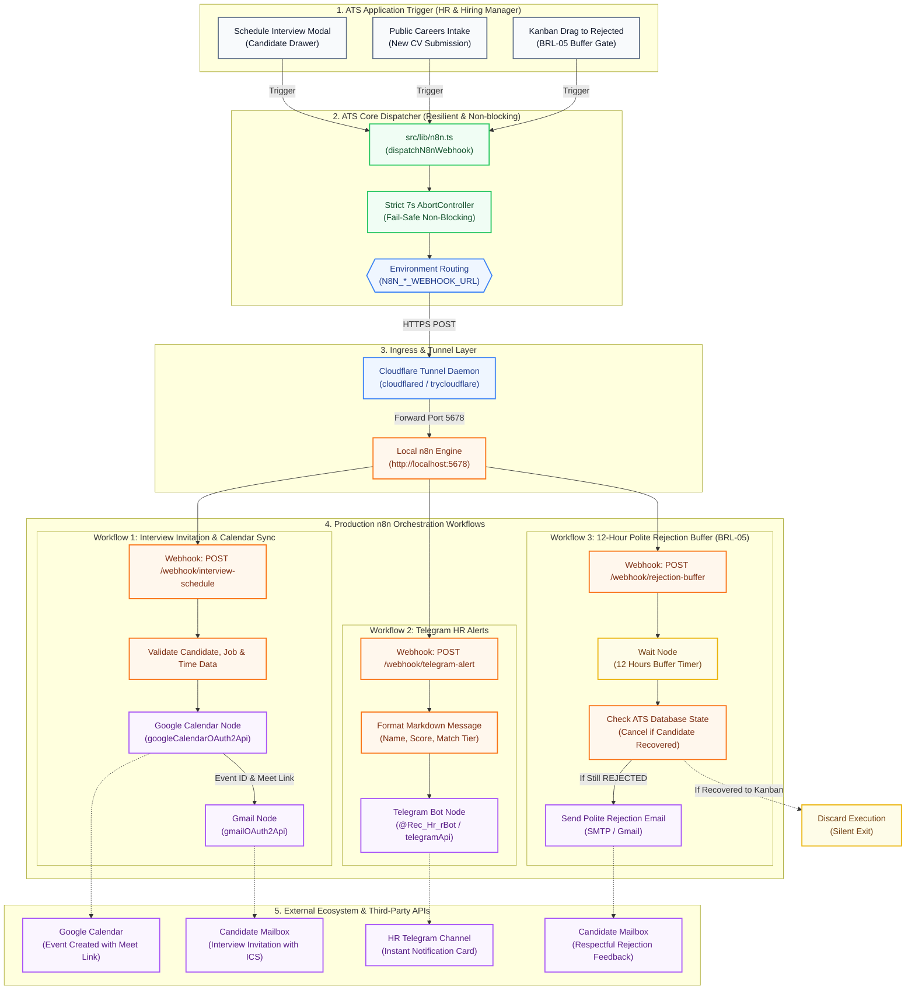

# DIAGRAM 08: ATS EVENT-DRIVEN AUTOMATION & N8N WORKFLOW TOPOLOGY

> **Domain:** External Workflow Automation, Event-Driven Webhooks & Third-Party Synchronization  
> **Source Mermaid Script:** [`docs/diagrams/08_automation_workflow_n8n.mmd`](file:///d:/ATS%20project/docs/diagrams/08_automation_workflow_n8n.mmd)  
> **Specification Standard:** Multi-Tier Event-Driven Micro-Workflow Topology  
> **Documentation Standard:** Universal BA Toolkit (English Only Execution Standard).

---

## 1. Quick Export Guide (Vector SVG & Infrastructure Topology)

The companion file [`08_automation_workflow_n8n.mmd`](file:///d:/ATS%20project/docs/diagrams/08_automation_workflow_n8n.mmd) illustrates the end-to-end decoupled webhook architecture between the ATS Next.js core, the ingress Cloudflare tunnel, the local n8n automation engine, and third-party APIs (Google Calendar, Gmail, Telegram Bot).

### Option A: Render & Export via Mermaid Live Editor (Browser)
1. Open **[https://mermaid.live](https://mermaid.live)**.
2. Copy the code block from [`08_automation_workflow_n8n.mmd`](file:///d:/ATS%20project/docs/diagrams/08_automation_workflow_n8n.mmd) and paste it into the editor.
3. The 5 architectural tiers (Client UI, Dispatcher, Tunnel, n8n Workflows, External APIs) with color-coded nodes will render instantly.
4. Export as **SVG** (recommended for Word/PDF embedding) or **PNG (3x)**.

### Option B: Local CLI Export via Mermaid CLI (`mmdc`)
```powershell
npx @mermaid-js/mermaid-cli -i docs/diagrams/08_automation_workflow_n8n.mmd -o docs/diagrams/08_automation_workflow_n8n.svg
npx @mermaid-js/mermaid-cli -i docs/diagrams/08_automation_workflow_n8n.mmd -o docs/diagrams/08_automation_workflow_n8n.png -s 3
```

---

## 2. Visual Architecture Diagram (Embedded Mermaid)



---

## 3. Workflow Specifications & Operational Parameters

| Workflow Name | Webhook Endpoint | Trigger Condition | Target External Services | SLA / Latency |
| :--- | :--- | :--- | :--- | :--- |
| **WF-01: Interview Scheduling** | `/webhook/interview-schedule` | Recruiter clicks *"Lên lịch & Gửi lời mời"* in Candidate Drawer | Google Calendar (OAuth2), Gmail (OAuth2) | < 3,000ms |
| **WF-02: Telegram HR Alerts** | `/webhook/telegram-alert` | Candidate applies on Public Portal & AI Match Score computed | Telegram Bot API (`@Rec_Hr_rBot`) | < 800ms |
| **WF-03: Polite Rejection Buffer** | `/webhook/rejection-buffer` | Recruiter drags card to `REJECTED` column (BRL-05) | n8n Wait Node (12h), SMTP / Gmail | 12 hours delay |

---

## 4. Resilience & Error Handling Architecture
1. **Circuit Breaker via `AbortController`:** ATS Core dispatches all webhooks via `fetch` wrapped in a 7-second abort controller. If the tunnel or n8n is offline, user experience remains completely responsive (HTTP 200 returned locally with fallback logging).
2. **Tunnel Ingress Resilience:** Cloudflare tunnel automatically recovers from IP renegotiation and reconnects to local port 5678.
3. **Idempotency & Rejection Recovery:** Workflow 3 queries the ATS database after the 12-hour wait period. If the candidate was dragged back to `SCREENING` or `INTERVIEW` (recovered), the execution terminates cleanly without sending rejection emails.
