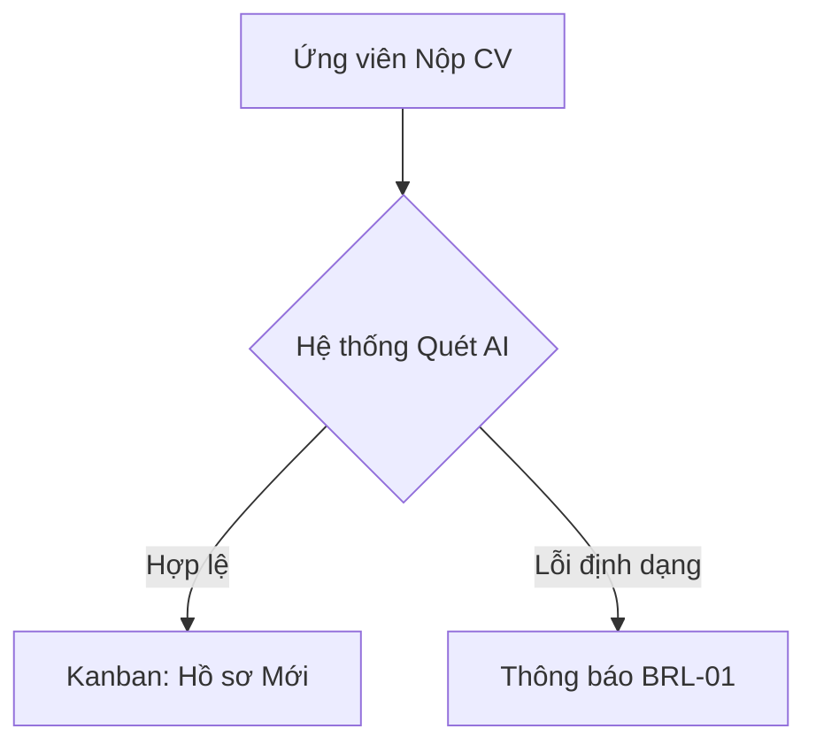

# CẨM NANG TOÀN DIỆN: HỆ THỐNG BIỂU ĐỒ (DIAGRAMS), PHẦN MỀM THIẾT KẾ & HƯỚNG DẪN NHÚNG CODE — ATS (APPLICANT TRACKING SYSTEM)

> **Dự án:** ATS — Applicant Tracking System  
> **Phiên bản tài liệu:** v2.2.0 (Bản Chốt Hoàn Thiện Nghiệm Thu)  
> **Tiêu chuẩn tài liệu:** Universal BA Toolkit & Spec-Driven Development (SDD)  
> **Thư mục lưu trữ:** [`docs/diagrams/`](file:///d:/ATS%20project/docs/diagrams/)

---

## 1. DANH MỤC TOÀN BỘ 8 BIỂU ĐỒ CHUẨN MỰC CỦA DỰ ÁN

| STT | Mã Biểu Đồ | Tên Biểu Đồ & Ý Nghĩa Nghiệp Vụ | Định Dạng File | File Nguồn | File Đặc Tả Đi Kèm |
| :---: | :---: | :--- | :---: | :--- | :--- |
| **01** | `DIAG-01-ASIS` | **Quy trình Tuyển dụng Hiện trạng (AS-IS):** Phản ánh quy trình thủ công 7 nút thắt, sàng lọc CV thủ công, nguy cơ bỏ sót ứng viên và trễ hạn SLA. | BPMN 2.0 XML + Markdown | [`01_as_is_recruitment_process_bpmn.bpmn`](file:///d:/ATS%20project/docs/diagrams/01_as_is_recruitment_process_bpmn.bpmn) | [`01_as_is_recruitment_process_bpmn.md`](file:///d:/ATS%20project/docs/diagrams/01_as_is_recruitment_process_bpmn.md) |
| **02** | `DIAG-02-TOBE` | **Quy trình Tuyển dụng Mục tiêu (TO-BE):** Tích hợp Hybrid AI 2 lớp, Kanban 5 cột, BRL-07 SLA, BRL-06 Stage Gate và Tự động hóa n8n. | BPMN 2.0 XML + Markdown | [`02_to_be_recruitment_process_bpmn.bpmn`](file:///d:/ATS%20project/docs/diagrams/02_to_be_recruitment_process_bpmn.bpmn) | [`02_to_be_recruitment_process_bpmn.md`](file:///d:/ATS%20project/docs/diagrams/02_to_be_recruitment_process_bpmn.md) |
| **03** | `DIAG-03-UC` | **Sơ đồ Ca Sử Dụng (Use Case Diagram):** Phân định ranh giới hệ thống, 3 nhóm Actor (`Candidate`, `HR Recruiter`, `Hiring Manager/Admin`), 8 ca sử dụng cốt lõi và quan hệ `<<include>>`/`<<extend>>`. | Mermaid UML (`.mmd`) | [`03_usecase_diagram.mmd`](file:///d:/ATS%20project/docs/diagrams/03_usecase_diagram.mmd) | [`03_usecase_diagram.md`](file:///d:/ATS%20project/docs/diagrams/03_usecase_diagram.md) |
| **04** | `DIAG-04-ERD` | **Sơ đồ Quan Hệ Thực Thể CSDL (Database ERD):** 8 thực thể dữ liệu quan hệ (`User`, `Job`, `Candidate`, `Application`, `Scorecard`, `AuditLog`, `SystemConfig`), chuẩn hóa 3NF, ràng buộc khóa ngoại và chỉ mục hiệu năng. | Mermaid ERD (`.mmd`) | [`04_database_erd.mmd`](file:///d:/ATS%20project/docs/diagrams/04_database_erd.mmd) | [`04_database_erd.md`](file:///d:/ATS%20project/docs/diagrams/04_database_erd.md) |
| **05** | `DIAG-05-FSM` | **Máy Trạng Thái Vòng Đời Ứng Tuyển (Finite State Machine - FSM):** 5 trạng thái Kanban (`NEW`, `SCREENING`, `INTERVIEW`, `HIRED`, `REJECTED`), điều kiện bảo vệ (Guard Conditions), phân quyền RBAC và cơ chế phục hồi hồ sơ loại. | Mermaid State (`.mmd`) | [`05_finite_state_machine.mmd`](file:///d:/ATS%20project/docs/diagrams/05_finite_state_machine.mmd) | [`05_finite_state_machine.md`](file:///d:/ATS%20project/docs/diagrams/05_finite_state_machine.md) |
| **06** | `DIAG-06-SEQ` | **Sơ đồ Tuần Tự Hệ Thống (System Sequence Diagrams):** 4 luồng tuần tự then chốt: (1) Nộp hồ sơ & Trích xuất AI, (2) Chấm điểm phù hợp JD, (3) Lên lịch phỏng vấn đồng bộ Google Calendar & Meet, (4) Bộ đệm từ chối 12h BRL-05. | Mermaid Sequence (`.mmd`) | [`06_system_sequence_diagrams.mmd`](file:///d:/ATS%20project/docs/diagrams/06_system_sequence_diagrams.mmd) | [`06_system_sequence_diagrams.md`](file:///d:/ATS%20project/docs/diagrams/06_system_sequence_diagrams.md) |
| **07** | `DIAG-07-ARCH` | **Kiến Trúc Đám Mây & Hệ Thống Fullstack (Cloud & System Architecture):** 6 phân tầng công nghệ (Client UI, Vercel Edge, Next.js Server Core, Hybrid AI Engine, Neon Serverless Postgres / S3 Storage, n8n Automation). | Mermaid Flowchart (`.mmd`) | [`07_cloud_architecture.mmd`](file:///d:/ATS%20project/docs/diagrams/07_cloud_architecture.mmd) | [`07_cloud_architecture.md`](file:///d:/ATS%20project/docs/diagrams/07_cloud_architecture.md) |
| **08** | `DIAG-08-N8N` | **Kiến Trúc Tự Động Hóa & Webhook n8n (Event-Driven Webhook Topology):** Cơ chế phát tín hiệu Webhook bất đồng bộ, Cloudflare Tunnel Ingress, bộ định tuyến n8n và 3 Workflow sản xuất (Google Calendar/Meet, Telegram Bot, 12h Rejection Buffer). | Mermaid Flowchart (`.mmd`) | [`08_automation_workflow_n8n.mmd`](file:///d:/ATS%20project/docs/diagrams/08_automation_workflow_n8n.mmd) | [`08_automation_workflow_n8n.md`](file:///d:/ATS%20project/docs/diagrams/08_automation_workflow_n8n.md) |

---

## 2. BẢNG PHÂN LOẠI PHẦN MỀM NÊN DÙNG ĐỂ VẼ, MỞ & CHỈNH SỬA

Tùy theo loại biểu đồ và nhu cầu làm việc (soạn thảo tài liệu Word, thuyết trình slide, làm việc nhóm trên Confluence/Notion hay lập trình trong VS Code), dưới đây là các công cụ tối ưu nhất được phân loại rõ ràng:

### A. Đối Với Biểu Đồ Quy Trình Nghiệp Vụ BPMN 2.0 (`.bpmn`)

| Tên Phần Mềm / Công Cụ | Loại Ứng Dụng | Mức Độ Khuyên Dùng | Ưu Điểm Nổi Bật | Cách Sử Dụng Với Dự Án ATS |
| :--- | :--- | :---: | :--- | :--- |
| **Camunda Modeler** | Desktop App (Win / Mac / Linux) | ⭐⭐⭐⭐⭐ (Khuyên Dùng Số 1) | Chuẩn quốc tế OMG BPMN 2.0; giao diện trực quan; hỗ trợ đầy đủ Pool, Lane, Service Task, Gateway; validate cú pháp chuẩn. Miễn phí 100%. | Tải tại [camunda.com/download/modeler](https://camunda.com/download/modeler/). Mở file `.bpmn` trong thư mục `docs/diagrams/` để chỉnh sửa và bấm **File ➔ Export as Image (SVG/PNG)**. |
| **bpmn.io (demo.bpmn.io)** | Web Browser (Trực tuyến) | ⭐⭐⭐⭐⭐ (Nhanh Nhất) | Không cần cài đặt bất kỳ phần mềm nào. Mở trình duyệt là xem và chỉnh sửa được ngay. | Truy cập [demo.bpmn.io](https://demo.bpmn.io). Kéo thả file `01_as_is...bpmn` hoặc `02_to_be...bpmn` vào trình duyệt để xem và xuất ảnh. |
| **BPMN Editor (VS Code Extension)** | Tiện ích mở rộng VS Code | ⭐⭐⭐⭐ | Xem và chỉnh sửa trực tiếp file `.bpmn` ngay trong giao diện lập trình VS Code. | Cài đặt extension `BPMN Editor` (bởi bpmn.io) từ VS Code Marketplace. Nhấp đúp vào file `.bpmn` để mở canvas vẽ trực quan. |
| **Draw.io / diagrams.net** | Web / Desktop App | ⭐⭐⭐⭐ | Bộ thư viện shape BPMN đầy đủ; khả năng dàn trang tự do, xuất file nhiều định dạng. | Truy cập [app.diagrams.net](https://app.diagrams.net), chọn shape library **BPMN**. |

---

### B. Đối Với Biểu Đồ Mermaid (`.mmd`, `.md` — ERD, Use Case, Sequence, State Machine, Architecture)

| Tên Phần Mềm / Công Cụ | Loại Ứng Dụng | Mức Độ Khuyên Dùng | Ưu Điểm Nổi Bật | Cách Sử Dụng Với Dự Án ATS |
| :--- | :--- | :---: | :--- | :--- |
| **Mermaid Live Editor** | Web Browser (`mermaid.live`) | ⭐⭐⭐⭐⭐ (Khuyên Dùng Số 1) | Trình biên dịch Mermaid chính thức; kiểm tra lỗi cú pháp tức thì (live linting); hỗ trợ đổi giao diện (Default, Neutral, Dark, Forest); xuất ảnh Vector SVG cực nét và PNG (độ phân giải 1x/2x/3x). | Truy cập [mermaid.live](https://mermaid.live). Copy toàn bộ nội dung từ file `.mmd` (ví dụ `04_database_erd.mmd`) dán vào ô bên trái. Bấm **Actions ➔ Download SVG** hoặc **PNG**. |
| **VS Code Markdown Preview Mermaid Support** | VS Code Extension | ⭐⭐⭐⭐⭐ (Lập Trình Viên) | Tự động kết xuất trực tiếp tất cả sơ đồ Mermaid khi xem file Markdown (`Ctrl + Shift + V`). | Cài extension `Markdown Preview Mermaid Support` (bởi Matt Bierner). Mọi file `.md` trong thư mục `docs/` sẽ tự động hiển thị sơ đồ trực quan. |
| **Mermaid CLI (`@mermaid-js/mermaid-cli` - `mmdc`)** | Command Line Tool (Node.js) | ⭐⭐⭐⭐ (Tự Động Hóa) | Biên dịch hàng loạt file `.mmd` thành `.svg` hoặc `.png` từ terminal mà không cần mở trình duyệt. | Chạy lệnh: `npx @mermaid-js/mermaid-cli -i docs/diagrams/04_database_erd.mmd -o docs/diagrams/04_database_erd.svg` |
| **Notion** | Ứng dụng Quản lý Tri thức | ⭐⭐⭐⭐⭐ (Làm Việc Nhóm) | Hỗ trợ Mermaid bản địa (Native Support). Hiển thị tương tác và zoom mượt mà. | Tạo block mới gõ `/code` ➔ Chọn ngôn ngữ **Mermaid** ➔ Dán code vào, sơ đồ sẽ tự động kết xuất đẹp mắt. |
| **Confluence / Jira** | Nền tảng Doanh nghiệp | ⭐⭐⭐⭐ | Quản lý tài liệu theo tiêu chuẩn doanh nghiệp lớn. | Chèn Macro **Mermaid Chart** hoặc **PlantUML/Mermaid Plugin** trên Confluence. |
| **Obsidian** | Ứng dụng Ghi chú Markdown | ⭐⭐⭐⭐⭐ | Hỗ trợ 100% cú pháp Mermaid và liên kết hai chiều (Backlinks). | Mở thư mục `docs/` dưới dạng Obsidian Vault để duyệt sơ đồ. |

---

### C. Đối Với Cơ Sở Dữ Liệu ERD & Mô Hình Hóa Dữ Liệu

| Tên Phần Mềm / Công Cụ | Loại Ứng Dụng | Ưu Điểm Nổi Bật | Cách Sử Dụng Với Dự Án ATS |
| :--- | :--- | :--- | :--- |
| **Prisma Studio** | Web GUI Nội Bộ | Giao diện trực quan tích hợp sẵn của dự án, xem dữ liệu thực tế và quan hệ bảng theo thời gian thực. | Chạy lệnh: `npx prisma studio` ➔ Truy cập `http://localhost:5555`. |
| **DBeaver Community** | Desktop App (Universal DB) | Kết nối trực tiếp SQLite (`prisma/dev.db`) hoặc PostgreSQL Neon để tự động tạo sơ đồ ERD từ schema cơ sở dữ liệu. | Tải tại [dbeaver.io](https://dbeaver.io). Kết nối vào CSDL và nhấp đúp vào schema để xem ERD tự sinh. |
| **dbdiagram.io** | Web Tool | Chuyên biệt cho việc thiết kế DBML và tạo quan hệ bảng nhanh qua mã. | Dán cú pháp schema hoặc import từ SQL. |

---

### D. Đối Với Sơ Đồ Kiến Trúc Hệ Thống & Tự Động Hóa

| Tên Phần Mềm / Công Cụ | Loại Ứng Dụng | Ưu Điểm Nổi Bật | Cách Sử Dụng Với Dự Án ATS |
| :--- | :--- | :--- | :--- |
| **n8n Canvas Editor** | Web GUI (`http://localhost:5678`) | Trực quan hóa toàn bộ node xử lý, luồng webhook, kiểm tra payload JSON input/output từng bước theo thời gian thực. | Đảm bảo n8n đang chạy ➔ Mở trình duyệt truy cập `http://localhost:5678` để xem 3 workflow sản xuất của ATS. |
| **Draw.io / diagrams.net** | Web / Desktop App | Thư viện icon phong phú chuẩn AWS, GCP, Vercel, Neon, Docker, Next.js. | Dùng khi cần vẽ sơ đồ kiến trúc minh họa nhiều màu sắc để báo cáo hội đồng cấp cao. |
| **Excalidraw** (`excalidraw.com`) | Web Browser | Phong cách vẽ tay tối giản (hand-drawn), hiện đại, rất được giới lập trình và startup ưa chuộng. | Dùng để vẽ phác thảo ý tưởng nhanh và brainstorm. |

---

## 3. HƯỚNG DẪN CHI TIẾT CÁCH NHÚNG MÃ NGUỒN BIỂU ĐỒ (CODE EMBEDDING GUIDE)

### Cách 1: Nhúng vào Tài Liệu Markdown (GitHub, GitLab, VS Code, Readme)
Sử dụng thẻ khối mã định danh `mermaid`:

````markdown

````

> **Kết quả:** GitHub, GitLab và VS Code sẽ tự động biên dịch khối mã trên thành sơ đồ trực quan tương tác.

---

### Cách 2: Nhúng vào Ứng Dụng Notion
1. Trong trang Notion, gõ `/code` và nhấn Enter để tạo một khối mã (Code Block).
2. Ở góc trên bên phải của khối mã, bấm vào menu chọn ngôn ngữ (mặc định là *JavaScript*) và chọn **Mermaid**.
3. Copy toàn bộ nội dung từ file `.mmd` (ví dụ `05_finite_state_machine.mmd`) và dán vào.
4. Notion sẽ ngay lập tức kết xuất thành sơ đồ đồ họa. Bạn có thể chuyển đổi giữa chế độ **Preview** (Xem hình vẽ), **Code** (Xem mã nguồn) hoặc **Split** (Xem song song cả hai).

---

### Cách 3: Nhúng vào Nền Tảng Atlassian Confluence / Jira
1. Khi chỉnh sửa trang Confluence, nhấn tổ hợp phím `/` hoặc chọn **Insert (+)** trên thanh công cụ.
2. Tìm kiếm Macro có tên **Mermaid Chart** hoặc **PlantUML / Mermaid Plugin**.
3. Dán đoạn mã Mermaid vào ô cấu hình.
4. Bấm **Insert / Save** để chèn sơ đồ vào văn bản tài liệu của dự án.

---

### Cách 4: Nhúng vào Báo Cáo Microsoft Word (.docx) & Bản In Doanh Nghiệp
Để đảm bảo biểu đồ trong tài liệu Word đạt **chuẩn in ấn chuyên nghiệp, không bị mờ hay vỡ nét (pixelated)**:
1. Mở file `.mmd` tương ứng tại `docs/diagrams/`.
2. Truy cập [mermaid.live](https://mermaid.live), dán mã nguồn vào.
3. Chọn định dạng xuất:
   - **Cách A (Tốt nhất cho in ấn):** Bấm **Download SVG**. Trong Microsoft Word, chọn **Insert ➔ Pictures ➔ This Device** và chọn file `.svg`. Microsoft Word (từ bản 2016 trở lên và Office 365) hỗ trợ đồ họa vector SVG nguyên bản, cho phép phóng to cực đại mà chữ và đường kẻ vẫn sắc nét tuyệt đối.
   - **Cách B (Tương thích cao):** Bấm **Download PNG**, chọn tỷ lệ phóng đại **Scale 3x** hoặc **4x** (độ phân giải cao 300 DPI) trước khi chèn vào Word.

---

### Cách 5: Nhúng vào Slide Thuyết Trình (PowerPoint, Google Slides, Canva)
1. Xuất file ảnh dưới dạng **SVG** (hoặc **PNG nền trong suốt - Transparent Background**).
2. Kéo thả file ảnh trực tiếp vào Slide.
3. Trong PowerPoint, bạn có thể nhấp chuột phải vào file SVG đã chèn và chọn **Convert to Shape** để tùy biến đổi màu từng thành phần theo bộ nhận diện thương hiệu.

---

## 4. QUY TRÌNH XUẤT HÀNG LOẠT VECTOR SVG / PNG BẰNG LỆNH TỰ ĐỘNG

Dự án đã chuẩn bị sẵn bộ lệnh xuất file tự động bằng Mermaid CLI. Khi cần xuất đồng loạt toàn bộ sơ đồ phục vụ làm báo cáo nghiệm thu:

```powershell
# Di chuyển vào thư mục dự án
cd "d:\ATS project"

# 1. Xuất Sơ đồ Ca Sử Dụng (Use Case Diagram)
npx @mermaid-js/mermaid-cli -i docs/diagrams/03_usecase_diagram.mmd -o docs/diagrams/03_usecase_diagram.svg

# 2. Xuất Cơ sở dữ liệu ERD
npx @mermaid-js/mermaid-cli -i docs/diagrams/04_database_erd.mmd -o docs/diagrams/04_database_erd.svg

# 3. Xuất Máy Trạng Thái FSM
npx @mermaid-js/mermaid-cli -i docs/diagrams/05_finite_state_machine.mmd -o docs/diagrams/05_finite_state_machine.svg

# 4. Xuất Sơ đồ Tuần Tự (Sequence Diagrams)
npx @mermaid-js/mermaid-cli -i docs/diagrams/06_system_sequence_diagrams.mmd -o docs/diagrams/06_system_sequence_diagrams.svg

# 5. Xuất Sơ đồ Kiến trúc Đám Mây
npx @mermaid-js/mermaid-cli -i docs/diagrams/07_cloud_architecture.mmd -o docs/diagrams/07_cloud_architecture.svg

# 6. Xuất Sơ đồ Tự động hóa n8n Webhook
npx @mermaid-js/mermaid-cli -i docs/diagrams/08_automation_workflow_n8n.mmd -o docs/diagrams/08_automation_workflow_n8n.svg
```

---

## 5. TỔNG KẾT & QUY CHUẨN ĐỒNG BỘ DỮ LIỆU
* **Nguyên tắc "Single Source of Truth":** Mọi logic nghiệp vụ trong biểu đồ (tên trạng thái, quy tắc phân quyền RBAC, mã lỗi `BRL-*`, chỉ số SLA) đều được đồng bộ 100% với tài liệu đặc tả tại `docs/ba/` và mã nguồn triển khai tại `src/`.
* **Không lưu biểu đồ ở dạng ảnh tĩnh không có mã nguồn:** Mọi sơ đồ trong dự án đều bắt buộc phải lưu kèm file mã nguồn (`.bpmn` hoặc `.mmd`) để đảm bảo khả năng bảo trì, mở rộng và cập nhật tự động trong tương lai.
