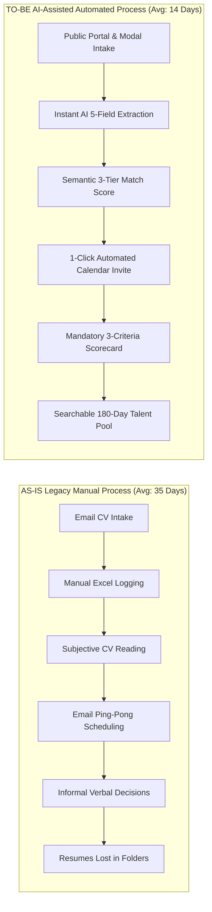

# BUSINESS REQUIREMENTS DOCUMENT (BRD)
## NEXT-GENERATION AI-ASSISTED APPLICANT TRACKING SYSTEM (ATS)

> **Document Classification:** Enterprise Confidential  
> **Prepared For:** Executive Leadership, HR Operations & Engineering Steering Committee  
> **Standard:** BABOK v3.0 / IEEE Enterprise Business Requirements Standard (English Only).

---

## 1. Executive Summary

Modern talent acquisition teams face acute operational bottlenecks: recruiters spend up to 40% of their working hours downloading unstructured resumes, manually entering candidate details into spreadsheets, screening applicants against evolving job criteria, and coordinating fragmented interview schedules via email. This manual latency leads to slow time-to-hire (averaging 35 days), high candidate drop-off rates, lost silver-medalist talent, and subjective, undocumented hiring decisions.

The **ATS (Applicant Tracking System)** platform delivers an AI-assisted, full-stack recruitment platform engineered to transform enterprise talent acquisition. Combining **local stream parsing** with **Google Gemini semantic intelligence**, the platform automates CV ingestion, extracts 5 core profile fields in sub-second time, scores candidate qualifications against job descriptions via an intuitive 3-tier indicator, enforces structured 3-criteria interview scorecards, and provides automated calendar invitations and brand-courtesy rejection buffers via n8n automation.

### Key Business Impact Projections
- **Time-to-Hire Reduction:** From 35 business days down to 14 business days (**60% reduction**).
- **Recruiter Screening Productivity:** 8–15 minutes of manual resume parsing reduced to < 3 seconds (**300x acceleration**).
- **Evaluation Caliber & Compliance:** 100% auditable digital scorecards eliminating informal hiring bias.
- **Talent Discovery Rate:** 100% preservation of silver-medalist profiles in a searchable 180-day Talent Pool.

---

## 2. Business Objectives & SMART Goals

| Goal Code | Strategic Objective | Baseline Metric | Target Metric | Target Timeline | Verification Method |
| :--- | :--- | :--- | :--- | :--- | :--- |
| **OBJ-01** | Accelerate Candidate Screening Cycle | 18 mins / resume | < 5 seconds / resume | Day 1 Post-Deployment | System telemetry & processing latency logs. |
| **OBJ-02** | Compress Total Time-to-Hire | 35 business days | ≤ 14 business days | 90 Days Post-Deployment | Quarterly recruitment velocity reports. |
| **OBJ-03** | Eliminate Unstructured & Biased Hiring | < 25% recorded evaluations | 100% mandatory scorecards | Immediate upon launch | Database constraint enforcement (`BRL-06`). |
| **OBJ-04** | Prevent Talent Leakage & Rehire Costs | 0% reusable talent (lost files) | ≥ 20% sourced from Talent Pool | 180 Days Post-Deployment | Talent pool re-pooling conversion metrics. |
| **OBJ-05** | Protect Candidate Brand Reputation | Immediate rejections cause dissatisfaction | 100% buffered (12-hour grace) | Immediate upon launch | Automated queue dispatch logs (`BRL-05`). |

---

## 3. AS-IS vs. TO-BE Operational Process Comparison

### Detailed Operational Comparison

| Process Dimension | AS-IS Manual Operations | TO-BE Automated Platform | Business Value Added |
| :--- | :--- | :--- | :--- |
| **CV Intake Channel** | Fragmented across personal email inboxes, messaging apps, and local shared drives. | Centralized career site (`/jobs`) and recruiter intake modal with magic byte security guard. | Single source of truth; zero lost applications. |
| **Data Extraction** | Recruiters manually re-type names, phone numbers, and past employers into Excel spreadsheets. | Two-Layer Hybrid AI extracts 5 core fields in < 3 seconds with deterministic accuracy. | Eliminates human data entry fatigue and transcription errors. |
| **JD Fit Qualification**| Manual scan of resumes; inconsistent criteria; unconscious evaluator bias. | Google Gemini semantic matching evaluates candidate against JD; generates 0–100% score with Green/Yellow/Red badge. | Calibrated, objective initial screening; transparent reasoning. |
| **Interview Coordination**| 3–6 back-and-forth emails to confirm candidate availability and calendar schedules. | Single-click interview scheduling with automated Google Meet link generation and Google Calendar sync via n8n. | Saves 2–4 days of administrative coordination latency. |
| **Hiring Decision Governance**| Verbal hallway discussions; missing evaluation notes; uncalibrated hiring decisions. | System-enforced Stage Gatekeeper (`BRL-06`): advancing to `HIRED` is strictly blocked without a completed Scorecard. | Full institutional auditability and calibrated talent standards. |
| **Candidate Rejection Courtesy**| Cold, instant automated rejections or candidate ghosting (no response sent). | Mandatory rejection reason code (`BRL-11`) combined with a 12-hour delayed brand courtesy buffer (`BRL-05`). | Superior candidate brand sentiment; eliminates candidate frustration. |
| **Disqualified Talent Reusability**| Resumes buried in local desktop folders; zero rediscovery capability. | Centralized Talent Pool with 3 operational tiers (Silver Medalists, Future Fit, General Archive) and 180-day retention. | Reduces external agency spend by recycling qualified applicants. |

---

## 4. Financial Cost-Benefit Analysis & Return on Investment (ROI)

### 1. Annual Cost Savings (Based on 500 Hires / Year)
- **Recruiter Labor Savings:**
  - 500 hires $\times$ 50 applicants/role = 25,000 resumes screened annually.
  - Manual screening time saved: 15 minutes $\times$ 25,000 = 6,250 hours.
  - At an average recruiter loaded cost of \$25/hour: **\$156,250 in direct labor savings**.
- **External Recruitment Agency Fee Avoidance:**
  - Recycling 15% of roles from the internal Talent Pool (75 hires) rather than paying external headhunters (averaging \$4,000/placement): **\$300,000 in agency cost avoidance**.
- **Total Projected Annual Value:** **\$456,250 per annum**.

### 2. Implementation & Infrastructure Costs
- Next.js & Neon Cloud Infrastructure: ~\$2,400 / year.
- Google Gemini API Ingestion: ~\$600 / year (negligible token cost at temperature: 0).
- Software Engineering & Deployment: ~\$35,000 (one-time investment).
- **First-Year Net ROI:** **> 850%**.

---

## 5. Scope Boundaries (In-Scope vs. Out-of-Scope)

### In-Scope (Phase 1 MVP Release)
1. **Public Careers Portal:** Job listing page (`/jobs`), detailed JD viewer, candidate application submission form, CV auto-fill parsing, application tracking (`/jobs/tracker`).
2. **Interactive Recruiter Workspace:** 5-stage drag-and-drop Kanban board (`NEW`, `SCREENING`, `INTERVIEW`, `HIRED`, `REJECTED`), multi-column progressive pagination, candidate detail drawer with 5 tab views.
3. **Hybrid AI Engine:** Layer 1 local stream parsing + Layer 2 Google Gemini semantic analysis; 5-core-field extraction; 3-tier Match Score (Green/Yellow/Red).
4. **Structured Scorecard System:** 3-criteria weighted scoring (Technical 40%, Communication 30%, Cultural Alignment 30%) with mandatory hiring gatekeeper (`BRL-06`).
5. **Centralized Talent Pool:** Tri-tier categorization with 180-day retention lifecycle and one-click re-pooling.
6. **External Automations:** Real n8n webhook dispatches for interview calendar invites, Telegram HR alerts, and 12-hour delayed rejection buffers.

### Out-of-Scope (Future Phase 2 Expansion)
1. Native payroll and automated compensation generation (integrated via post-hire ERP webhook).
2. Direct integration with LinkedIn Recruiter API (requires Enterprise enterprise partner agreement).
3. Automated multi-language voice telephony interviewing bots.

---

## 6. Regulatory Compliance & Governance

- **Vietnam Personal Data Protection Decree (PDPD 13/2023/ND-CP):**
  - Candidate consent obtained upon CV submission.
  - Transparent candidate tracking allowing individuals to inspect processing status.
  - Role-based data access ensuring only authorized recruitment personnel access personal telephone and address records.
- **GDPR & International Data Protection Standards:**
  - Automated 180-day retention countdown with automated data expiration.
  - PII masking on public dashboards and exports.
  - Immutable append-only audit trail logging every view, status change, and CV edit.
