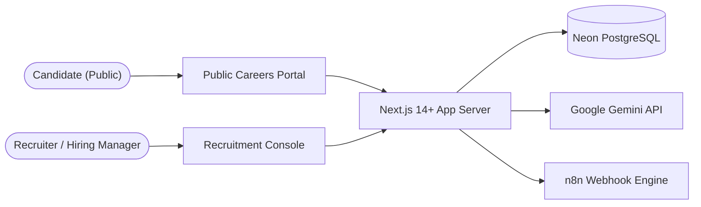

# SOFTWARE REQUIREMENTS SPECIFICATION (SRS)
## NEXT-GENERATION ENTERPRISE APPLICANT TRACKING SYSTEM (ATS)

> **Specification Standard:** IEEE Std 830-1998 / ISO/IEC/IEEE 29148:2018  
> **Target Audience:** Solution Architects, Fullstack Engineers, QA Teams, Security Auditors (English Only).

---

## 1. Introduction

### 1.1 Purpose
This document provides the definitive Software Requirements Specification (SRS) for the **ATS (Applicant Tracking System)**. It details functional and non-functional specifications, interfaces, behavioral constraints, and verification criteria for full-stack engineering, test automation, and production deployment.

### 1.2 System Scope
The ATS is an AI-assisted recruitment platform operating across two primary interfaces:
1. **Public Careers Portal (`RecoverX Careers`):** A responsive web portal enabling candidates to view job openings, submit applications with resume auto-fill parsing, and track application milestones.
2. **Enterprise Recruitment Console:** A secure workspace for recruiters and hiring managers featuring a 5-stage Kanban board, multi-tier semantic AI screening, structured interview scorecards, automated calendar synchronization, and a 180-day Talent Pool.

### 1.3 Definitions, Acronyms & Abbreviations
- **ATS:** Applicant Tracking System.
- **BRL:** Business Rule Logic constraint identifier (`BRL-01` to `BRL-13`).
- **FSM:** Finite State Machine.
- **Magic Bytes:** First sequence of binary bytes in a file used to identify the authentic file format.
- **RTM:** Requirements Traceability Matrix.
- **Scorecard:** Standardized interview evaluation form with 3 weighted rating criteria.

---

## 2. Overall Description

### 2.1 Product Perspective & Context
The ATS operates as a modern cloud-native system hosted on Vercel with serverless PostgreSQL persistence provided by Neon Lakebase. Background workflow automation is offloaded to a self-hosted n8n engine, while semantic intelligence is powered by Google Gemini.

### 2.2 User Classes & Characteristics
- **Guest Candidate:** Public user browsing vacancies and submitting applications.
- **Recruiter (`HR`):** Manages job postings, intake CVs, screens applicants, advances cards `NEW ➔ SCREENING`, and maintains the Talent Pool.
- **Hiring Manager (`HIRING_MANAGER`):** Conducts technical reviews, advances cards `SCREENING ➔ INTERVIEW ➔ HIRED`, schedules interviews, and completes Scorecards.
- **System Administrator (`ADMIN`):** Manages user accounts, configures system parameters, and exports compliance reports.

### 2.3 Operating Environment
- **Browser Compatibility:** Google Chrome (v100+), Mozilla Firefox (v100+), Apple Safari (v15+), Microsoft Edge (v100+).
- **Runtime Environment:** Node.js 18+ LTS / Next.js 14+ App Router.
- **Database Engine:** PostgreSQL 15+ (Production via Neon) / SQLite 3 (Local Development).

---

## 3. Specific Functional Requirements (FR)

### Module 1: Job Requisition & Sourcing Management (`FR-JOB`)
- **`FR-JOB-01`:** The system shall allow authorized users (`HR`, `ADMIN`) to create, update, and publish job requisitions with title, department, location, employment type, target headcount quota, and required skills.
- **`FR-JOB-02`:** The system shall calculate the maximum concurrent interview limit as `3 * targetHeadcount` (`BRL-13`).
- **`FR-JOB-03`:** The system shall automatically transition job status to `CLOSED` when all approved headcount positions transition to `HIRED`.

### Module 2: Candidate Application Intake & Ingress Security (`FR-APP`)
- **`FR-APP-01`:** The system shall provide an application form accepting candidate full name, email, phone number, and a resume document.
- **`FR-APP-02`:** The system shall validate resume uploads by checking binary magic bytes (`%PDF` for PDF, `PK` for DOCX) and enforce a 5MB maximum file size limit (`BRL-01`).
- **`FR-APP-03`:** The system shall compute a SHA-256 binary hash of the resume file to identify duplicate submissions.
- **`FR-APP-04`:** The system shall enforce an application velocity limit of at most 3 submissions per candidate in any rolling 90-day window (`BRL-04`).
- **`FR-APP-05`:** The system shall check for existing submissions matching email or phone for the same job within 30 days (`BRL-02`).

### Module 3: Hybrid AI Parsing & Semantic Scoring (`FR-AI`)
- **`FR-AI-01`:** The system shall extract 5 mandatory core fields from uploaded CVs (Full Name, Email, Phone, Skills, Experience) via a two-layer hybrid model (`BRL-03`).
- **`FR-AI-02`:** The system shall invoke Google Gemini API with `temperature: 0` to compute a 0–100% semantic match score against the job description.
- **`FR-AI-03`:** The system shall categorize the match score into 3 visual tiers: Green (≥ 75%), Yellow (50–74%), and Red (< 50%) (`BRL-09`).
- **`FR-AI-04`:** The system shall isolate untrusted resume text inside XML delimiter tags to neutralize prompt injection attacks.

### Module 4: 5-Stage Kanban Board & Stage Transitions (`FR-PIPE`)
- **`FR-PIPE-01`:** The system shall display candidate cards across 5 standardized Kanban columns: `NEW`, `SCREENING`, `INTERVIEW`, `HIRED`, `REJECTED`.
- **`FR-PIPE-02`:** The system shall support drag-and-drop transitions with progressive column pagination (15 items per page).
- **`FR-PIPE-03`:** The system shall enforce RBAC transition permissions: `HR` cannot advance cards to `INTERVIEW` or `HIRED` (`BRL-07`).
- **`FR-PIPE-04`:** The system shall strictly block advancing any candidate to `HIRED` unless at least one completed Scorecard exists (`BRL-06 Gate`).
- **`FR-PIPE-05`:** The system shall require a structured rejection reason when moving a card to `REJECTED` (`BRL-11`).
- **`FR-PIPE-06`:** The system shall buffer outbound rejection emails for exactly 12 hours after transition to `REJECTED` (`BRL-05`).

### Module 5: Interview Scheduling & Scorecards (`FR-INT`)
- **`FR-INT-01`:** The system shall provide an interview scheduling interface capturing date, time, format (Online/Offline), location, and interviewer notes.
- **`FR-INT-02`:** The system shall dispatch an automated HTTP POST webhook to `N8N_INTERVIEW_WEBHOOK_URL` to create Google Calendar events and send candidate invites.
- **`FR-INT-03`:** The system shall enforce a 3-criteria weighted Scorecard: Technical Competence (40%), Communication (30%), Cultural Fit (30%) (`BRL-08`).
- **`FR-INT-04`:** The system shall calculate and display the weighted score alongside hiring recommendations (`HIRE`, `STRONG_HIRE`, `NO_HIRE`).

### Module 6: Talent Pool Management (`FR-POOL`)
- **`FR-POOL-01`:** The system shall automatically archive disqualified candidates into the Talent Pool under 3 tiers: Silver Medalists, Future Fit, and General Archive (`BRL-10`).
- **`FR-POOL-02`:** The system shall maintain an active search lifecycle of 180 days for archived profiles.
- **`FR-POOL-03`:** The system shall provide a 1-click re-pooling feature that reactivates an archived candidate directly into `SCREENING` for an active job.

---

## 4. Non-Functional Requirements (NFR)

### 4.1 Performance & Latency (`NFR-PERF`)
- **`NFR-PERF-01`:** Public portal initial page load time (LCP) shall not exceed 1.8 seconds on a standard 4G connection.
- **`NFR-PERF-02`:** Layer 1 local text extraction shall complete within 500 milliseconds.
- **`NFR-PERF-03`:** Kanban drag-and-drop state updates shall render optimistically within 50 milliseconds on the user interface.

### 4.2 Security & Compliance (`NFR-SEC`)
- **`NFR-SEC-01`:** All inbound HTTP traffic must be encrypted via TLS 1.3; unencrypted HTTP requests shall be redirected to HTTPS.
- **`NFR-SEC-02`:** User session tokens must be signed via HMAC-SHA256, stored in HTTP-only SameSite cookies, and expire after 8 hours of inactivity.
- **`NFR-SEC-03`:** Candidate contact numbers in list views must be masked (`+84 *** *** 888`) to prevent unauthorized scraping.

### 4.3 Reliability & Availability (`NFR-REL`)
- **`NFR-REL-01`:** The platform shall maintain an operational uptime of at least 99.9% excluding scheduled maintenance windows.
- **`NFR-REL-02`:** Outbound webhook calls to n8n shall be protected by a 7-second timeout, ensuring that external service latency never blocks internal database transactions.

---

## 5. Bidirectional Requirements Traceability Matrix (RTM)

| Functional Req (FR) | Business Rule (BRL) | Use Case ID | Architecture Diagram | Test Suite Verification |
| :--- | :--- | :--- | :--- | :--- |
| `FR-APP-02` | `BRL-01` | `UC-02` | Diagram 06 (Flow 1) | `tests/run-tests.js` (Section 1 & 19) |
| `FR-APP-05` | `BRL-02` | `UC-09` | Diagram 04 (ERD) | `tests/run-tests.js` (Section 2) |
| `FR-AI-01` | `BRL-03` | `UC-04` | Diagram 07 (Tier 5) | `tests/run-tests.js` (Section 9) |
| `FR-APP-04` | `BRL-04` | `UC-05` | Diagram 05 (FSM) | `tests/run-tests.js` (Section 9) |
| `FR-PIPE-06` | `BRL-05` | `UC-20` | Diagram 02 (BPMN TO-BE) | `tests/run-tests.js` (Section 5) |
| `FR-PIPE-04` | `BRL-06` | `UC-16` | Diagram 05 (FSM Guard) | `tests/run-tests.js` (Section 4 & 8) |
| `FR-PIPE-03` | `BRL-07` | `UC-06`, `UC-08` | Diagram 03 (Use Case) | `tests/run-tests.js` (Section 7) |
| `FR-INT-03` | `BRL-08` | `UC-15` | Diagram 04 (ERD) | `tests/run-tests.js` (Section 3 & 10) |
| `FR-AI-03` | `BRL-09` | `UC-10` | Diagram 02 (BPMN TO-BE) | `tests/run-tests.js` (Section 9) |
| `FR-POOL-01` | `BRL-10` | `UC-17` | Diagram 02 (BPMN TO-BE) | `tests/run-tests.js` (Section 10) |
| `FR-PIPE-05` | `BRL-11` | `UC-12` | Diagram 05 (FSM Guard) | `tests/run-tests.js` (Section 18) |
| `FR-AI-04` | `BRL-12` | `UC-04` | Diagram 07 (Tier 5) | `tests/run-tests.js` (Section 21) |
| `FR-JOB-02` | `BRL-13` | `UC-13` | Diagram 04 (ERD) | `tests/run-tests.js` (Section 16) |
