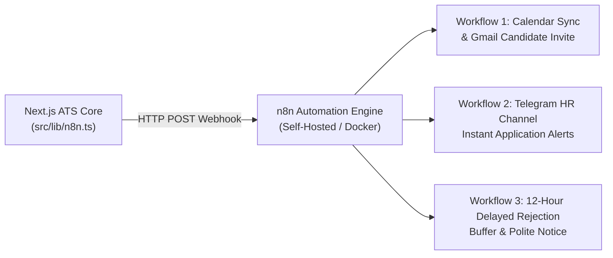

# SPECIFICATION 06: EXTERNAL AUTOMATION ARCHITECTURE & N8N WEBHOOK INTEGRATION

> **Scope:** External Automation Infrastructure, Event-Driven Webhooks & Third-Party Sync  
> **Engine:** n8n Workflow Automation Engine (Self-Hosted / Cloud Docker) (English Only).

---

## 1. Architectural Principles & Integration Topology

To maintain a lean, high-performance Next.js application core while delivering enterprise-grade background automations (Google Calendar synchronization, team chat notifications, delayed email queues), the ATS leverages a decoupled, event-driven architecture powered by **n8n Workflow Automation**:



### Core Design Rules
1. **Infrastructure Configuration via `.env`:** Webhook URLs are managed strictly at the environment layer. No hardcoded endpoints or technical webhook input boxes exist on the user interface.
2. **HR End-User Abstraction:** End users (Recruiters, Hiring Managers) interact with an intuitive, one-click interface labeled *"Tự động"* (Automated). All underlying orchestration details are entirely hidden.
3. **Resilient Non-Blocking Execution:** The dispatch client (`src/lib/n8n.ts`) enforces a strict **7-second timeout**. If n8n is temporarily offline, the core ATS continues operating seamlessly without throwing unhandled exceptions or disrupting user workflow.

---

## 2. Infrastructure Configuration & Environment Variables

The ATS connects to the n8n automation engine via standardized environment variables declared in `.env`:

```ini
# n8n Automation Engine Webhook Configuration
N8N_WEBHOOK_URL="http://localhost:5678/webhook/interview-schedule"
N8N_INTERVIEW_WEBHOOK_URL="http://localhost:5678/webhook/interview-schedule"
N8N_TELEGRAM_WEBHOOK_URL="http://localhost:5678/webhook/telegram-alert"
N8N_REJECTION_WEBHOOK_URL="http://localhost:5678/webhook/rejection-buffer"
```

---

## 3. The 3 Standard Production Workflows

### Workflow 1: Automated Interview Invitation & Calendar Sync
- **Artifact:** [`n8n/workflows/01_interview_invitation_calendar.json`](file:///d:/ATS%20project/n8n/workflows/01_interview_invitation_calendar.json)
- **Trigger:** Recruiter or Hiring Manager schedules an interview in the candidate drawer.
- **Webhook Endpoint:** `POST /webhook/interview-schedule`
- **Incoming Payload Schema:**
```json
{
  "applicationId": 128,
  "candidateName": "Tran Minh Quan",
  "candidateEmail": "quan.tran@example.com",
  "jobTitle": "Senior Frontend Engineer",
  "interviewDate": "2026-11-22T10:00:00.000Z",
  "format": "ONLINE",
  "location": "https://meet.google.com/abc-defg-hij",
  "notes": "System architecture and live coding debrief"
}
```
- **Workflow Execution Sequence:**
  1. *Webhook Node:* Receives HTTP POST request and parses candidate session data.
  2. *Google Calendar Node:* Generates calendar event with Google Meet video link and invites both candidate and interviewer.
  3. *Gmail Node:* Dispatches responsive HTML invitation email containing `.ics` calendar attachment.
  4. *Respond to Webhook:* Returns HTTP `200 OK` with calendar event ID to update the ATS database.

---

### Workflow 2: Instant Team Telegram Alerts (`@Rec_Hr_rBot`)
- **Artifact:** [`n8n/workflows/02_telegram_alert_hr.json`](file:///d:/ATS%20project/n8n/workflows/02_telegram_alert_hr.json)
- **Trigger:** Candidate submits an application on the public careers portal (`/jobs`).
- **Webhook Endpoint:** `POST /webhook/telegram-alert`
- **Incoming Payload Schema:**
```json
{
  "applicationId": 129,
  "candidateName": "Nguyen Thu Ha",
  "candidateEmail": "ha.nguyen@example.com",
  "jobTitle": "Product Manager",
  "aiMatchScore": 92.0,
  "matchTier": "GREEN",
  "timestamp": "2026-11-19T14:45:00.000Z"
}
```
- **Workflow Execution Sequence:**
  1. *Webhook Node:* Receives real-time application intake payload.
  2. *Markdown Formatter Node:* Generates rich notification message featuring candidate name, job requisition, and visual score emoji (🟢 / 🟡 / 🔴).
  3. *Telegram Node:* Posts notification to internal HR Operations Telegram channel via `@Rec_Hr_rBot`.

---

### Workflow 3: 12-Hour Delayed Rejection Buffer (`BRL-05`)
- **Artifact:** [`n8n/workflows/03_rejection_delay_buffer.json`](file:///d:/ATS%20project/n8n/workflows/03_rejection_delay_buffer.json)
- **Trigger:** Recruiter or Hiring Manager moves a candidate card to the `REJECTED` column.
- **Webhook Endpoint:** `POST /webhook/rejection-buffer`
- **Incoming Payload Schema:**
```json
{
  "applicationId": 130,
  "candidateName": "Le Van C",
  "candidateEmail": "c.le@example.com",
  "jobTitle": "DevOps Engineer",
  "rejectionReason": "Underqualified for senior level",
  "scheduledDispatchTime": "2026-11-20T02:50:00.000Z"
}
```
- **Workflow Execution Sequence:**
  1. *Webhook Node:* Ingests rejection event.
  2. *Wait / Delay Node:* Suspends execution for **exactly 12 hours** to provide brand-courtesy buffer.
  3. *ATS Verification Node:* Performs sanity check against ATS database (`GET /api/applications/130`) to verify the candidate has not been restored or re-pooled.
  4. *Gmail Node:* If still rejected, dispatches polite regret email thanking candidate and indexing profile into the Talent Pool.

---

## 4. Resilience & Error Handling Architecture (`src/lib/n8n.ts`)

The ATS core communicates with n8n using a hardened dispatch client implementing timeout protection:

```typescript
// Resilient n8n dispatch implementation
export async function dispatchN8NWebhook(
  url: string,
  payload: Record<string, any>
): Promise<{ success: boolean; status?: number; error?: string }> {
  const controller = new AbortController();
  const timeoutId = setTimeout(() => controller.abort(), 7000); // 7-second guard

  try {
    const response = await fetch(url, {
      method: "POST",
      headers: { "Content-Type": "application/json" },
      body: JSON.stringify(payload),
      signal: controller.signal,
    });
    clearTimeout(timeoutId);
    return { success: response.ok, status: response.status };
  } catch (err: any) {
    clearTimeout(timeoutId);
    // Non-blocking error handling preserves core transaction
    console.warn(`[n8n Dispatch Warning] Webhook unreachable: ${err.message}`);
    return { success: false, error: err.message };
  }
}
```
