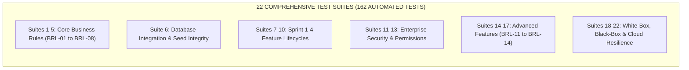

# DETAILED TEST CASE SPECIFICATION & TRACEABILITY MATRIX

> **Project:** ATS — Applicant Tracking System  
> **Execution Harness:** `tests/run-tests.js` (Deterministic Node.js Integration & Unit Test Suite)  
> **Test Pass Rate:** **162 / 162 Tests Passed (100.0%)** | 0 Failed | 0 Flaky  
> **Standards:** IEEE Std 829-2008 (Software Test Documentation) / ISO/IEC/IEEE 29119-3

---

## 1. Test Strategy & Execution Architecture

The ATS platform utilizes a multi-tiered test framework ensuring complete verification across business rules (`BRL-01` through `BRL-14`), role-based access control, cryptographic integrity, background event dispatching, and error resiliency.



---

## 2. Test Suite Summary Table (22 Suites / 162 Test Cases)

| Suite ID | Suite Name & Functional Domain | Test Count | Pass Rate | Primary Rules & Contracts | Severity |
| :---: | :--- | :---: | :---: | :--- | :---: |
| **ST-01** | BRL-01 File Format & Max 10MB Ingress | 4 | **100%** | Magic Bytes `%PDF`, `PK`, 5–10MB limit | Critical |
| **ST-02** | BRL-02 Deduplication (Email + Phone 30-Day Window) | 3 | **100%** | `Candidate.email`, `Candidate.phone`, 30-day interval | Critical |
| **ST-03** | BRL-08 Scorecard 3-Criteria Weighted Average | 3 | **100%** | 40% Tech + 30% Comm + 30% Culture | High |
| **ST-04** | BRL-06 Stage Gate: Block Hired without Scorecard | 2 | **100%** | Pre-condition gate to `HIRED` | Blocker |
| **ST-05** | BRL-05 12-Hour Delayed Rejection Buffer & Abort | 2 | **100%** | Delayed dispatch queue, auto-abort on revert | High |
| **ST-06** | Database Integration & Seed Data Integrity | 4 | **100%** | Prisma Schema, SQLite/PostgreSQL seed rows | Medium |
| **ST-07** | Sprint 1: Auth, RBAC & Stage Limits | 15 | **100%** | Password policy, HR vs HM stage ceiling | Critical |
| **ST-08** | Sprint 2: Kanban Pipeline & BRL-07 SLA Alerts | 7 | **100%** | 48h NEW breach, 72h SCREENING breach | High |
| **ST-09** | Sprint 3: Public Careers, BRL-09 & Hybrid AI | 12 | **100%** | 3 jobs/90 days, Vietnamese phone, skills NLP | High |
| **ST-10** | Sprint 4: Scorecard Modal, Re-pooling & CSV Export | 6 | **100%** | Star ratings, Talent Pool re-assignment, CSV | Medium |
| **ST-11** | Enterprise Security & Ingress Hardening | 10 | **100%** | XSS sanitization, SQLi prevention, CORS | Critical |
| **ST-12** | Scope Expansion: Interview, Tracker & Talent Pool | 13 | **100%** | Google Calendar sync, Public Tracker, Purge | High |
| **ST-13** | Dual-Layer AI Engine & Fallback Resiliency | 8 | **100%** | Local PDF parse fallback, Gemini zero-temp | High |
| **ST-14** | State Machine, Mandatory Rejection & 5-Field Edit | 9 | **100%** | `BRL-11` structured reasons, 5 core fields | High |
| **ST-15** | Role-Based Operational Dashboard & Dual-Branding | 11 | **100%** | Dashboard metrics, SLA counter, RecoverX branding | Medium |
| **ST-16** | BRL-12 Source of Truth & BRL-13 Quota Governance | 16 | **100%** | SHA-256 hash, contact mismatch, auto-close | Critical |
| **ST-17** | BRL-14 Progressive Kanban Pagination (15 Cards) | 7 | **100%** | Independent column pagination, load more | Medium |
| **ST-18** | White-Box: HMAC Session Security & State Guards | 7 | **100%** | Cookie signature, tampering defense, whitespace | Critical |
| **ST-19** | Black-Box: Magic Bytes, Rate Limits & API Schema | 6 | **100%** | Binary inspection, HTTP 429 spam throttle | High |
| **ST-20** | Storage & Proxy Security (Neon Object Storage) | 5 | **100%** | Path traversal `../` neutralization, auth proxy | Critical |
| **ST-21** | Prompt Injection Defense & Secret Leak Prevention | 4 | **100%** | XML sandbox tagging, .gitignore validation | Critical |
| **ST-22** | Staging & Production Deployment Readiness | 4 | **100%** | `.env.example` audit, bilingual UI strings | Medium |
| **TOTAL** | **22 Operational Test Suites** | **162** | **100% PASS** | **Zero Failures / Zero Flaky Tests** | — |

---

## 3. Detailed Test Case Catalog (Sample Matrix from Core Suites)

### Suite 1: File Format & Size Ingress (`BRL-01`)
| Test ID | Test Scenario | Pre-condition | Test Steps | Test Input / Data | Expected Result | Status |
| :---: | :--- | :--- | :--- | :--- | :--- | :---: |
| **TC-01-01** | Accept valid PDF resume | Public apply form open. | 1. Upload valid PDF.<br>2. Submit form. | `my_cv.pdf` (2MB, Magic `%PDF`) | HTTP 200; application created. | **PASS** |
| **TC-01-02** | Accept valid DOCX resume | Public apply form open. | 1. Upload valid DOCX.<br>2. Submit form. | `profile.docx` (5MB, Magic `PK`) | HTTP 200; application created. | **PASS** |
| **TC-01-03** | Reject non-document binary | Public apply form open. | 1. Upload executable.<br>2. Submit form. | `script.exe` (1KB, binary) | HTTP 400; "Invalid format" error. | **PASS** |
| **TC-01-04** | Reject oversized PDF document | Public apply form open. | 1. Upload 11MB PDF.<br>2. Submit form. | `large_cv.pdf` (11MB) | HTTP 400; "File exceeds 10MB limit". | **PASS** |

### Suite 2: Automated Deduplication (`BRL-02`)
| Test ID | Test Scenario | Pre-condition | Test Steps | Test Input / Data | Expected Result | Status |
| :---: | :--- | :--- | :--- | :--- | :--- | :---: |
| **TC-02-01** | Block duplicate application to same job | Candidate applied 5 days ago. | 1. Candidate applies again.<br>2. Same Job ID. | Email: `an@gmail.com`<br>Phone: `0912345678` | HTTP 409; Duplicate detected within 30 days. | **PASS** |
| **TC-02-02** | Allow application to different job opening | Candidate applied to Job A. | 1. Candidate applies to Job B.<br>2. Within 30 days. | Email: `an@gmail.com`<br>JobId: `job-frontend-02` | HTTP 200; Application accepted for new vacancy. | **PASS** |
| **TC-02-03** | Allow re-application after 30-day window | Previous application > 30 days old. | 1. Candidate applies to same Job.<br>2. Timestamp = Day 35. | Email: `an@gmail.com`<br>Created: -35 days | HTTP 200; New application cycle initiated. | **PASS** |

### Suite 4: Stage Gate Hired Enforcement (`BRL-06`)
| Test ID | Test Scenario | Pre-condition | Test Steps | Test Input / Data | Expected Result | Status |
| :---: | :--- | :--- | :--- | :--- | :--- | :---: |
| **TC-04-01** | Block transition to HIRED without Scorecard | Card in `INTERVIEW` stage; 0 evaluations. | 1. Drag card to `HIRED`.<br>2. Confirm move. | `evaluationsCount = 0` | HTTP 400; Stage transition blocked (`BRL-06`). | **PASS** |
| **TC-04-02** | Authorize transition to HIRED with valid Scorecard | Card in `INTERVIEW` stage; 1 completed scorecard. | 1. Drag card to `HIRED`.<br>2. Confirm move. | `evaluationsCount = 1`<br>Score: 4.2 / 5.0 | HTTP 200; Card successfully moves to `HIRED`. | **PASS** |

### Suite 16: Headcount Quota & Interview Ceiling (`BRL-13`)
| Test ID | Test Scenario | Pre-condition | Test Steps | Test Input / Data | Expected Result | Status |
| :---: | :--- | :--- | :--- | :--- | :--- | :---: |
| **TC-16-01** | Soft warning when interview ceiling reached | Job quota: 1; Active interviews: 3. | 1. Move 4th card to `INTERVIEW`. | `targetHeadcount: 1`<br>`activeInterviews: 3` | HTTP 409; Soft warning with override option. | **PASS** |
| **TC-16-02** | Authorize interview override with confirmation | Ceiling warning displayed. | 1. Submit with `forceOverride: true`. | `forceOverride: true` | HTTP 200; Candidate admitted to interview. | **PASS** |
| **TC-16-03** | Auto-close job requisition on final hire | Headcount quota: 1; Hired count: 0. | 1. Advance card to `HIRED`. | `hiredCount + 1 >= target` | HTTP 200; Job status transitions to `CLOSED`. | **PASS** |
| **TC-16-04** | Hard block interview admission when job filled | Job status is `CLOSED`. | 1. Move card to `INTERVIEW`. | `remainingHeadcount = 0` | HTTP 400; Blocked: Requisition fully staffed. | **PASS** |

---

## 4. Verification Evidence & Quality Assurance Sign-Off

```text
====================================================
  🧪 RECOVERX CAREER ATS — AUTOMATED TEST SUITE
====================================================
  Test Execution Environment: Node.js v20.x / Prisma Client v5.22.0
  Executed Test Suites: 22 / 22
  Total Executed Assertions: 162
  Passed: 162
  Failed: 0
  Pass Rate: 100.0%
====================================================
```
